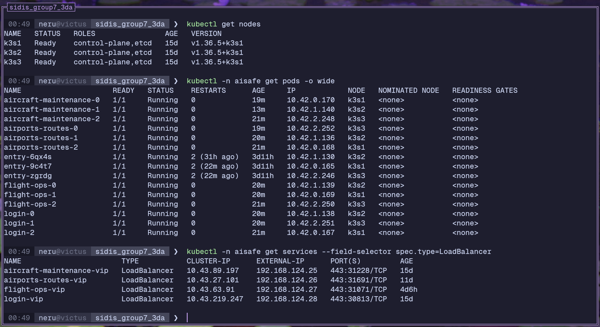
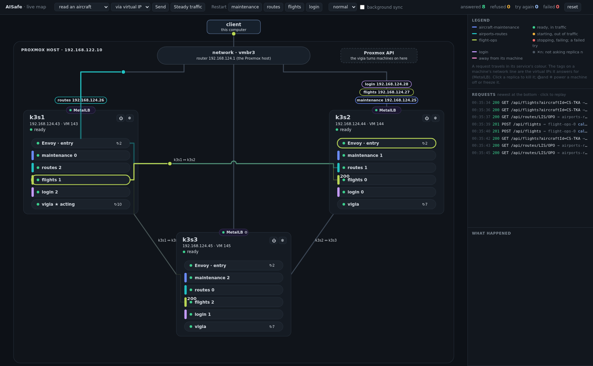
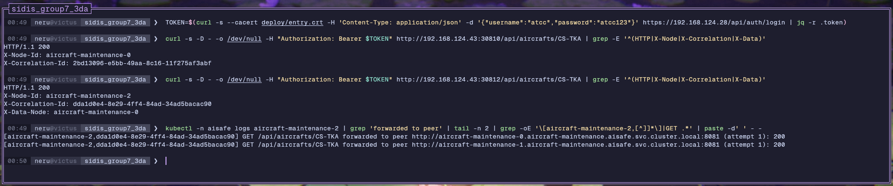
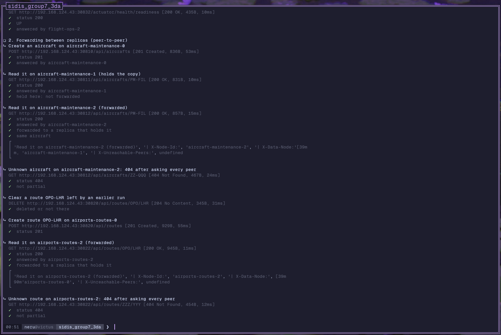
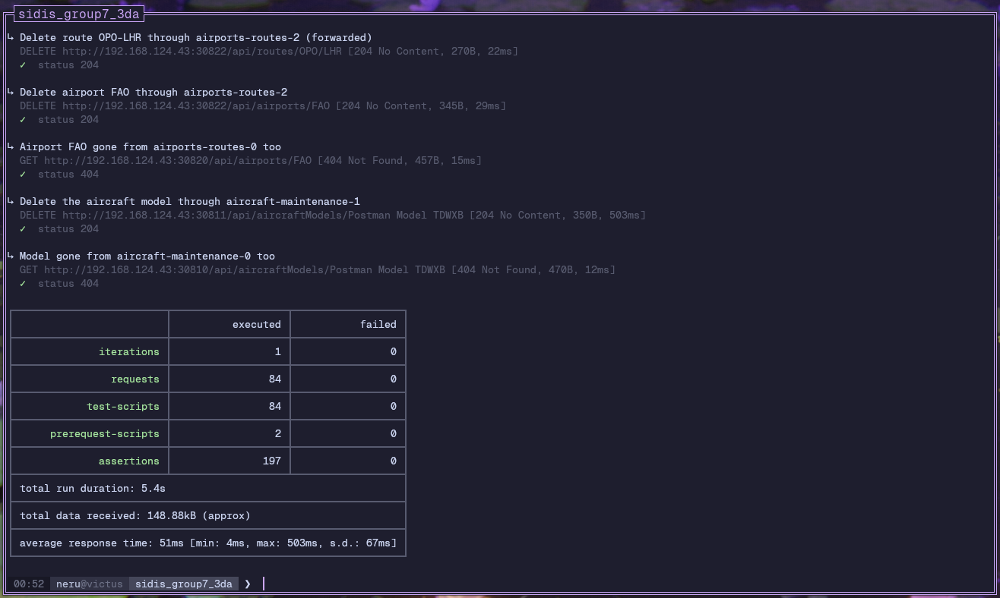
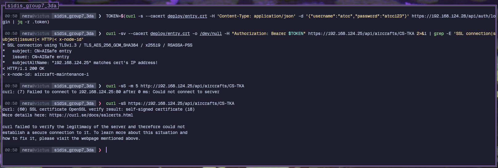
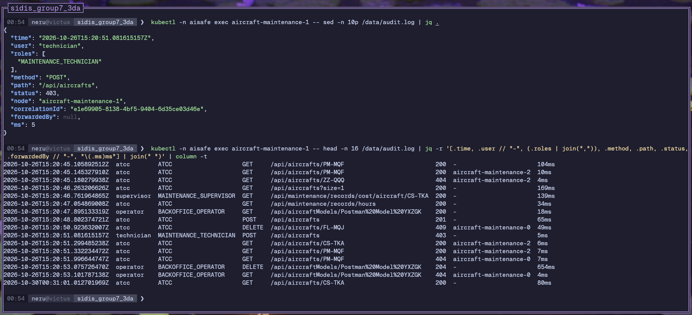
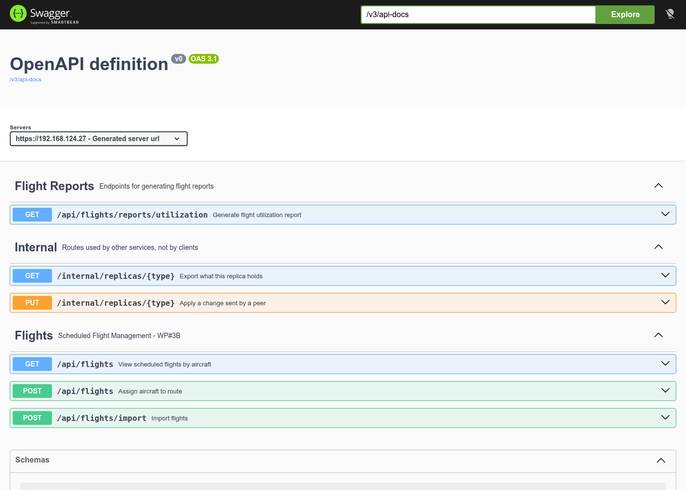

# AISafe

A distributed RESTful backend for aviation safety management - aircraft, airports, flight routes, maintenance records and scheduled flights - split into services that run replicated on a k3s cluster.

## About

AISafe is designed to manage the operational data of an airline organisation. It provides a structured API that any frontend (web or mobile) can consume to:

- Register and track **aircraft models** and individual **aircraft** instances across their full lifecycle
- Manage **airport** information including runways, facilities, certifications, and operational status
- Define and maintain **flight routes** between airports, including history of changes
- Schedule and record **maintenance** operations with templates, parts inventory, and technician notes
- **Schedule flights**, assigning an available aircraft to a route

The system is distributed (SIDIS): the original monolith is split into **three services and a login**, each running as **three replicas** with their own database. A replica that does not hold the requested data asks its peers (peer-to-peer forwarding and aggregation), every write is copied to other replicas (eventual consistency), and the system keeps answering with a replica or a whole machine down.

The system is built around **role-based access control** with five distinct roles:

| Role                   | Description                                                           |
| ---------------------- | --------------------------------------------------------------------- |
| Admin                  | Full system access                                                    |
| Backoffice Operator    | Airport and aircraft management                                       |
| ATCC                   | Air Traffic Control - route and airport visibility, flight scheduling |
| Maintenance Technician | Record maintenance operations                                         |
| Maintenance Supervisor | Manage parts, templates, and maintenance oversight                    |

All endpoints are authenticated via **JWT** (issued by the login, checked by each service) and return **HAL-compliant** responses (HATEOAS) with links to related resources.

## Tech Stack

| Layer          | Technology                                                       |
| -------------- | ---------------------------------------------------------------- |
| Language       | Java 25                                                          |
| Framework      | Spring Boot 4                                                    |
| Persistence    | Spring Data JPA + Hibernate + H2 (one file per replica) + Flyway |
| Security       | Spring Security + JWT, HTTPS at the entry, audit trail           |
| API style      | REST + HATEOAS (Spring HATEOAS)                                  |
| API docs       | SpringDoc OpenAPI (Swagger UI)                                   |
| Validation     | Jakarta Validation + Hibernate Validator                         |
| Utilities      | Lombok                                                           |
| Build          | Maven (wrapper included - no local install required), Jib images |
| Infrastructure | Proxmox VMs, k3s, MetalLB (virtual IPs), Envoy (entry), vigia    |

## Architecture

The system is made of four services and a shared library, one Maven module each:

| Module                 | Owns                                                               | Port | Calls                                                   |
| ---------------------- | ------------------------------------------------------------------ | ---- | ------------------------------------------------------- |
| `aircraft-maintenance` | aircraft, aircraft models, maintenance records, templates, parts   | 8081 | -                                                       |
| `airports-routes`      | airports, certifications, routes, route history                    | 8082 | aircraft-maintenance (C1, C3)                           |
| `flight-ops`           | scheduled flights (Saga), utilization reports                      | 8083 | airports-routes (C2, C5), aircraft-maintenance (C1, C4) |
| `login`                | accounts; issues the JWT                                           | 8085 | -                                                       |
| `common`               | library: forwarding, replication, token validation, tracing, audit | -    | -                                                       |

Requests flow through the cluster like this:

```
                              Client (REST + JWT)
                                      │
                    virtual IP of the service (MetalLB)
                                      │
                                      ▼
                     entry (Envoy) of the VM that holds the IP
                       sends it to a ready replica, retries on another one
                                      │
          ┌───────────────────────────┼───────────────────────────┐
          ▼                           ▼                           ▼
     replica -0  ◀── peer to peer ──▶ replica -1 ◀── peer to peer ──▶ replica -2
     own database                 own database                own database

  flight-ops ──C2, C5──▶ airports-routes ──C1, C3──▶ aircraft-maintenance
      └───────────────────────C1, C4──────────────────────────▲
```

Inside each service, requests flow through three layers within each bounded context:

```
                         HTTP Request
                               │
                               ▼
┌─────────────────────────────────────────────────────────────┐
│                      infrastructure/                        │
│   Controllers, JPA adapters, replication handlers, filters, │
│   Spring Security config, clients of other services         │
└──────────────────────────────┬──────────────────────────────┘
                               │
                               ▼
┌─────────────────────────────────────────────────────────────┐
│                       application/                          │
│              One Use Case class per user action             │
│   RegisterAirportUseCase, ScheduleFlightUseCase, etc.       │
└──────────────────────────────┬──────────────────────────────┘
                               │
                               ▼
┌─────────────────────────────────────────────────────────────┐
│                         domain/                             │
│         Entities, value objects, repository interfaces      │
│   Airport, Route, Aircraft, ScheduledFlight, etc.           │
└─────────────────────────────────────────────────────────────┘
```

Each bounded context follows this same three-layer structure. Distribution concerns live in `common`:

```
aircraft-maintenance/src/main/java/aisafe/
├── aircrafts/           # Aircraft, AircraftModel, RegistrationNumber; C1 and C3
├── maintenance/         # MaintenanceRecord, MaintenanceTemplate, MaintenancePart
└── flightcopies/        # copies of the flights of flight-ops (C4)
airports-routes/src/main/java/aisafe/
├── airports/            # Airport, Runway, IataCode, certifications
├── routes/              # Route, RouteHistory; C2
├── flightcopies/        # copies of the flights of flight-ops (C5)
└── fleet/               # client of aircraft-maintenance (C1, C3)
flight-ops/src/main/java/aisafe/
├── flights/             # ScheduledFlight, ScheduleFlightUseCase (the Saga)
├── fleet/               # client of airports-routes and aircraft-maintenance (C1, C2, C4, C5)
└── flightops/           # saga compensations, bootstrap, security
login/src/main/java/aisafe/
└── security/            # User, Role, JwtService, AuthController
common/src/main/java/aisafe/shared/
├── domain/              # DomainException, PaginatedResult, ...
├── application/         # UseCase (base interface + annotations)
└── infrastructure/
    ├── peers/           # PeerClient, PeerForwardingAdvice: forwarding to other replicas
    ├── replication/     # Replicator, outbox, ReplicaSync, ReplicaGatherer
    └── security/        # JWT validation, service tokens, audit trail
```

Full architecture (C4 context and containers, logical and physical views, contracts between services, consistency model, fault tolerance, security, scenarios): [`docs/README.md`](docs/README.md).

## Getting Started

**On a cluster** (three VMs on Proxmox, or three existing Debian/Ubuntu machines):

```bash
cp deploy/config.example.sh deploy/config.sh   # machines, network, virtual IPs
deploy/setup.sh                                # VMs, k3s, services, checks (~15 min the first time)
```

Step by step, requirements and troubleshooting: [`deploy/README.md`](deploy/README.md). Once running:

| Resource             | URL                                                         |
| -------------------- | ----------------------------------------------------------- |
| Login                | `https://<VIP_LOGIN>/api/auth/login`                        |
| A service            | `https://<VIP of the service>/api/...`                      |
| One replica directly | `http://<any node>:<30810-30812, 30820-30822, 30830-30832>` |
| Swagger UI           | `/swagger-ui.html` of any replica                           |

The virtual IPs answer only with HTTPS. Their certificate is self-signed, made by `deploy/setup.sh`
and saved in `deploy/entry.crt`: trust it in the client (`curl --cacert deploy/entry.crt`, Postman:
see [`docs/postman/README.md`](docs/postman/README.md)).

**On one computer** (development; needs Java 25):

```bash
./mvnw package -DskipTests
java -jar login/target/login-0.0.1-SNAPSHOT.jar &
java -jar aircraft-maintenance/target/aircraft-maintenance-0.0.1-SNAPSHOT.jar &
java -jar airports-routes/target/airports-routes-0.0.1-SNAPSHOT.jar &
java -jar flight-ops/target/flight-ops-0.0.1-SNAPSHOT.jar &
```

Each service then runs as a single replica (no peers), with an in-memory database and sample data:

| Resource     | URL                                                       |
| ------------ | --------------------------------------------------------- |
| Swagger UI   | http://localhost:<8081, 8082, 8083, 8085>/swagger-ui.html |
| OpenAPI spec | http://localhost:<port>/v3/api-docs                       |
| H2 console   | http://localhost:<port>/h2-console                        |

Several replicas of one service on one computer: give each a `PORT`, a `NODE_ID` and the same `PEERS` (the base URLs of all of them, whose first host label is the replica's id, e.g. `http://ar0.localtest.me:18090`, since `*.localtest.me` resolves to 127.0.0.1).

### Default Credentials

| Username   | Password      | Role                   |
| ---------- | ------------- | ---------------------- |
| admin      | admin123      | Admin                  |
| operator   | operator123   | Backoffice Operator    |
| atcc       | atcc123       | ATCC                   |
| technician | technician123 | Maintenance Technician |
| supervisor | supervisor123 | Maintenance Supervisor |

Authenticate via `POST /api/auth/login` on the login to receive a JWT token, then pass it as `Authorization: Bearer <token>` on subsequent requests to any service.

## The system running

Screenshots of the reference cluster (3 VMs on Proxmox), taken from a computer on its network.

**The cluster**: three k3s nodes, one replica of each service and one login per node, an entry
(Envoy) on every node, and the four virtual IPs on port 443.



**The demo dashboard** (`deploy/dashboard/dashboard.sh`): requests travelling from this computer
through a virtual IP and an entry to a replica. Here a list of flights: the flight-ops replica that
got it asks the other two for theirs and merges them.



**A replica down**: `aircraft-maintenance-1` was just killed from the dashboard. k3s starts it again,
the entries leave it out of traffic meanwhile, and the requests keep being answered (failed: 0).


**Forwarding between replicas**: a read on a replica that holds the aircraft, and one on a replica
that does not, which asks its peers (`X-Data-Node` names the one that had it); its log shows each
peer asked, under the request's correlation id.



**Postman**: the forwarding folder, and the whole collection (none failed).





**HTTPS**: the virtual IPs answer only with HTTPS, with the entries' certificate; plain HTTP is
refused, and a client that does not trust the certificate stops.



**Audit trail**: one JSON line per request to the API on each replica's disk, also the refused ones
(403 for the technician).



**API documentation**: Swagger UI of flight-ops, through its virtual IP.



## Database Structure (Flyway)

Each service creates and changes its database through numbered SQL files in
`<service>/src/main/resources/db/migration`, applied by Flyway once and in order on every replica.
Hibernate only checks that the database matches the entities (`ddl-auto=validate`): a service whose
entities and migrations disagree does not start, and its tests fail.

- **Changing an entity** (new field, new table, new rule): add a new file with the next number,
  e.g. `V3__add_route_notes.sql`. Never edit a file that was already pushed: databases that
  applied it would not see the change.
- **A file can also fix data** before changing the structure (see
  `airports-routes/.../V2__one_route_per_origin_and_destination.sql`).
- **A new service** starts with `V1__initial_schema.sql`, and the same two lines in its
  `application.properties` (`ddl-auto=validate`, `flyway.baseline-on-migrate=true`).
- Databases created before Flyway (by Hibernate) are taken as being at version 1, and get only the
  later files.

## Testing

In each module, JUnit tests are organised to mirror the same three-layer structure as the source code:

```
<service>/src/test/java/aisafe/
├── <context>/
│   ├── domain/          # Entity and value object rules
│   ├── application/     # Use case behaviour with mocked repositories
│   └── infrastructure/  # Controller slice tests (MockMvc), JPA adapters, replication
└── architecture/        # ArchitectureTest: layering rules (ArchUnit)
```

To run all tests:

```bash
./mvnw test
```

End to end, against the cluster:

- **Postman** ([`docs/postman/`](docs/postman/README.md)): local access, forwarding between replicas, aggregation, catalogs, calls between services, roles, failures.
- **Failure test** (`deploy/manifests/failure-test.sh`): requests without pause while replicas, logins and VMs fail, counting the requests that failed.
- **Demo dashboard** (`deploy/dashboard/dashboard.sh`): a live map of the machines, replicas and requests, to see forwarding, retries and failures as they happen ([deploy/README.md](deploy/README.md#watching-it-live-demo-dashboard)).

## Team Tooling

### Diagram Generation

PlantUML `.puml` files live in `puml/` subfolders: `docs/puml/` for the whole system and `docs/<service>/puml/` for each service. To generate the corresponding `.svg` files:

```bash
# Unix / macOS (requires plantuml on PATH)
bash scripts/generate-svg.sh

# Windows
scripts/generate-svg.ps1
```

Use the `-l` flag to preview which files would be converted without actually generating them.

## Documentation

- Distributed system (SIDIS): [`docs/README.md`](docs/README.md), with one folder per service ([aircraft-maintenance](docs/aircraft-maintenance/README.md), [airports-routes](docs/airports-routes/README.md), [flight-ops](docs/flight-ops/README.md), [login](docs/login/README.md)).
- Use cases, contracts and global artifacts of the distributed system (as in the monolith's documentation): [`docs/system-documentation/`](docs/system-documentation/README.md): every user story with its SSD and SD, the contracts C1-C5, glossary and FURPS+.
- Team and tasks: [`docs/TeamMembersAndTasks.md`](docs/TeamMembersAndTasks.md).
- Deployment: [`deploy/README.md`](deploy/README.md).
- PSOFT monolith - use cases, glossary, FURPS+, domain model, Postman collection, and client Q&A: [`docs_monolith/README.md`](docs_monolith/README.md).
