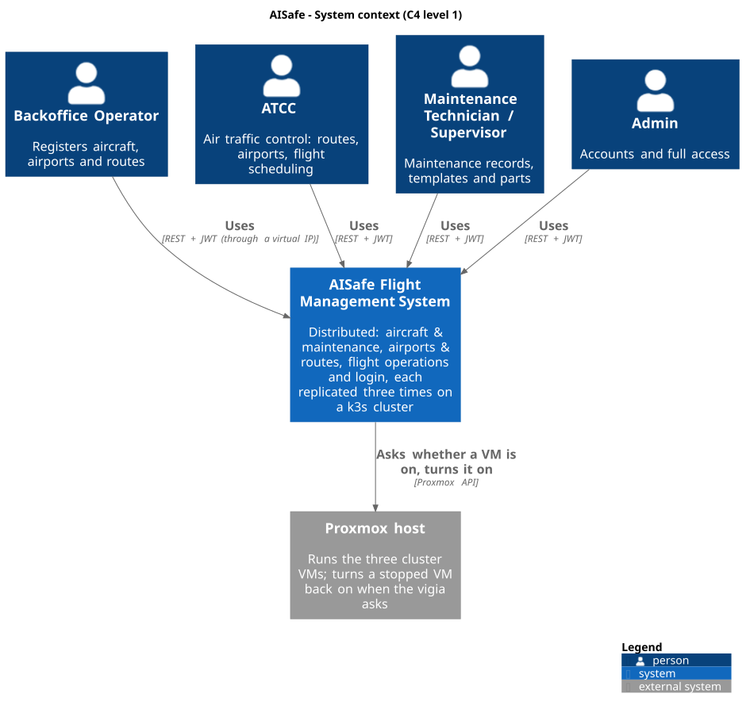
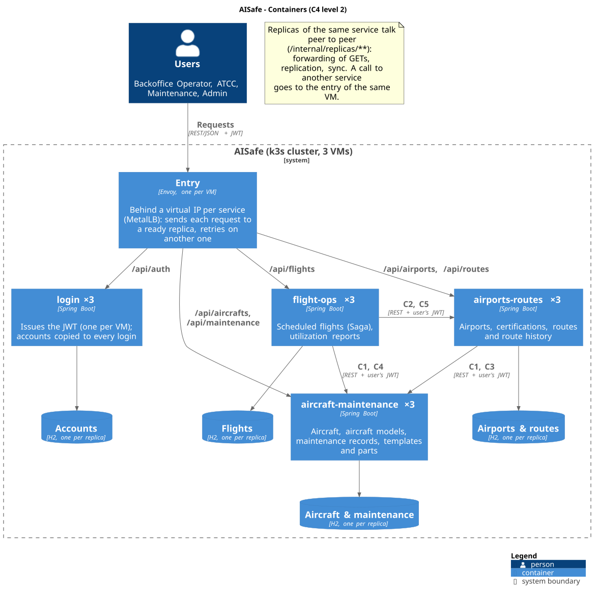
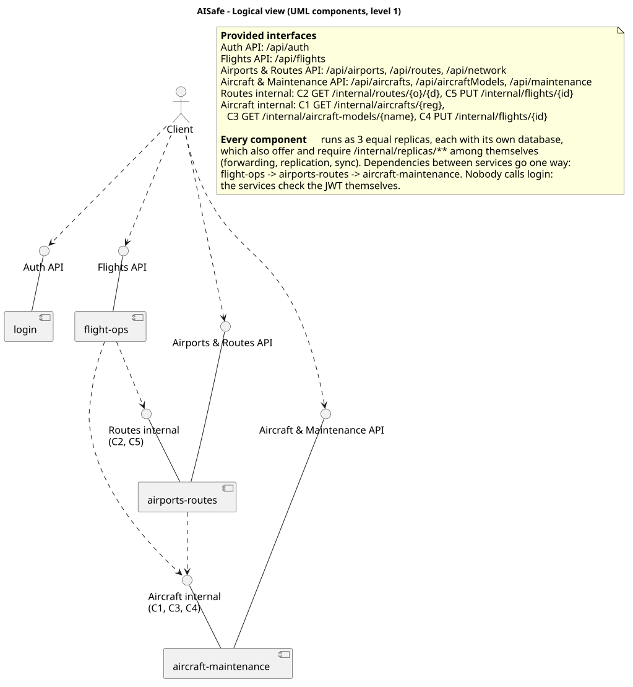
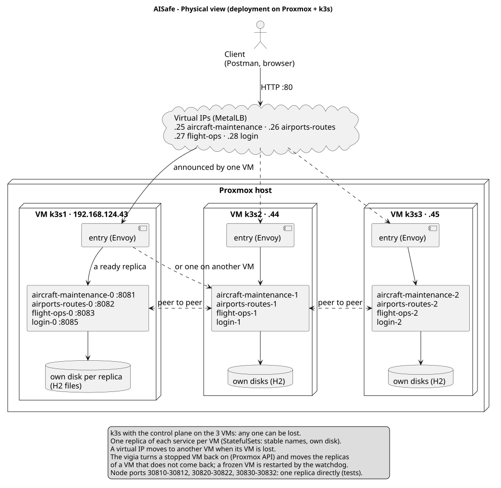
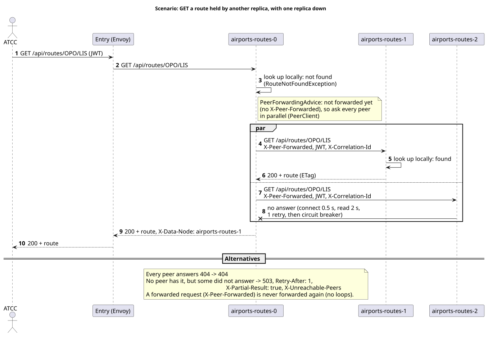
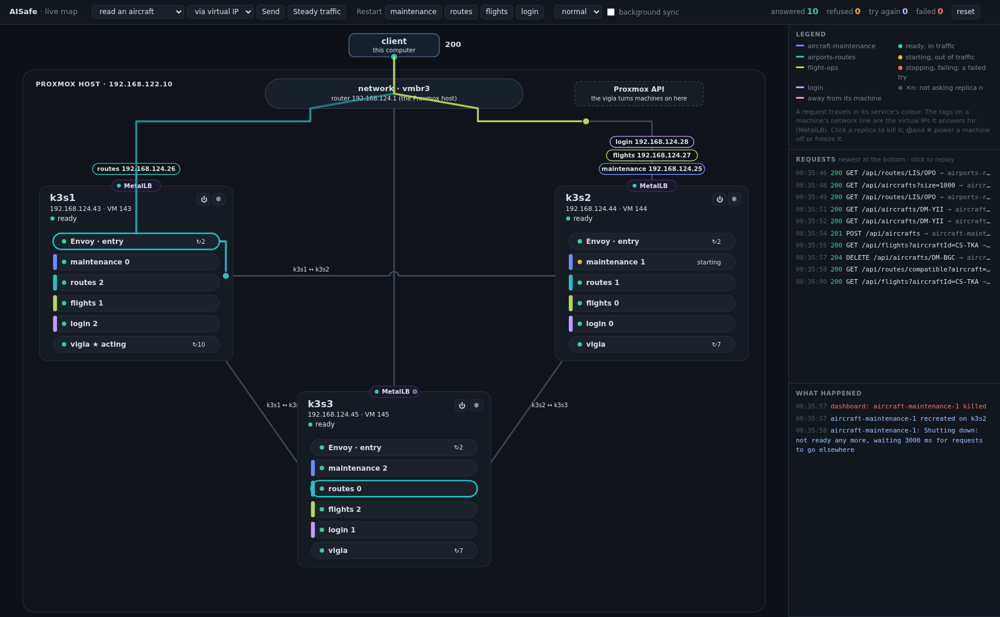
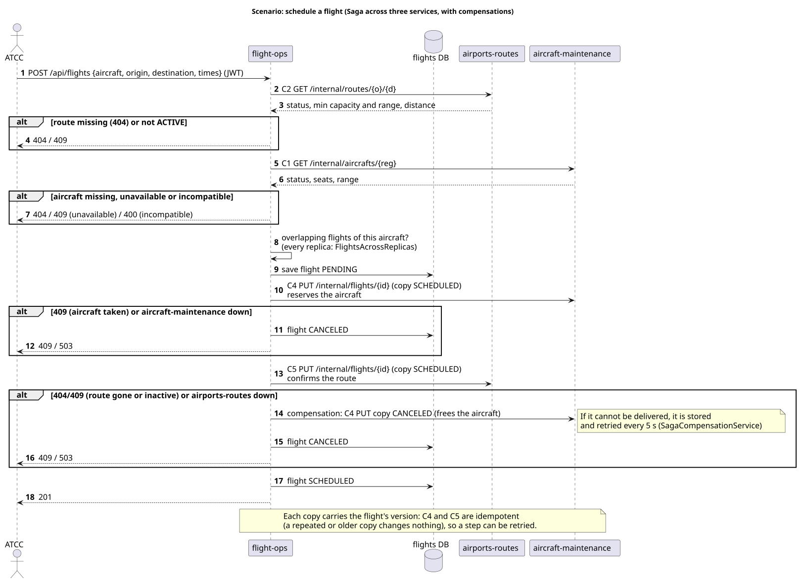

# AISafe - Distributed System Documentation

Documentation of the distributed version of AISafe (SIDIS, Assignment 1): the PSOFT monolith split
into three services plus a login, each replicated three times on a k3s cluster. The documentation of
the original monolith (use cases, glossary, FURPS+, domain model) is in
[`../docs_monolith/`](../docs_monolith/README.md).

|                  |                                                                                                                                                                                                                                                                                                                           |
| ---------------- | ------------------------------------------------------------------------------------------------------------------------------------------------------------------------------------------------------------------------------------------------------------------------------------------------------------------------- |
| Use cases        | [every user story](system-documentation/use-cases/README.md) in the distributed system: service, routes, how each request is served across replicas, SSD and SD                                                                                                                                                           |
| Contracts        | [C1-C5](system-documentation/contracts/README.md): the calls between services, one page and one SD each                                                                                                                                                                                                                   |
| Global artifacts | [diagrams, glossary, FURPS+](system-documentation/global-artifacts/README.md)                                                                                                                                                                                                                                             |
| Team             | [members, ownership and pull requests](TeamMembersAndTasks.md)                                                                                                                                                                                                                                                            |
| Deployment       | [`../deploy/README.md`](../deploy/README.md)                                                                                                                                                                                                                                                                              |
| Tests            | [Postman](postman/README.md), unit and integration tests (`./mvnw test`, run by CI), failure test (`deploy/manifests/failure-test.sh`)                                                                                                                                                                                    |
| Watching it run  | the demo dashboard (`deploy/dashboard/dashboard.sh`, section 9), screenshots in the [root README](../README.md#the-system-running)                                                                                                                                                                                        |
| Per service      | [aircraft-maintenance](aircraft-maintenance/README.md), [airports-routes](airports-routes/README.md), [flight-ops](flight-ops/README.md), [login](login/README.md): logical view, components (C4 level 3), domain model, data, contracts, scenarios. Each replica also serves its API documentation at `/swagger-ui.html` |

Diagrams: PlantUML sources in `puml/`, images in `svg/`, here for the whole system and in each
service's folder for that service (`scripts/generate-svg.sh` regenerates them all).

## 1. Context (C4 level 1)

The users are the roles of the monolith (Backoffice Operator, ATCC, Maintenance Technician and
Supervisor, Admin). The only external system is the Proxmox host that runs the cluster's VMs:
the vigia asks it to turn a stopped VM back on.

## 2. Containers (C4 level 2)

| Container            | Owns                                                             | Port                                                  | Virtual IP (reference cluster)     | Replicas       |
| -------------------- | ---------------------------------------------------------------- | ----------------------------------------------------- | ---------------------------------- | -------------- |
| aircraft-maintenance | aircraft, aircraft models, maintenance records, templates, parts | 8081                                                  | 192.168.124.25                     | 3              |
| airports-routes      | airports, certifications, routes, route history                  | 8082                                                  | 192.168.124.26                     | 3              |
| flight-ops           | scheduled flights, utilization reports                           | 8083                                                  | 192.168.124.27                     | 3              |
| login                | accounts; issues the JWT                                         | 8085                                                  | 192.168.124.28                     | 3 (one per VM) |
| entry (Envoy)        | nothing: ends HTTPS and sends each request to a ready replica    | 10441-10445 (HTTPS), 10081-10082 (inside the cluster) | behind every virtual IP (port 443) | one per VM     |

Split by business capability, as the assignment suggests. Dependencies go one way only,
**flight-ops → airports-routes → aircraft-maintenance**, so there are no cycles and
aircraft-maintenance can run alone. No service reads another one's database: they talk only
through REST (section 5).

## 3. Logical view

With the replicas as `<<instance>>`: each offers its service's API and the peer API
(`/internal/replicas/**`) and requires the peer API of the others (forwarded requests, copies, sync):
[logical view with the replicas](svg/logical-view-replicas.svg).

Inside, every service keeps the three layers of the monolith (`domain`, `application`,
`infrastructure`), checked by ArchUnit (`ArchitectureTest`). What the distribution needs is shared by
all of them in the `common` module: forwarding between replicas (`PeerForwardingAdvice`,
`PeerClient`), replication (`Replicator`, outbox, `ReplicaSync`), listings over every replica
(`ReplicaGatherer`), token validation and request tracing.

## 4. Physical view

| Piece                  | How                                                                                                                                                                                        |
| ---------------------- | ------------------------------------------------------------------------------------------------------------------------------------------------------------------------------------------ |
| 3 VMs on Proxmox       | k3s with the control plane on all three: the cluster is still managed with one VM down                                                                                                     |
| Replicas               | StatefulSets: stable names (`airports-routes-0..2`), one replica of each service per VM, each with its own disk (H2 file)                                                                  |
| Virtual IPs            | MetalLB: one per service, announced by one VM and moved to another when that VM is lost                                                                                                    |
| Entry                  | Envoy on every VM: ends HTTPS (the virtual IPs answer only on port 443), sends a request to a ready replica (health checks every second), and repeats it on another replica when one fails |
| Calls between services | to the entry of the same VM (`aircraft-maintenance-local`, `airports-routes-local`), which picks a ready replica                                                                           |
| Vigia                  | turns a stopped VM back on (Proxmox API); isolates a VM that does not come back, so its replicas are reborn on the others; a frozen VM is restarted by the Proxmox watchdog                |
| Tests                  | node ports 30810-30812, 30820-30822, 30830-30832: one replica directly                                                                                                                     |

How to build it: [`deploy/README.md`](../deploy/README.md) (`deploy/setup.sh` builds the VMs, the
cluster and the services).

## 5. Contracts between services

| #   | Caller → owner                                     | Request                                         | Answers                                                                           |
| --- | -------------------------------------------------- | ----------------------------------------------- | --------------------------------------------------------------------------------- |
| C1  | airports-routes, flight-ops → aircraft-maintenance | `GET /internal/aircrafts/{reg}`                 | 200 status, model, seats, range, fuel consumption; 404                            |
| C2  | flight-ops → airports-routes                       | `GET /internal/routes/{origin}/{destination}`   | 200 status, flight time, minimum capacity and range, distance; 404                |
| C3  | airports-routes → aircraft-maintenance             | `GET /internal/aircraft-models/{name}`          | 200 exists; 404                                                                   |
| C4  | flight-ops → aircraft-maintenance                  | `PUT /internal/flights/{id}` (copy of a flight) | 200 stored, idempotent; 404 no such aircraft; 409 aircraft cannot take the flight |
| C5  | flight-ops → airports-routes                       | `PUT /internal/flights/{id}` (copy of a flight) | 200 stored, idempotent; 404 no such route; 409 route not active                   |

All are commands or queries over HTTP (no events or message queues in Assignment 1), carrying the
user's JWT and the correlation id; outside a user's request (sample data at start-up, retried
compensations), flight-ops sends its replica's service token instead. They are reachable only from inside the cluster: through the
virtual IPs, `/internal/**` answers 404. Each one answers wherever the data is: a replica that does not
hold it asks its peers (section 7). The fields of each request are in the OpenAPI documentation of
the owner (`/v3/api-docs`).

**Routes that changed service:** US203 (compatible routes) and US227 (fuel efficiency) used
`/api/aircrafts/...` in the monolith; they need the routes, so they moved to airports-routes
(`/api/routes/compatible?aircraft=`, `/api/routes/{o}/{d}/fuel-efficiency?aircraft=`) rather than
make aircraft-maintenance depend on airports-routes.

## 6. Where the data lives

Each replica has its own database. Data is either a **catalog** (small, rarely changed, needed by
most writes: copied to every replica) or a **record** (partitioned: kept by the replica that created
it, its _home_, and the next one in the ring `-0 → -1 → -2 → -0`).

| Service              | Catalogs (every replica)                      | Records (home + next replica)                |
| -------------------- | --------------------------------------------- | -------------------------------------------- |
| aircraft-maintenance | aircraft models, maintenance templates, parts | aircraft, maintenance records, flight copies |
| airports-routes      | airports, certifications                      | routes (with history), flight copies         |
| flight-ops           | -                                             | flights                                      |
| login                | accounts                                      | -                                            |

Two copies of every record: any one replica (or VM) can be lost without losing data.

**Identity across replicas.** A record is created on one replica only, without asking the others, so
its key must be one that no other replica can give at the same time to a different record:

| Record                                       | Key                                                                                                                                                                            |
| -------------------------------------------- | ------------------------------------------------------------------------------------------------------------------------------------------------------------------------------ |
| aircraft                                     | registration number (given by the client, checked on the peers before creating)                                                                                                |
| maintenance record                           | random UUID                                                                                                                                                                    |
| route                                        | origin and destination IATA codes (checked on the peers before creating)                                                                                                       |
| flight, and its copies in the other services | a number that ends in the replica's own digit: `flight-ops-0` gives 1, 11, 21…, `flight-ops-1` 2, 12, 22…, after the highest one it holds ([flight-ops](flight-ops/README.md)) |

The flight id stays a number in the API (as in the monolith), and the database's own row number is
never shown: domain identity apart from database identity, as in PSOFT.

## 7. Replication and forwarding (peer to peer)

| Request reaching a replica                               | What it does                                                                                                                                                                                                                                                                                  |
| -------------------------------------------------------- | --------------------------------------------------------------------------------------------------------------------------------------------------------------------------------------------------------------------------------------------------------------------------------------------- |
| `GET` of something it holds                              | answers (200)                                                                                                                                                                                                                                                                                 |
| `GET` of something it does not hold                      | asks **all its peers in parallel**; the first that has it answers (200, `X-Data-Node` names it); 404 only if every peer answered and none has it; if some peer did not answer, **503** with `Retry-After`, `X-Partial-Result` and `X-Unreachable-Peers` (never a 404 for data that may exist) |
| Listing or report                                        | its own data plus that of every peer (`/internal/replicas/{type}`), one entry per key (the latest change), then sorts and pages; `X-Partial-Result` only if both holders of some record did not answer                                                                                        |
| `PUT` / `PATCH` / `DELETE` of something it does not hold | sent to the peers one at a time until one holds it                                                                                                                                                                                                                                            |
| `POST`                                                   | never forwarded: the new record stays on the replica that created it                                                                                                                                                                                                                          |
| Already forwarded (`X-Peer-Forwarded`)                   | never forwarded again: one hop, no loops                                                                                                                                                                                                                                                      |

On the running cluster, a read that a replica answers by itself and one it forwards, with the
replica's log of the peers it asked: [screenshot](screenshots/forwarding.png).

Robustness (`PeerClient`): 0.5 s to connect, 2 s to answer, one retry with backoff, circuit breaker
per peer (3 failures → skipped for 10 s). Every attempt is logged with the replica and the
correlation id. Writes are copied to the other holders through an **outbox** written in the same
transaction (sent right after the commit, retried every 0.5 s), and every 30 s each replica asks its
peers for what it should hold (`ReplicaSync`), which repairs anything missed.

## 8. Consistency model

- **AP (availability and partition tolerance), eventual consistency**, as the assignment asks: a
  write is answered by one replica and reaches the others shortly after.
- **Conflicts: last writer wins.** Every change carries a stamp (time of the change and replica id
  to break ties); a replica applies a copy only if it is later than what it has. Deletions leave a
  **tombstone**, so an old copy cannot bring a deleted record back.
- **Optimistic concurrency** inside a replica: `If-Match` / `ETag` with the version, as in the
  monolith; the copy keeps the sender's version, so the ETag is the same on both holders.
- **Uniqueness across replicas** (e.g. one route per origin and destination) is checked on the
  peers before creating: best effort, a network partition can let a duplicate through.
- **Scheduling a flight touches three services: a Saga** (section 10.2), not a distributed
  transaction. Each step is a local transaction; a failure undoes the steps already done with
  compensations, and the copies are idempotent so any step can be retried.

## 9. Fault tolerance

| Failure              | Behaviour                                                                                                                                                                                                 |
| -------------------- | --------------------------------------------------------------------------------------------------------------------------------------------------------------------------------------------------------- |
| One replica down     | Its records are served by the next replica; the entry stops sending it requests (Envoy health checks); listings stay complete                                                                             |
| One VM off           | Its virtual IPs move to another VM (MetalLB); the vigia turns the VM back on; the replicas on it come back with their disks and catch up with their peers before reporting ready                          |
| One VM lost for good | The vigia isolates it; its replicas are reborn on the other VMs, empty, and recover their data from their peers                                                                                           |
| VM frozen            | Restarted by the Proxmox watchdog                                                                                                                                                                         |
| A peer slow or down  | Timeouts, retry, circuit breaker; partial answers are marked (503 / `X-Partial-Result`), never wrong                                                                                                      |
| Another service down | Only what needs it fails, with 503 and `Retry-After` (e.g. US203 without aircraft-maintenance); a flight cannot be scheduled, and a compensation that cannot be delivered is stored and retried every 5 s |
| A login down         | The other logins answer through the login virtual IP; tokens already issued keep working (each service checks them itself)                                                                                |

`deploy/manifests/failure-test.sh` sends requests without pause while it kills a replica or a
login, redeploys, powers off a VM or freezes one, and counts the requests that failed.

**Measured** on 2026-10-30, on the reference cluster (commit `15bb7ca`, the entries closed to `/internal`),
with 14 kinds of request running at the same time (reads, listings, writes and deletes of aircraft and
routes, flight scheduling, logins):

| Scenario                                                | Back to normal | Requests | Bad | What the bad ones were                                                                                                                                                                                                  | Slowest answer |
| ------------------------------------------------------- | -------------- | -------- | --- | ----------------------------------------------------------------------------------------------------------------------------------------------------------------------------------------------------------------------- | -------------- |
| replica-crash (aircraft-maintenance-1 killed)           | 21 s           | 1411     | 1   | one create got 503 ("try again") 3 s after the kill                                                                                                                                                                     | 2.5 s          |
| routes-crash (airports-routes-1 killed)                 | 16 s           | 1321     | 1   | one route re-created right after its deletion got 409                                                                                                                                                                   | 0.6 s          |
| flight-ops-crash (flight-ops-1 killed)                  | 18 s           | 1420     | 0   | -                                                                                                                                                                                                                       | 1.0 s          |
| login-crash (a login killed)                            | 16 s           | 1313     | 0   | -                                                                                                                                                                                                                       | 0.9 s          |
| deploy (every service restarted, one replica at a time) | 166 s          | 5707     | 0   | -                                                                                                                                                                                                                       | 2.5 s          |
| node-off (a machine loses power)                        | 87 s           | 3062     | 174 | between 5 s and 33 s after the failure: 107 listings answered with `X-Partial-Result: true`, 23 deletes and 19 flight schedulings got 503, 24 route re-creations got 409, 1 flight scheduling had no answer within 15 s | 15 s           |
| node-freeze (a machine's kernel stops)                  | 99 s           | 3524     | 1   | one route creation had no answer within 15 s                                                                                                                                                                            | 15 s           |

Losing a replica, a login or a redeploy costs at most one request in more than a thousand. Losing a
whole machine costs about 30 s in which part of the answers are partial or "try again" (503), which
the client can tell apart from a normal answer, plus the two problems in the known limitations
(section 13). The details of each request are kept in `target/failure-test/<run>/`.

To watch it happen, the **demo dashboard** (`deploy/dashboard/dashboard.sh`, run on any computer that
reaches the cluster) draws the machines, the replicas and their state, the virtual IPs, and every
request as it travels: client → virtual IP → entry → replica, the other attempts when a replica
fails, and the calls between services and between replicas. It follows them through the logs of the
entries and the replicas, by correlation id. Below, `aircraft-maintenance-1` was just killed: k3s
is starting it again, the entries keep it out of traffic, and every request is still answered.

## 10. Scenarios (C4+1)

### 10.1 GET forwarded to the peers, with a replica down

Section 7 (diagram above).

### 10.2 Scheduling a flight (Saga)

### 10.3 More scenarios

- [US203 compatible routes: another service and every replica](airports-routes/svg/sd_us203_compatible_routes.svg)
- [C5 copy of a flight](airports-routes/svg/sd_c5_flight_copy.svg)

## 11. Security

| Measure                         | How                                                                                                                                                                                                                                                                                                                                              | Status                                                                 |
| ------------------------------- | ------------------------------------------------------------------------------------------------------------------------------------------------------------------------------------------------------------------------------------------------------------------------------------------------------------------------------------------------ | ---------------------------------------------------------------------- |
| Authentication of users         | login issues a JWT (HMAC-SHA, shared secret from a k3s Secret); every service validates it locally, without calling login                                                                                                                                                                                                                        | Done                                                                   |
| Access control (RBAC)           | per service, the same rules as the monolith (`SecurityConfig` of each service); 401 without a token, 403 with the wrong role                                                                                                                                                                                                                     | Done                                                                   |
| Authentication between services | contracts C1-C5 carry the user's token (the callee applies its own rules), or, outside a user's request (sample data at start-up, retried compensations) flight-ops sends its replica's service token instead; replication between replicas (`/internal/replicas/**`) needs a service token (role `SERVICE`)                                     | Done, with the same secret as user tokens                              |
| Traceability                    | every log line has the replica and the correlation id (`X-Correlation-Id`), passed on to peers and other services                                                                                                                                                                                                                                | Done                                                                   |
| Internal routes not exposed     | through the virtual IPs the entries answer 404 for `/internal/**` (contracts and replication) and for the H2 database console; services reach `/internal/**` only from inside the cluster (the entries' plain HTTP ports, or replica to replica)                                                                                                 | Done                                                                   |
| Encryption in transit           | client to entry: HTTPS only (TLS 1.2 or later) on the virtual IPs, ended by Envoy; certificate for the four virtual IPs, made by `deploy/setup.sh` and kept in a k3s Secret (its key never leaves the cluster); plain HTTP on the virtual IPs is refused                                                                                         | Done for the client. **Not done** inside the cluster (see limitations) |
| Audit logging                   | every request to the API (`/api/**`), also those refused (401, 403), is one JSON line in its own file on the replica's disk (`/data/audit.log`, 5 files of 10 MB at most): time, user and roles, method and path, status, replica, correlation id, the peer that forwarded it, duration. Never the body or the token (`AuditFilter` in `common`) | Done                                                                   |

On the running cluster: [HTTPS on a virtual IP, plain HTTP refused](screenshots/https.png), and
[the audit trail of a replica](screenshots/audit.png).

## 12. Main decisions

| Decision                                                                       | Why                                                                               | Alternative left out                                                        |
| ------------------------------------------------------------------------------ | --------------------------------------------------------------------------------- | --------------------------------------------------------------------------- |
| 3 services by business capability, plus a login                                | As the assignment proposes; each owns its data                                    | One service per aggregate: more calls, more failure points                  |
| Dependencies in one direction; US203 and US227 moved to airports-routes        | No cycles between services; aircraft-maintenance works alone                      | aircraft-maintenance calling airports-routes                                |
| Each service keeps its own copies of types of others (no shared domain module) | Independent deployability                                                         | Sharing domain classes through `common`                                     |
| Database per replica, records on two replicas, catalogs on all                 | Partitioned data (the assignment asks forwarding to be needed) with redundancy    | Full copy everywhere (no forwarding), or a single copy (no fault tolerance) |
| Commands over HTTP only                                                        | Events and message queues are left for Assignment 2                               | Messaging                                                                   |
| Saga with compensations for scheduling flights                                 | Three services, no distributed transactions                                       | Two-phase commit (blocks when one service is down)                          |
| k3s + MetalLB + Envoy on 3 VMs                                                 | No single point of failure, virtual IPs, retries on another replica, self-healing | Docker Compose on one machine (that machine is a single point of failure)   |
| Last writer wins with stamps and tombstones                                    | Simple, deterministic, works during partitions                                    | Vector clocks or asking the user to resolve conflicts                       |

## 13. Known limitations

- **Encryption only from the client to the entry** (section 11): inside the cluster (entry to
  replica, replica to replica, service to service) requests go in plain HTTP; to add, mutual TLS
  there, and RS256 tokens with a public key (JWKS) so services cannot issue tokens.
- **The audit trail is split by replica**: each replica writes what it answered on its own disk, so
  following a request means reading the trail of the replicas involved (the correlation id joins
  them); it is lost with the replica's disk, and login attempts are recorded without the user name
  (it is only in the body). Replication between replicas (`/internal/**`) is not in it.
- **Inside the cluster the internal routes only need a valid token** (`/internal/**`): the contracts C1-C5 accept any
  role (the caller forwards the user's token), and each replica's H2 console is still on (default
  credentials). Both are closed to clients (404 through the virtual IPs), but anything already inside
  the cluster could reach them; to add, the service token for C1-C5 and the console turned off.
- **Losing a whole machine is not invisible** (section 9): for about 30 s some listings are marked
  partial and some writes get 503 ("try again"); a request already sent to the machine that died can
  stay unanswered until the client gives up.
- **A route re-created right after its deletion can get 409**: until the deletion reaches every
  replica, the uniqueness check can still find the old route on a peer.
- **The entries' certificate is self-signed**: every client has to trust `deploy/entry.crt`; in
  production it would come from a certificate authority the clients already trust.
- **The node ports for tests** (one replica directly) are plain HTTP and bypass the entry.
- **Last writer wins** depends on the clocks of the VMs being synchronised (NTP); of two concurrent
  changes to the same record, one is lost without warning.
- **Uniqueness during a partition** is best effort (section 8).
- **Two replicas lost at once with their disks** lose the records only they held (two copies survive
  one failure, not two).
- **Right after a replica restarts**, a request may get 503 (try again) for data that exists.
- **Tombstones are never removed**: irrelevant with the volumes of the project.
