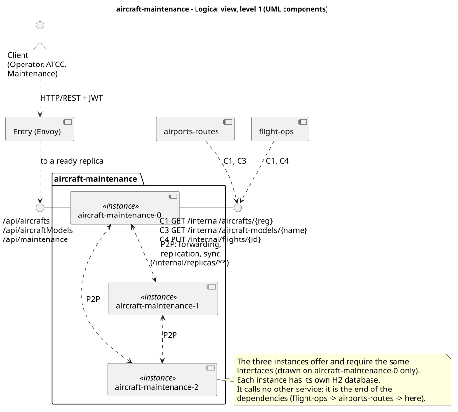
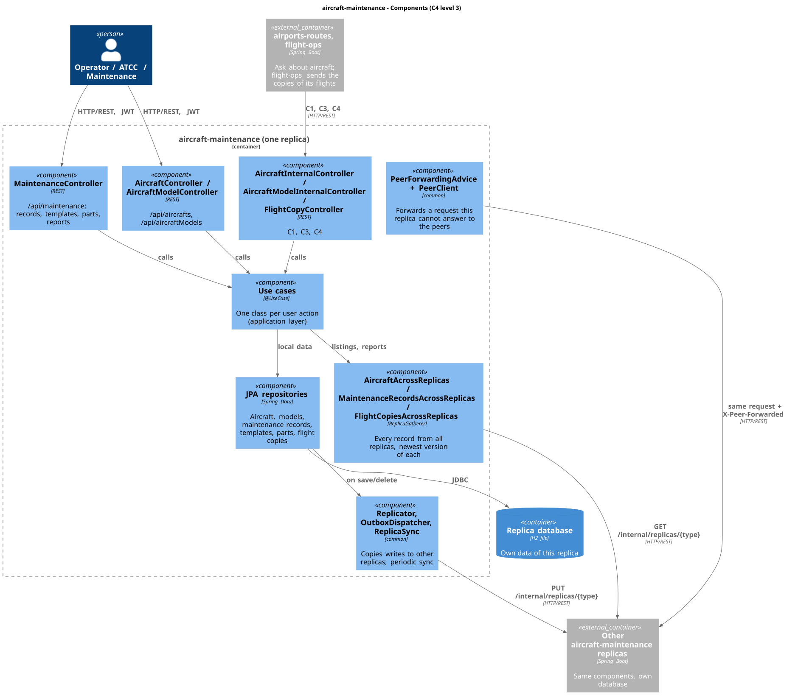
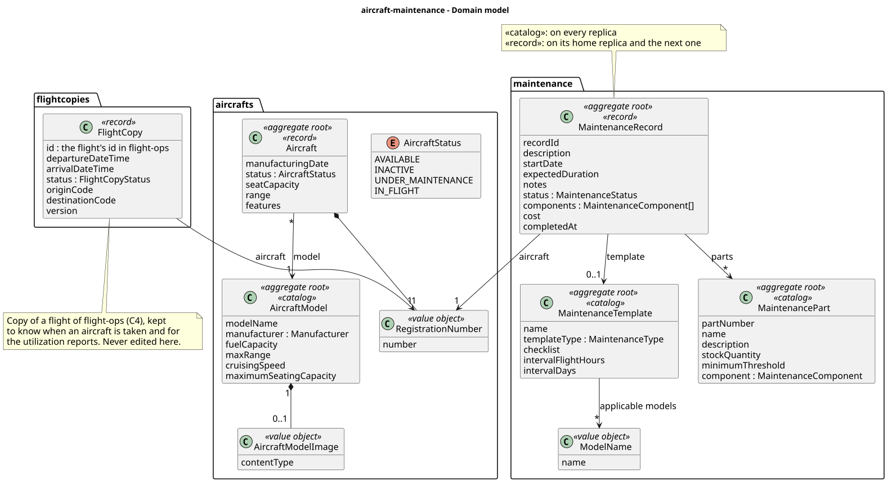
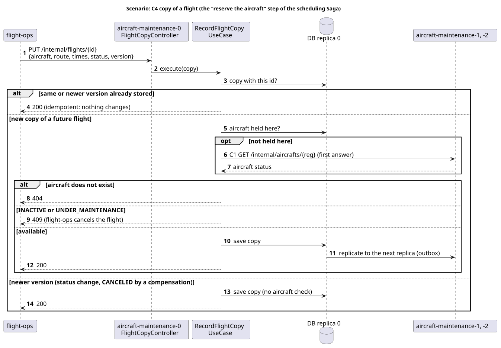

# aircraft-maintenance

The Aircraft & Maintenance service of AISafe: aircraft models and aircraft, their operational
status, and maintenance records, templates and parts. It runs as three replicas, each with its own
database, that answer for each other.

|                      |                                                                                                                    |
| -------------------- | ------------------------------------------------------------------------------------------------------------------ |
| Code                 | [`aircraft-maintenance/`](../../aircraft-maintenance) (packages `aircrafts`, `maintenance`, `flightcopies`)        |
| Port                 | 8081 (each replica)                                                                                                |
| Entry                | virtual IP of the service (`VIP_AIRCRAFT_MAINTENANCE` in `deploy/config.sh`), through the Envoy entry of each node |
| One replica directly | node ports 30810, 30811, 30812 (`aircraft-maintenance-0..2`), on any node                                          |
| API documentation    | `/swagger-ui.html` and `/v3/api-docs` of any replica                                                               |
| Depends on           | nothing: the end of the dependencies                                                                               |
| Used by              | airports-routes (C1, C3), flight-ops (C1, C4)                                                                      |

## 1. Logical view

The three instances are equal: the client reaches any of them through the entry, and each one
forwards to its peers what it cannot answer. It calls no other service, so it can run, and be
tested, alone.

## 2. Components (C4 level 3)

Each replica keeps the three layers of the monolith (`domain`, `application`, `infrastructure`),
checked by `ArchitectureTest`. What the distribution added:

| Component                                                                                       | What it does                                                                       |
| ----------------------------------------------------------------------------------------------- | ---------------------------------------------------------------------------------- |
| `AircraftInternalController`, `AircraftModelInternalController`                                 | Aircraft and model data for other services (C1, C3), wherever the aircraft is held |
| `FlightCopyController`, `RecordFlightCopyUseCase`                                               | Receives the copies of the flights from flight-ops (C4): reserves the aircraft     |
| `AircraftAcrossReplicas`, `MaintenanceRecordsAcrossReplicas`, `FlightCopiesAcrossReplicas`      | Every record of all replicas, for listings, reports and checks                     |
| `*ReplicaHandler` (`*/infrastructure/replication`)                                              | What is copied to other replicas, and how a received copy is applied               |
| `PeerForwardingAdvice`, `PeerClient`, `ReplicaGatherer`, `Replicator`, `ReplicaSync` (`common`) | Forwarding and replication shared by every service                                 |

## 3. Domain model

## 4. Where the data lives

| Data                                                      | Kept by                                                                 | Why                                                                         |
| --------------------------------------------------------- | ----------------------------------------------------------------------- | --------------------------------------------------------------------------- |
| Aircraft models, maintenance templates, maintenance parts | **every replica** (catalog)                                             | Few, rarely change, and needed to register aircraft and maintenance records |
| Aircraft                                                  | the replica that created it (**home**) and the **next one** in the ring | Partitioned data: a replica may not have an aircraft and must ask its peers |
| Maintenance records                                       | home and next replica                                                   | Same as aircraft                                                            |
| Flight copies (from flight-ops)                           | home and next replica                                                   | Same as aircraft                                                            |

Ring: `aircraft-maintenance-0 → 1 → 2 → 0`. Two copies of every record: any one replica can be lost
without losing data.

## 5. Contracts it offers

| #   | Caller                      | Request                                | Answer                                                                                                      |
| --- | --------------------------- | -------------------------------------- | ----------------------------------------------------------------------------------------------------------- |
| C1  | airports-routes, flight-ops | `GET /internal/aircrafts/{reg}`        | registration, model, status, seat capacity, range, fuel consumption; 404 if no replica holds it             |
| C3  | airports-routes             | `GET /internal/aircraft-models/{name}` | 200 with the manufacturer if the model exists, 404 if not                                                   |
| C4  | flight-ops                  | `PUT /internal/flights/{id}`           | 200 stored (idempotent); 404 the aircraft does not exist; 409 the aircraft is inactive or under maintenance |

All are commands or queries over HTTP, with the user's token (no events in Assignment 1).

## 6. Scenarios

### 6.1 C4 copy of a flight: the "reserve the aircraft" step of the scheduling Saga

A 404 or 409 makes flight-ops cancel the flight. When a later step fails, flight-ops sends a newer
copy with status CANCELED (the compensation), which frees the aircraft. The whole Saga is in the
[system documentation](../README.md#102-scheduling-a-flight-saga).

### 6.2 GET forwarded to the peers

Same mechanism as every service: [system documentation, section 7](../README.md#7-replication-and-forwarding-peer-to-peer).

## 7. Listings and reports over every replica

Records are partitioned, so the use cases that need **all** of them read every replica
(`ReplicaGatherer`), keep one entry per key (the newest version) and only then sort and page.

| Reads every replica | Use cases                                                                                                                                                                                                       |
| ------------------- | --------------------------------------------------------------------------------------------------------------------------------------------------------------------------------------------------------------- |
| aircraft            | list and search aircraft, fleet status, utilization and operational hours, top utilized models, maintenance due, maintenance costs by aircraft or model, average turnaround, delete an aircraft model (in use?) |
| maintenance records | search and list records, ongoing maintenance, total maintenance hours, maintenance due, costs, turnaround, create a record, delete an aircraft, a part or a template (in use?)                                  |
| flight copies       | utilization, operational hours, top utilized models, maintenance due, delete an aircraft (has flights?)                                                                                                         |

`X-Unreachable-Peers` lists the replicas that did not answer; `X-Partial-Result: true` is added only
when data may be missing (both holders of some records did not answer).

## 8. Failures

| Failure                              | Behaviour                                                                                          |
| ------------------------------------ | -------------------------------------------------------------------------------------------------- |
| One replica down                     | Its records are served by the next replica; listings complete; the entry stops sending it requests |
| Replica restarts (disk kept)         | Asks its peers for what changed before reporting ready                                             |
| Replica reborn empty on another node | Recovers the catalogs and its records from the peers before reporting ready                        |
| Other services down                  | Nothing here depends on them                                                                       |

## 9. Security

- Every request needs a JWT issued by login, validated here without calling login.
- Access by role (`SecurityConfig`), the same rules as the monolith.
- `/internal/replicas/**` (replication between replicas): role SERVICE only.
- `/internal/**` (C1, C3, C4): authenticated with the user's token forwarded by the calling service.
- Every log line carries the replica and the correlation id.

## 10. Known limitations

Those of the whole system: [system documentation, section 13](../README.md#13-known-limitations).
