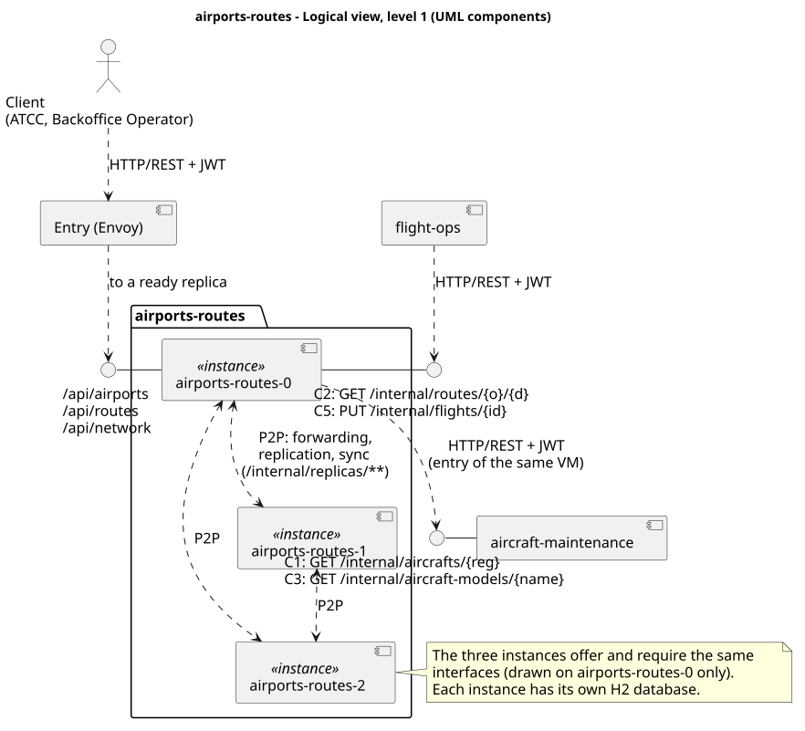
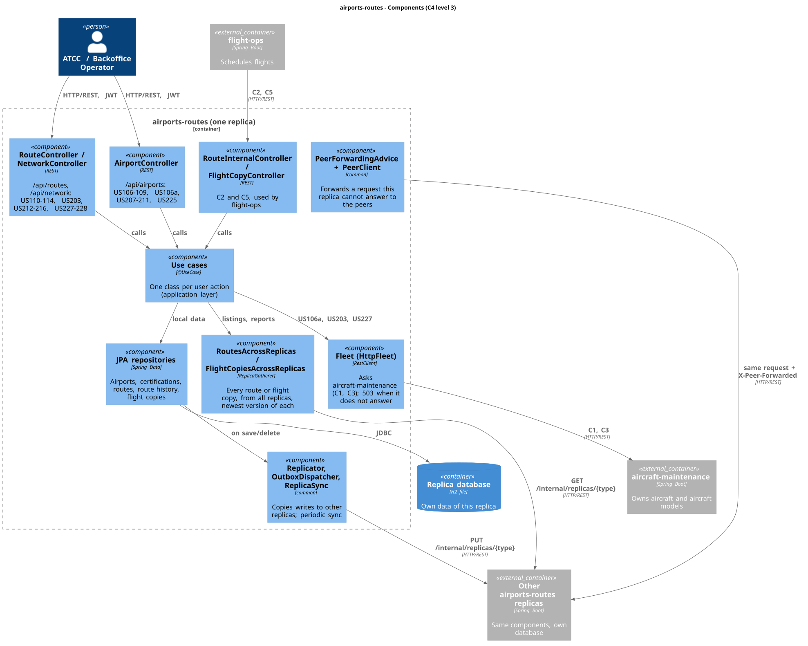
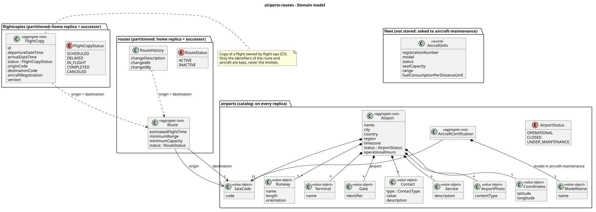
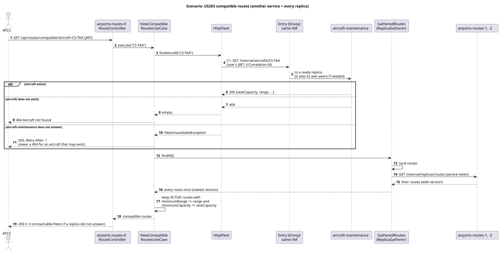
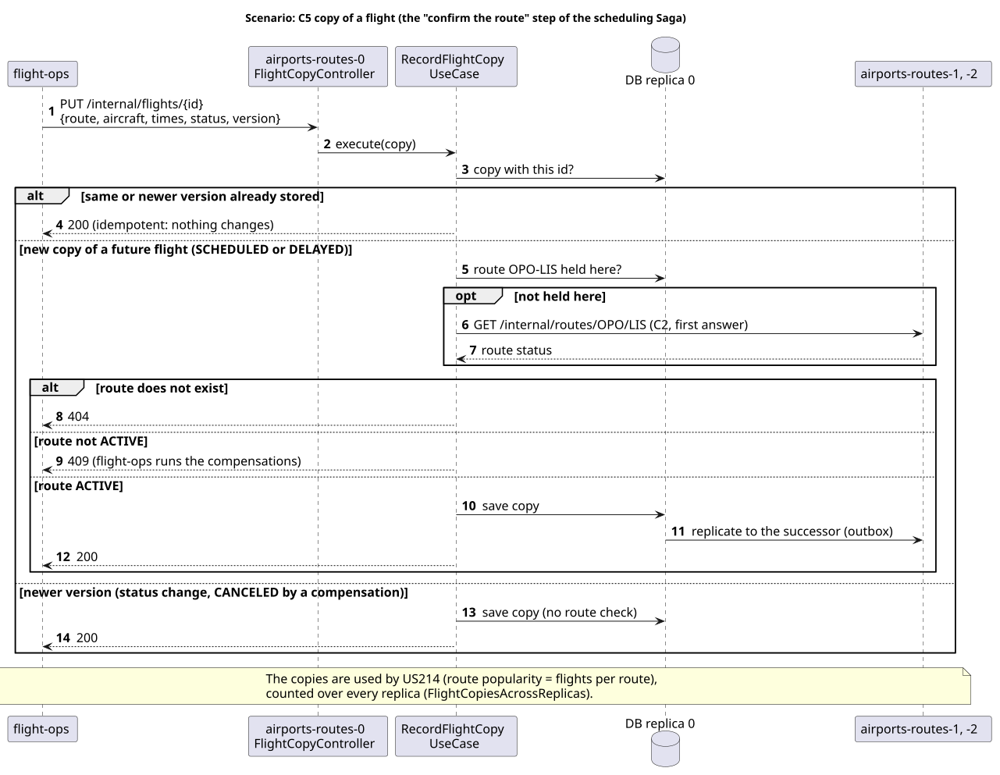

# airports-routes

The Airports & Routes service of AISafe: registration and querying of airports (runways,
facilities, certifications) and the definition and history of flight routes. It runs as three
replicas, each with its own database, that answer for each other.

| | |
|---|---|
| Code | [`airports-routes/`](../../airports-routes) (packages `airports`, `routes`, `flightcopies`, `fleet`) |
| Port | 8082 (each replica) |
| Entry | virtual IP of the service (`VIP_AIRPORTS_ROUTES` in `deploy/config.sh`), through the Envoy entry of each node |
| One replica directly | node ports 30820, 30821, 30822 (`airports-routes-0..2`), on any node |
| API documentation | `/swagger-ui.html` and `/v3/api-docs` of any replica |
| Depends on | aircraft-maintenance (C1, C3) |
| Used by | flight-ops (C2, C5) |

## 1. Logical view

The three instances are equal: the client reaches any of them through the entry, and each one
forwards to its peers what it cannot answer. The only other service it calls is
aircraft-maintenance, and only flight-ops calls it. Dependencies go one way:
flight-ops → airports-routes → aircraft-maintenance.

## 2. Components (C4 level 3)

Each replica keeps the three layers of the monolith (`domain`, `application`, `infrastructure`),
checked by `ArchitectureTest`. What the distribution added:

| Component | Where | What it does |
|---|---|---|
| `Fleet` / `HttpFleet` | `fleet` | Port to aircraft-maintenance (C1, C3). Sends the user's token and the correlation id |
| `RoutesAcrossReplicas`, `FlightCopiesAcrossReplicas` | `routes`, `flightcopies` | Every route or flight copy of all replicas, for listings, reports and checks |
| `RecordFlightCopyUseCase`, `FlightCopyController` | `flightcopies` | Receives the copies of the flights from flight-ops (C5) |
| `RouteInternalController`, `ViewRouteForServicesUseCase` | `routes` | Route data for other services and for the peers (C2) |
| `*ReplicaHandler`, `RouteReplicaSender` | `*/infrastructure/replication` | What is copied to other replicas, and how a received copy is applied |
| `PeerForwardingAdvice`, `PeerClient`, `ReplicaGatherer`, `Replicator`, `ReplicaSync` | `common` | Forwarding and replication shared by every service |

## 3. Domain model

The service keeps its own copies of types that belong to other services (`IataCode` is its own;
`ModelName` names a model of aircraft-maintenance), instead of sharing them through `common`
(decision D1). Aircraft are never stored here: they are asked to aircraft-maintenance every time
(`AircraftInfo`), so the answer is always the owner's.

## 4. Where the data lives

| Data | Kept by | Why |
|---|---|---|
| Airports and their certifications | **every replica** (catalog) | Few, rarely change, and every write of a route needs both airports (status, coordinates for the distance) |
| Routes (with their history) | the replica that created it (**home**) and the **next one** in the ring | Partitioned data, as the assignment asks: a replica may not have a route and must ask its peers |
| Flight copies | the replica that received it (home) and the next one | Same as routes |

Ring: `airports-routes-0 → 1 → 2 → 0`. With three replicas, a route is on two of them: any one
replica can be lost without losing data.

## 5. Contracts with other services

| # | Direction | Request | Answer |
|---|---|---|---|
| C1 | → aircraft-maintenance | `GET /internal/aircrafts/{reg}` | registration, model, status, seat capacity, range, fuel consumption; 404 if it does not exist |
| C2 | flight-ops → | `GET /internal/routes/{origin}/{destination}` | status, estimated flight time, minimum capacity and range, **distance in km**; 404 if no replica holds it |
| C3 | → aircraft-maintenance | `GET /internal/aircraft-models/{name}` | 200 if the model exists, 404 if not |
| C5 | flight-ops → | `PUT /internal/flights/{id}` | 200 stored (idempotent); 404 route does not exist; 409 route not active |

All of them are commands or queries over HTTP, with the user's token: there are no events or
message queues (Assignment 1). Calls to aircraft-maintenance go to the Envoy entry of the same
node, which picks a ready replica and repeats the request on another one if it fails. Timeouts:
1 s to connect, 10 s to answer.

**Routes that changed service (D2):** US203 and US227 used `/api/aircrafts/...` in the monolith. They
need the routes, and aircraft-maintenance must not depend on airports-routes, so they moved here:

| US | Monolith | Now |
|---|---|---|
| US203 compatible routes | `GET /api/aircrafts/{reg}/compatible-routes` | `GET /api/routes/compatible?aircraft={reg}` |
| US227 fuel efficiency | `GET /api/aircrafts/{reg}/fuel-efficiency` | `GET /api/routes/{origin}/{destination}/fuel-efficiency?aircraft={reg}` |

## 6. Scenarios (C4+1)

### 6.1 GET forwarded to the peers, with a replica down

| Situation | Answer |
|---|---|
| Found locally | 200 |
| Found on a peer | 200, with `X-Data-Node` naming the peer |
| No replica has it, all answered | 404 |
| No replica that answered has it, some did not answer | **503**, `Retry-After: 1`, `X-Partial-Result: true`, `X-Unreachable-Peers` (never a 404 for data that may exist) |
| Request already forwarded (`X-Peer-Forwarded`) | never forwarded again: one hop, no loops |
| `PUT`/`PATCH`/`DELETE` of a route this replica does not hold | sent to the peers one at a time until one holds it |
| `POST` | never forwarded: the new route stays on the replica that created it |

Robustness (`PeerClient`): peers asked in parallel; 0.5 s to connect, 2 s to answer; 1 retry with
backoff; circuit breaker per peer (3 failures → skipped for 10 s, closed as soon as that peer
contacts this replica again). Every attempt is logged with the replica and the correlation id.

These cases are tested end to end by the [Postman collection](../postman/README.md) (folders 1, 2,
3, 4, 7 and 8 for airports-routes).

### 6.2 US203 compatible routes: another service and every replica

### 6.3 C5 copy of a flight: a step of the scheduling Saga

When flight-ops schedules a flight, sending the copy here confirms that the route is still active.
A 404 or 409 makes flight-ops undo the steps already done (the aircraft reservation in
aircraft-maintenance, the flight itself). The Saga is described with flight-ops.

## 7. Listings and reports over every replica

Routes are partitioned, so any use case that needs **all** routes or flight copies reads them
from every replica (`ReplicaGatherer`): it takes the local ones and those of each peer
(`GET /internal/replicas/{type}`), keeps one entry per key (the newest version) and only then
sorts and pages. Summing partial results of each replica would count each route twice (it is
on two replicas).

| Use case | Reads every replica |
|---|---|
| US113 routes from an airport, US209 routes of an airport | routes |
| US114 search routes | routes |
| US203 compatible routes | routes (+ C1) |
| US214 active routes, by distance or popularity | routes + flight copies (popularity = number of flights per route) |
| US215 total network distance, US216 alternative routes | routes |
| US210 busiest airports | routes |
| US228 export network | routes |
| Delete airport (in use by a route?) | routes |

`X-Unreachable-Peers` lists the replicas that did not answer; `X-Partial-Result: true` is added
only when data may be missing (both holders of some routes did not answer).

## 8. Consistency

- **AP (availability and partition tolerance), eventual consistency.** A write is answered by
  one replica and copied to the others right after: to every other replica for airports and
  certifications, to the successor for routes and flight copies. A copy that fails stays in an
  outbox and is retried; every 30 s each replica also asks its peers for what it should hold
  (`ReplicaSync`), which repairs anything missed.
- **Conflicts:** the newest change wins (time of the change plus replica id to break ties).
  Deletes leave a tombstone, so an old copy does not bring a deleted route back.
- **Unique routes:** creating a route checks the local database and the peers (C2 on them).
  This is best effort: during a network partition a duplicate can be created. Flyway migration
  `V2__one_route_per_origin_and_destination.sql` keeps one row per origin and destination in each
  database.
- **Optimistic concurrency:** `If-Match` / `ETag` with the version, as in the monolith. The copy
  keeps the version of the replica that sent it, so the ETag is the same on both holders.

## 9. Failures

| Failure | Behaviour |
|---|---|
| One replica down | Its routes are still served by the successor; listings complete; the entry stops sending it requests |
| Replica restarts (disk kept) | Asks its peers for what changed before reporting ready |
| Replica reborn empty on another node | Recovers the catalogs and its routes from the peers before reporting ready |
| aircraft-maintenance down | US106a, US203 and US227 answer **503** with `Retry-After`; everything else keeps working |
| flight-ops down | Nothing here depends on it; flight copies already received keep counting in US214 |

## 10. Security

- Every request needs a JWT issued by login; this service only validates it, without calling login.
- Access by role (`SecurityConfig`), the same rules as the monolith for airports and routes; US203
  and US227 require ATCC.
- `/internal/replicas/**` (replication between replicas): role SERVICE only, the token of a replica.
- `/internal/**` (C2, C5): authenticated with the user's token forwarded by the calling service.
- Every log line carries the replica (`nodeId`) and the correlation id (`X-Correlation-Id`), also
  across services.

## 11. Known limitations

- **Unique routes during a partition:** a duplicate can be created (section 8).
- **Last write wins:** of two changes to the same route at the same time on different replicas,
  one is lost without warning; it depends on the clocks of the nodes being synchronised (NTP).
- **Two replicas lost at once with their disks:** the routes only they held are lost (two copies
  survive one failure, not two).
- **Right after a replica restarts:** for a few seconds a request may get 503 (try again) for a
  route that exists.
- **Tombstones are never removed:** irrelevant with the volumes of the project.
- **No TLS yet** between services and replicas (plain HTTP inside the cluster).
