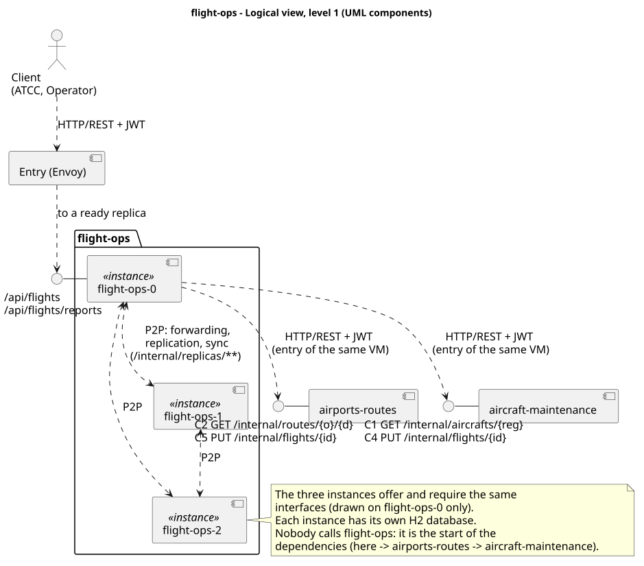
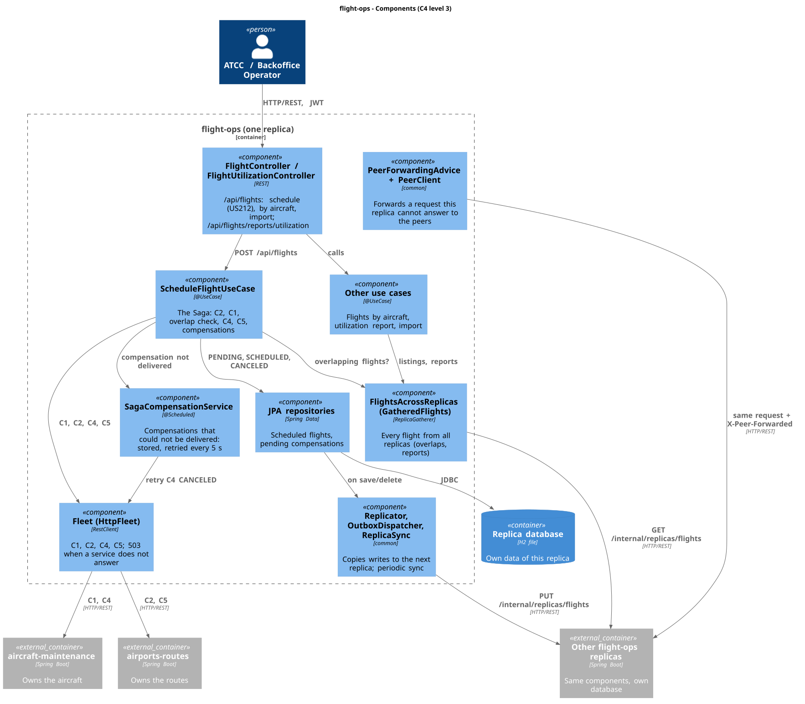
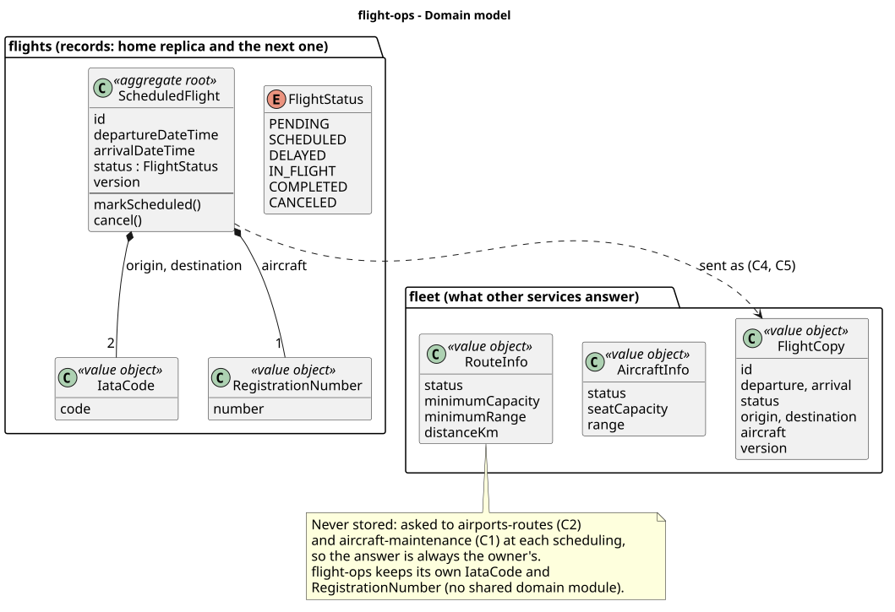
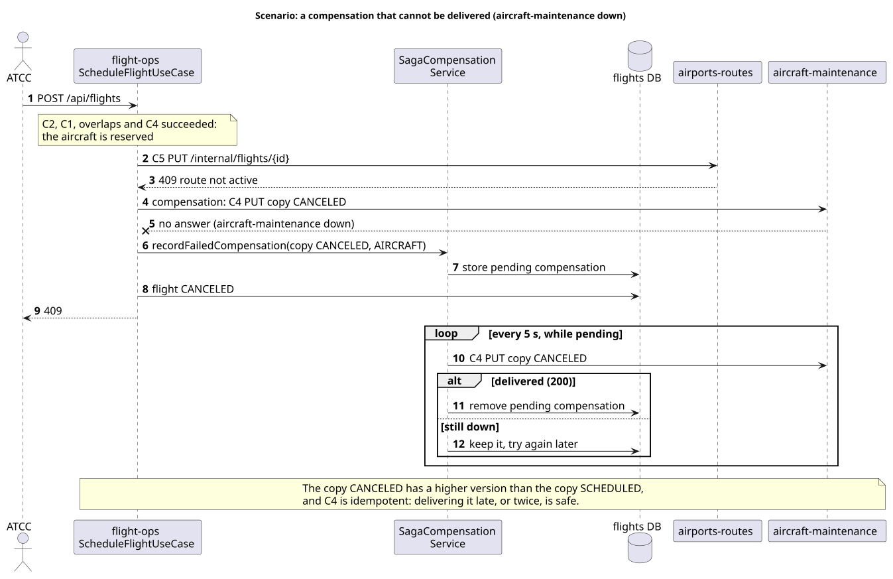

# flight-ops

The Flight Operations service of AISafe: scheduling flights (assigning an aircraft to a route),
checking that the aircraft is available, and utilization reports. It runs as three replicas, each
with its own database, that answer for each other.

| | |
|---|---|
| Code | [`flight-ops/`](../../flight-ops) (packages `flights`, `fleet`, `flightops`) |
| Port | 8083 (each replica) |
| Entry | virtual IP of the service (`VIP_FLIGHT_OPS` in `deploy/config.sh`), through the Envoy entry of each node |
| One replica directly | node ports 30830, 30831, 30832 (`flight-ops-0..2`), on any node |
| API documentation | `/swagger-ui.html` and `/v3/api-docs` of any replica |
| Depends on | airports-routes (C2, C5), aircraft-maintenance (C1, C4) |
| Used by | nobody: the start of the dependencies |

## 1. Logical view

The three instances are equal: the client reaches any of them through the entry, and each one
forwards to its peers what it cannot answer. Calls to the other services go to the Envoy entry of
the same node, which picks a ready replica and repeats the request on another one if it fails.

## 2. Components (C4 level 3)

| Component | What it does |
|---|---|
| `ScheduleFlightUseCase` | The scheduling Saga (section 6.1) |
| `Fleet` / `HttpFleet` (`fleet`) | Port to the other services (C1, C2, C4, C5). Sends the user's token and the correlation id; 503 when a service does not answer |
| `SagaCompensationService` (`flightops/infrastructure/saga`) | Compensations that could not be delivered: stored in the database, retried every 5 s |
| `FlightsAcrossReplicas` (`GatheredFlights`) | Every flight of all replicas: overlapping flights of an aircraft, reports |
| `FlightReplicaHandler` | What is copied to the next replica, and how a received copy is applied |
| `PeerForwardingAdvice`, `PeerClient`, `ReplicaGatherer`, `Replicator`, `ReplicaSync` (`common`) | Forwarding and replication shared by every service |

## 3. Domain model

Routes and aircraft are never stored here: they are asked to their owners at each scheduling (C2,
C1), so the answer is always the owner's. The service keeps its own `IataCode` and
`RegistrationNumber` instead of sharing them with the other services.

## 4. Where the data lives

| Data | Kept by | Why |
|---|---|---|
| Scheduled flights | the replica that created it (**home**) and the **next one** in the ring | Partitioned data: a replica may not have a flight and must ask its peers |
| Pending compensations | the replica that could not deliver them | Retried by that replica only |

Ring: `flight-ops-0 → 1 → 2 → 0`.

A flight's `id` is the same on every replica that holds it, and in its copies (C4, C5). Each replica
gives the ids that end in its own digit (`flight-ops-0`: 1, 11, 21…; `flight-ops-1`: 2, 12, 22…),
after the highest one it holds, so no two replicas give the same id without having to agree on
it. A replica reborn empty recovers its flights before it is ready, and goes on after them. The
database's own row number (domain identity apart from database identity, as in PSOFT) never
leaves the replica.

## 5. Contracts it uses

| # | Owner | Request | Used for |
|---|---|---|---|
| C2 | airports-routes | `GET /internal/routes/{o}/{d}` | the route exists, is active; minimum capacity and range; distance |
| C1 | aircraft-maintenance | `GET /internal/aircrafts/{reg}` | the aircraft exists, its status, seats and range |
| C4 | aircraft-maintenance | `PUT /internal/flights/{id}` | reserve the aircraft (copy SCHEDULED) or free it (copy CANCELED) |
| C5 | airports-routes | `PUT /internal/flights/{id}` | confirm the route (copy SCHEDULED) |

Each copy carries the flight's version: C4 and C5 are idempotent, so a step can be repeated.

## 6. Scenarios

### 6.1 Scheduling a flight (Saga)

| Step | Local transaction | If it fails |
|---|---|---|
| T1 | C2: route exists and is active | 404 / 409, nothing to undo |
| T2 | C1: aircraft exists, available and compatible | 404 / 409 / 400, nothing to undo |
| T3 | No overlapping flight of the aircraft (every replica); flight saved PENDING | 409 |
| T4 | C4: aircraft reserved | flight CANCELED; 409 / 503 |
| T5 | C5: route confirmed | **compensation**: C4 with copy CANCELED frees the aircraft; flight CANCELED; 409 / 503 |
| T6 | flight SCHEDULED | 201 |

### 6.2 A compensation that cannot be delivered

## 7. Listings and reports over every replica

| Use case | Reads every replica |
|---|---|
| Scheduled flights of an aircraft | flights |
| Scheduling a flight (overlapping flights of the aircraft) | flights |
| Utilization report | flights |

## 8. Failures

| Failure | Behaviour |
|---|---|
| One replica down | Its flights are served by the next replica; listings complete; the entry stops sending it requests |
| Replica restarts or is reborn empty | Recovers its flights from the peers before reporting ready |
| airports-routes or aircraft-maintenance down | Scheduling answers 503 (`Retry-After`) and undoes what was done; listings and reports keep working |
| A compensation cannot be delivered | Stored and retried every 5 s until delivered |

## 9. Security

- Every request needs a JWT issued by login, validated here without calling login.
- Access by role (`SecurityConfig`): scheduling a flight requires ATCC; importing flights requires
  Backoffice Operator.
- Calls to the other services carry the user's token, so each owner applies its own rules.
- `/internal/replicas/**` (replication between replicas): role SERVICE only.

## 10. Known limitations

- **No two-phase commit:** between T4 and T6 the aircraft is reserved for a flight that may still
  be canceled (a Saga is eventually consistent).
- **Overlap check across replicas is best effort:** two flights for the same aircraft scheduled at
  the same time on two replicas, during a partition, could overlap.
- The rest, as for the whole system: [system documentation, section 13](../README.md#13-known-limitations).
