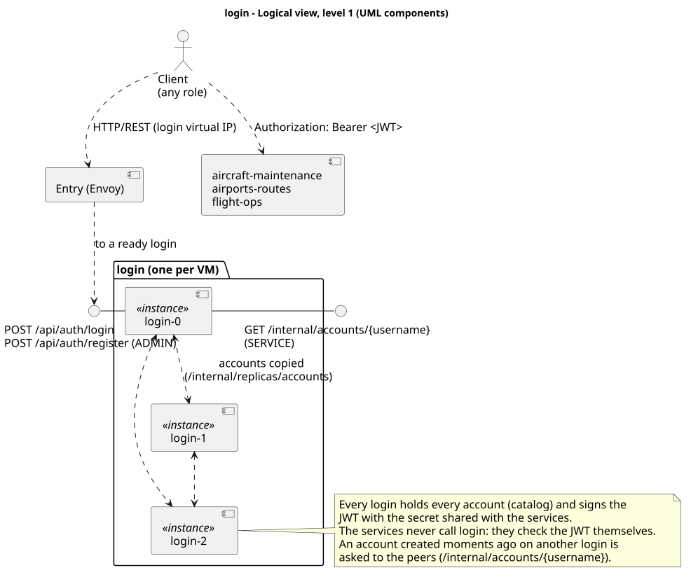
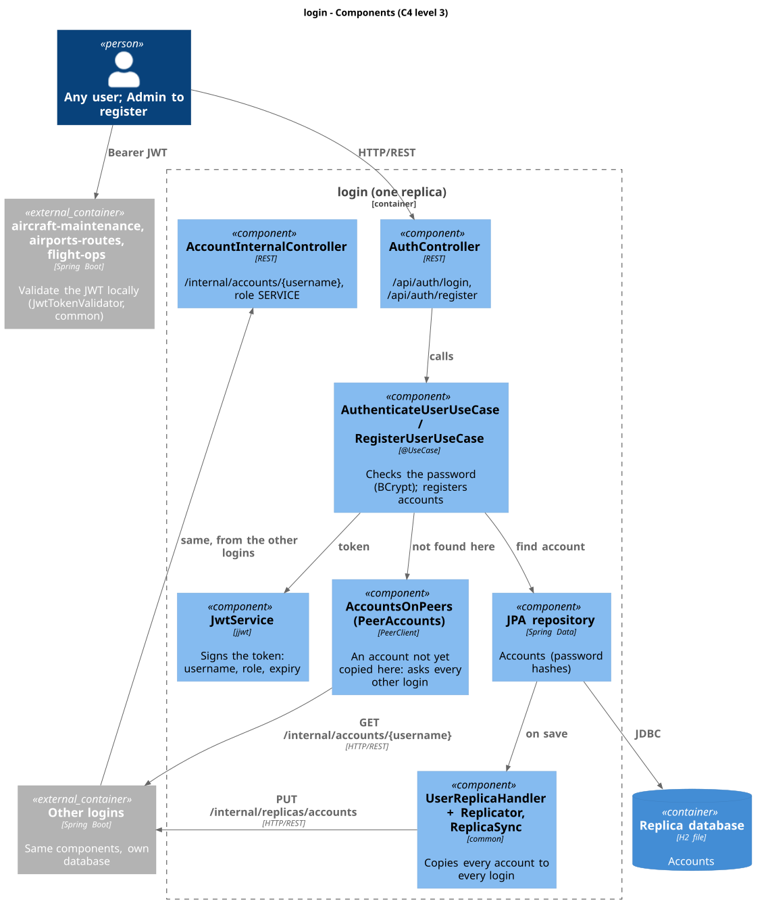
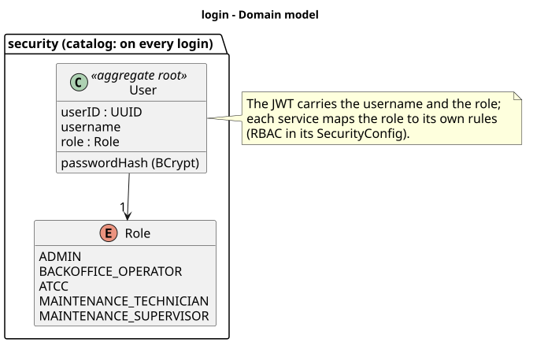
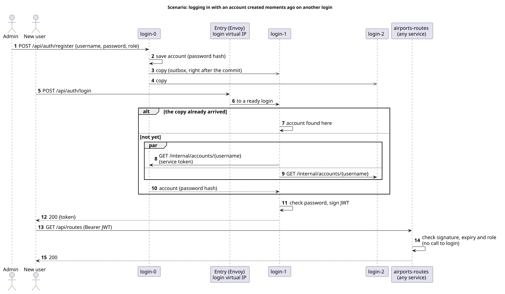

# login

The login of AISafe: accounts, passwords and the JWT that every other service accepts. One login runs
on each VM, each with its own database holding every account.

| | |
|---|---|
| Code | [`login/`](../../login) (package `security`) |
| Port | 8085 (each replica) |
| Entry | virtual IP of the login (`VIP_LOGIN` in `deploy/config.sh`), through the Envoy entry of each node |
| API documentation | `/swagger-ui.html` and `/v3/api-docs` of any login |
| Depends on | nothing |
| Used by | clients only: the services check the JWT themselves |

## 1. Logical view

## 2. Components (C4 level 3)

| Component | What it does |
|---|---|
| `AuthController`, `AuthenticateUserUseCase` | `POST /api/auth/login`: checks the password (BCrypt) and returns a JWT |
| `RegisterUserUseCase` | `POST /api/auth/register` (Admin): creates an account |
| `JwtService` | Signs the token: username, role, expiry (HMAC-SHA, secret from the k3s Secret `aisafe-jwt`) |
| `AccountsOnPeers` (`PeerAccounts`), `AccountInternalController` | An account not copied here yet is asked to the other logins (`/internal/accounts/{username}`, role SERVICE) |
| `UserReplicaHandler` + `Replicator`, `ReplicaSync` (`common`) | Copies every account to every login |

## 3. Domain model

## 4. Where the data lives

| Data | Kept by | Why |
|---|---|---|
| Accounts (password hashes) | **every login** (catalog) | Any login must be able to log anyone in, with the other logins down |

## 5. Scenario: logging in with an account created on another login

## 6. Failures

| Failure | Behaviour |
|---|---|
| One login down | The others answer through the login virtual IP; tokens already issued keep working |
| Every login down | No new logins; tokens already issued keep working until they expire |
| A login restarts or is reborn empty | Recovers every account from the other logins before reporting ready |

## 7. Security

- Passwords stored only as BCrypt hashes; the answer to a wrong password does not say whether the
  username exists.
- Registering accounts requires Admin; `/internal/**` requires a service token (role SERVICE).
- Limitation: the services validate tokens with the **same secret** login signs them with, so a
  service could issue tokens. RS256 with a public key (JWKS) would remove that
  ([system documentation, section 13](../README.md#13-known-limitations)).
