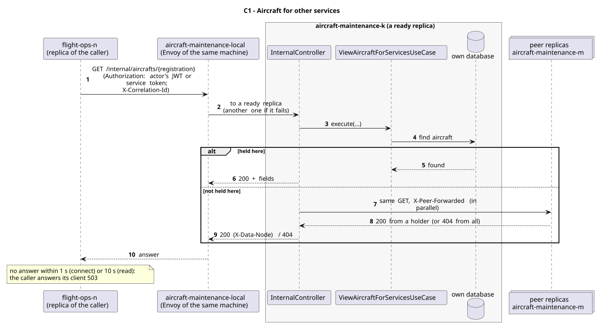

# C1 - Aircraft for other services

| Caller                      | Owner                | Request                                  | Through                                                                                                                          |
| --------------------------- | -------------------- | ---------------------------------------- | -------------------------------------------------------------------------------------------------------------------------------- |
| airports-routes, flight-ops | aircraft-maintenance | `GET /internal/aircrafts/{registration}` | `aircraft-maintenance-local`: the entry (Envoy) of the caller's own machine, which picks a ready replica of aircraft-maintenance |

## Used by

| User story                                               | Caller          | Why                                                            |
| -------------------------------------------------------- | --------------- | -------------------------------------------------------------- |
| [US203](../../use-cases/airports-routes/US203/README.md) | airports-routes | compatible routes need the aircraft's range and seats          |
| [US227](../../use-cases/airports-routes/US227/README.md) | airports-routes | fuel efficiency needs the aircraft's consumption               |
| [US212](../../use-cases/flight-ops/US212/README.md)      | flight-ops      | scheduling checks the aircraft (Saga T2)                       |
| [US213](../../use-cases/flight-ops/US213/README.md)      | flight-ops      | the flights of an aircraft: 404 if the aircraft does not exist |

## Request

Path: the registration number.

Answer fields (200):

| Field                            | Meaning                                           |
| -------------------------------- | ------------------------------------------------- |
| `registrationNumber`             | string                                            |
| `model`                          | model name                                        |
| `status`                         | AVAILABLE, IN_FLIGHT, UNDER_MAINTENANCE, INACTIVE |
| `seatCapacity`                   | integer                                           |
| `range`                          | km                                                |
| `fuelConsumptionPerDistanceUnit` | number                                            |

## Responses

| Status    | Meaning                                                       |
| --------- | ------------------------------------------------------------- |
| 200       | the aircraft (fields above)                                   |
| 404       | no replica holds it (every peer answered)                     |
| 503       | it may exist on a replica that did not answer (`Retry-After`) |
| 401 / 403 | no valid token (the owner checks every `/internal/**` call)   |

## Security

The caller sends the actor's JWT (`Authorization`), so the owner applies its own rules to the same user; outside a user's request (sample data at start-up, retried compensations) it sends its replica's service token (role `SERVICE`). The correlation id (`X-Correlation-Id`) goes along, so the call is followed in the logs of both services.

## Across replicas

The aircraft is a record (two replicas). The replica that gets the call answers if it holds it; if not, it asks its peers like any other read (`X-Data-Node` names the holder).

## Failures

The caller waits 1 s to connect and 10 s for the answer. If aircraft-maintenance does not answer (or answers 5xx), the caller answers its own client 503 with `Retry-After` (`FleetUnavailableException`): an unknown answer is never taken as "no aircraft".

## Sequence Diagram

Source: [`puml/sd_c1.puml`](puml/sd_c1.puml). The fields of each request are also in the OpenAPI documentation of aircraft-maintenance (`/v3/api-docs`).
