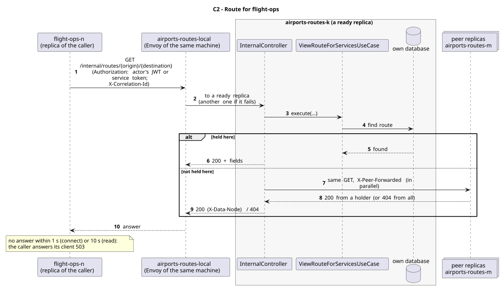

# C2 - Route for flight-ops

| Caller     | Owner           | Request                                       | Through                                                                                                                |
| ---------- | --------------- | --------------------------------------------- | ---------------------------------------------------------------------------------------------------------------------- |
| flight-ops | airports-routes | `GET /internal/routes/{origin}/{destination}` | `airports-routes-local`: the entry (Envoy) of the caller's own machine, which picks a ready replica of airports-routes |

## Used by

| User story                                          | Caller     | Why                                         |
| --------------------------------------------------- | ---------- | ------------------------------------------- |
| [US212](../../use-cases/flight-ops/US212/README.md) | flight-ops | scheduling checks the route first (Saga T1) |

## Request

Path: the origin and destination IATA codes.

Answer fields (200):

| Field                 | Meaning                       |
| --------------------- | ----------------------------- |
| `originIataCode`      | IATA code                     |
| `destinationIataCode` | IATA code                     |
| `status`              | ACTIVE, INACTIVE or SUSPENDED |
| `estimatedFlightTime` | minutes                       |
| `minimumCapacity`     | seats                         |
| `minimumRange`        | km                            |
| `distanceKm`          | km                            |

## Responses

| Status    | Meaning                                                       |
| --------- | ------------------------------------------------------------- |
| 200       | the route (fields above)                                      |
| 404       | no replica holds it (every peer answered)                     |
| 503       | it may exist on a replica that did not answer (`Retry-After`) |
| 401 / 403 | no valid token (the owner checks every `/internal/**` call)   |

## Security

The caller sends the actor's JWT (`Authorization`), so the owner applies its own rules to the same user; outside a user's request (sample data at start-up, retried compensations) it sends its replica's service token (role `SERVICE`). The correlation id (`X-Correlation-Id`) goes along, so the call is followed in the logs of both services.

## Across replicas

The route is a record (two replicas); a replica that does not hold it asks its peers.

## Failures

As for C1: 1 s to connect, 10 s to answer; no answer means 503 to the actor and nothing is scheduled.

## Sequence Diagram

Source: [`puml/sd_c2.puml`](puml/sd_c2.puml). The fields of each request are also in the OpenAPI documentation of airports-routes (`/v3/api-docs`).
