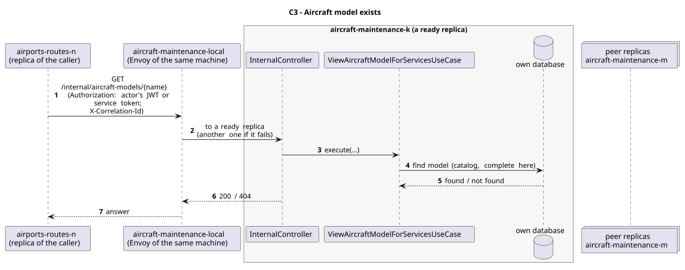

# C3 - Aircraft model exists

| Caller          | Owner                | Request                                | Through                                                                                                                          |
| --------------- | -------------------- | -------------------------------------- | -------------------------------------------------------------------------------------------------------------------------------- |
| airports-routes | aircraft-maintenance | `GET /internal/aircraft-models/{name}` | `aircraft-maintenance-local`: the entry (Envoy) of the caller's own machine, which picks a ready replica of aircraft-maintenance |

## Used by

| User story                                                 | Caller          | Why                                                  |
| ---------------------------------------------------------- | --------------- | ---------------------------------------------------- |
| [US106a](../../use-cases/airports-routes/US106a/README.md) | airports-routes | an airport is certified only for a model that exists |

## Request

Path: the model name.

Answer fields (200):

| Field          | Meaning                                                             |
| -------------- | ------------------------------------------------------------------- |
| `modelName`    | string                                                              |
| `manufacturer` | BOEING, AIRBUS, EMBRAER, BOMBARDIER, ATR, COMAC, SUKHOI, MITSUBISHI |

## Responses

| Status    | Meaning                                                     |
| --------- | ----------------------------------------------------------- |
| 200       | the model exists                                            |
| 404       | no such model                                               |
| 401 / 403 | no valid token (the owner checks every `/internal/**` call) |

## Security

The caller sends the actor's JWT (`Authorization`), so the owner applies its own rules to the same user; outside a user's request (sample data at start-up, retried compensations) it sends its replica's service token (role `SERVICE`). The correlation id (`X-Correlation-Id`) goes along, so the call is followed in the logs of both services.

## Across replicas

The aircraft models are a catalog: every replica holds all of them, so any replica answers by itself.

## Failures

As for C1: no answer means 503 to the actor, and the certification is not added.

## Sequence Diagram

Source: [`puml/sd_c3.puml`](puml/sd_c3.puml). The fields of each request are also in the OpenAPI documentation of aircraft-maintenance (`/v3/api-docs`).
