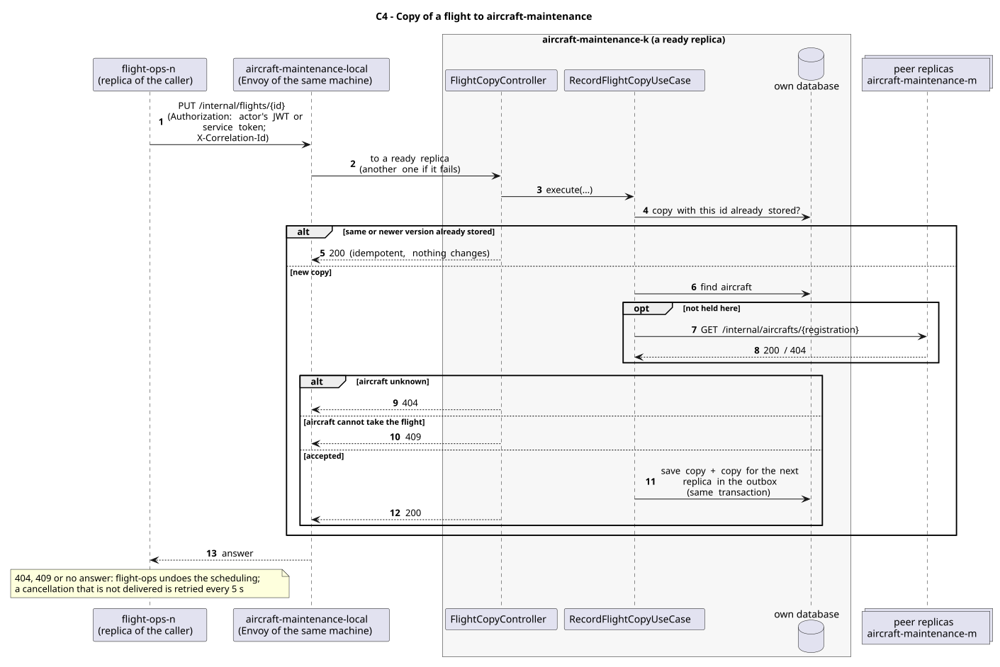

# C4 - Copy of a flight to aircraft-maintenance

| Caller     | Owner                | Request                      | Through                                                                                                                          |
| ---------- | -------------------- | ---------------------------- | -------------------------------------------------------------------------------------------------------------------------------- |
| flight-ops | aircraft-maintenance | `PUT /internal/flights/{id}` | `aircraft-maintenance-local`: the entry (Envoy) of the caller's own machine, which picks a ready replica of aircraft-maintenance |

## Used by

| User story                                             | Caller     | Why                                                                                                  |
| ------------------------------------------------------ | ---------- | ---------------------------------------------------------------------------------------------------- |
| [US212](../../use-cases/flight-ops/US212/README.md)    | flight-ops | Saga T4: "reserve the aircraft"; also each change of the flight, and its cancellation (compensation) |
| [US225](../../use-cases/cross-service/US225/README.md) | flight-ops | each imported flight runs the Saga                                                                   |

The copies kept by aircraft-maintenance are also its source for the operational hours, utilization, top models and maintenance due (US206, US223, US204, US222), and the check that an aircraft with flights is not deleted.

## Request

Path: the flight id. Body: the flight as flight-ops has it now.

Body fields:

| Field                  | Meaning                                                        |
| ---------------------- | -------------------------------------------------------------- |
| `id`                   | flight id                                                      |
| `departureDateTime`    | date and time                                                  |
| `arrivalDateTime`      | date and time                                                  |
| `status`               | SCHEDULED, DELAYED, IN_FLIGHT, COMPLETED or CANCELED           |
| `originIataCode`       | IATA code                                                      |
| `destinationIataCode`  | IATA code                                                      |
| `aircraftRegistration` | registration number                                            |
| `version`              | the flight's version: an older copy never replaces a newer one |

## Responses

| Status    | Meaning                                                               |
| --------- | --------------------------------------------------------------------- |
| 200       | stored (or already there: idempotent)                                 |
| 404       | no such aircraft, on any replica                                      |
| 409       | the aircraft cannot take a new flight (inactive or under maintenance) |
| 401 / 403 | no valid token (the owner checks every `/internal/**` call)           |

## Security

The caller sends the actor's JWT (`Authorization`), so the owner applies its own rules to the same user; outside a user's request (sample data at start-up, retried compensations) it sends its replica's service token (role `SERVICE`). The correlation id (`X-Correlation-Id`) goes along, so the call is followed in the logs of both services.

## Across replicas

The copy is stored as a record of aircraft-maintenance (`flight-copies`: the replica that received it and the next one). The aircraft may be on another replica: the receiving replica looks for it on its peers (`GET /internal/aircrafts/{registration}`).

## Failures

A 404 or 409 makes flight-ops undo the scheduling (the flight is cancelled). If aircraft-maintenance does not answer, flight-ops also undoes it; a cancellation that cannot be delivered is stored (`saga_compensation`) and sent again every 5 s until it is. Sending the same copy twice changes nothing.

## Sequence Diagram

Source: [`puml/sd_c4.puml`](puml/sd_c4.puml). The fields of each request are also in the OpenAPI documentation of aircraft-maintenance (`/v3/api-docs`).
