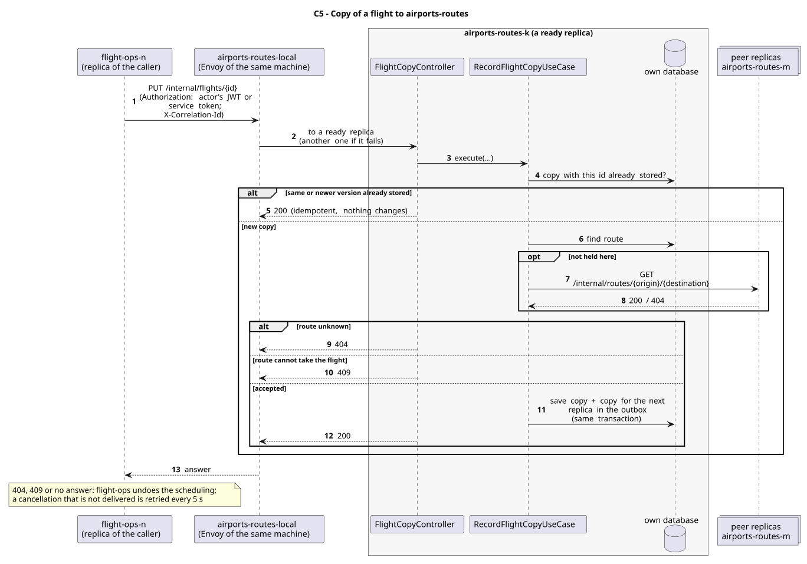

# C5 - Copy of a flight to airports-routes

| Caller     | Owner           | Request                      | Through                                                                                                                |
| ---------- | --------------- | ---------------------------- | ---------------------------------------------------------------------------------------------------------------------- |
| flight-ops | airports-routes | `PUT /internal/flights/{id}` | `airports-routes-local`: the entry (Envoy) of the caller's own machine, which picks a ready replica of airports-routes |

## Used by

| User story                                             | Caller     | Why                                                                        |
| ------------------------------------------------------ | ---------- | -------------------------------------------------------------------------- |
| [US212](../../use-cases/flight-ops/US212/README.md)    | flight-ops | Saga T5: "the route counts one more flight"; also changes and cancellation |
| [US225](../../use-cases/cross-service/US225/README.md) | flight-ops | each imported flight runs the Saga                                         |

The copies kept by airports-routes are also its source for the popularity of the routes (US214).

## Request

Path: the flight id. Body: the same as C4.

Body fields:

| Field                  | Meaning                                              |
| ---------------------- | ---------------------------------------------------- |
| `id`                   | flight id                                            |
| `departureDateTime`    | date and time                                        |
| `arrivalDateTime`      | date and time                                        |
| `status`               | SCHEDULED, DELAYED, IN_FLIGHT, COMPLETED or CANCELED |
| `originIataCode`       | IATA code                                            |
| `destinationIataCode`  | IATA code                                            |
| `aircraftRegistration` | registration number                                  |
| `version`              | the flight's version                                 |

## Responses

| Status    | Meaning                                                     |
| --------- | ----------------------------------------------------------- |
| 200       | stored (or already there: idempotent)                       |
| 404       | no such route, on any replica                               |
| 409       | the route is not active                                     |
| 401 / 403 | no valid token (the owner checks every `/internal/**` call) |

## Security

The caller sends the actor's JWT (`Authorization`), so the owner applies its own rules to the same user; outside a user's request (sample data at start-up, retried compensations) it sends its replica's service token (role `SERVICE`). The correlation id (`X-Correlation-Id`) goes along, so the call is followed in the logs of both services.

## Across replicas

The copy is stored as a record of airports-routes (`flight-copies`); the route may be on another replica, looked up on the peers (`GET /internal/routes/{origin}/{destination}`).

## Failures

As for C4: a refusal or no answer makes flight-ops undo the scheduling (cancel the copy already sent with C4); undelivered cancellations are retried every 5 s.

## Sequence Diagram

Source: [`puml/sd_c5.puml`](puml/sd_c5.puml). The fields of each request are also in the OpenAPI documentation of airports-routes (`/v3/api-docs`).
