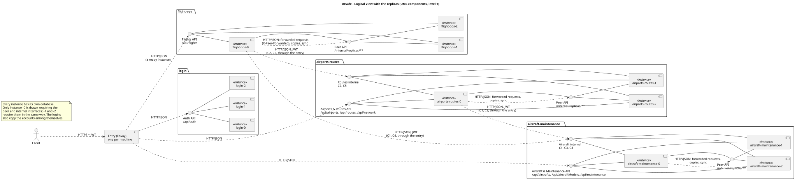

# Global artifacts

Artifacts that describe the whole distributed system. The architecture itself (views, data placement,
replication, consistency, fault tolerance, security, decisions, limitations) is explained in the
[system documentation](../../README.md); here are its diagrams and the global documents in one place.

| Artifact                                  | Description                                                                            |
| ----------------------------------------- | -------------------------------------------------------------------------------------- |
| [Glossary](glossary.md)                   | Terms of the distribution: replicas, catalogs and records, forwarding, outbox, Saga... |
| [FURPS+](furps.md)                        | Non-functional requirements and where the system meets them                            |
| [Contracts C1-C5](../contracts/README.md) | The calls between services                                                             |
| [Use cases](../use-cases/README.md)       | Every user story in the distributed system, with SSD and SD                            |

## C4 level 1: context

## C4 level 2: containers

## Logical view

The services as UML components: the interfaces each offers (its routes) and the ones it requires (the
contracts).

The same with the replicas (`<<instance>>`): every instance offers the service's API and the peer API
(`/internal/replicas/**`), and requires the peer API of the others, for forwarded requests, copies and
sync.

## Physical view

## Scenario: scheduling a flight (Saga)

## Per service

Logical view, components (C4 level 3), domain model and scenarios of each service:

| Service                                                      | Domain model                                                    |
| ------------------------------------------------------------ | --------------------------------------------------------------- |
| [aircraft-maintenance](../../aircraft-maintenance/README.md) | [domain model](../../aircraft-maintenance/svg/domain-model.svg) |
| [airports-routes](../../airports-routes/README.md)           | [domain model](../../airports-routes/svg/domain-model.svg)      |
| [flight-ops](../../flight-ops/README.md)                     | [domain model](../../flight-ops/svg/domain-model.svg)           |
| [login](../../login/README.md)                               | [domain model](../../login/svg/domain-model.svg)                |

Sources of the diagrams: [`docs/puml/`](../../puml/) for the whole system, `docs/<service>/puml/` for each
service. `scripts/generate-svg.sh` regenerates every `.svg`.
