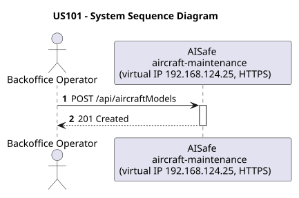
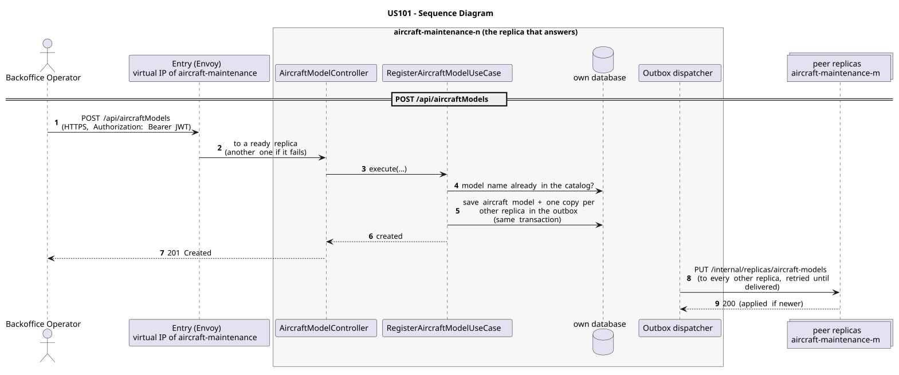

# US101 - Register Aircraft Model

| Service              | Work package (monolith) | Monolith documentation                                                                    |
| -------------------- | ----------------------- | ----------------------------------------------------------------------------------------- |
| aircraft-maintenance | WP1A                    | [US101](../../../../../docs_monolith/system-documentation/use-cases/WP1A/US101/README.md) |

## User Story

> As a Backoffice Operator, I want to register a new aircraft model so that the catalog contains the model data used by aircraft registrations.

## Endpoints

| Method | Route                 | Roles               | Use case                       |
| ------ | --------------------- | ------------------- | ------------------------------ |
| POST   | `/api/aircraftModels` | Backoffice Operator | `RegisterAircraftModelUseCase` |

Through the virtual IP of the service, HTTPS only, with a JWT issued by the login.

## Acceptance Criteria

- The request must provide `modelName`, `manufacturer`, `maxRange`, `fuelCapacity`, `cruisingSpeed`, `maximumSeatingCapacity`, and `imagePath`.
- `manufacturer` is a fixed enum value, not free text.
- `modelName` must be unique; duplicate names return HTTP 409.
- Numeric fields must be positive and `maximumSeatingCapacity` must be at least 1.
- On success the system returns HTTP 201 with an `AircraftModelResponse` payload and HATEOAS links.

In the distributed system:

- The new entry reaches every replica once the copies are delivered (normally right after the answer).
- Every request and its answer are in the audit trail of the replica that answered.

## Pre-conditions

- The actor is authenticated through the login (JWT) with a role allowed for the route (see Endpoints).
- No aircraft model with the same name exists yet.
- At least one replica of the service is ready.

## Post-conditions

- A new `AircraftModel` entity is persisted.
- The created model becomes available to aircraft registration and template selection flows.
- The change is on every replica once the outbox delivers it.

## Main Success Scenario

1. The actor sends `POST /api/aircraftModels` with the JWT to the virtual IP of aircraft-maintenance (HTTPS); the entry (Envoy) of the machine that holds that IP passes it to a ready replica of aircraft-maintenance, and tries another replica if that one fails.
2. `RegisterAircraftModelUseCase` validates the request and checks that no aircraft model with the same model name exists (the catalog is complete on every replica).
3. It stores the aircraft model and, in the same transaction, one copy for every other replica in the outbox; it answers 201.
4. Right after the commit the outbox sends the copies (`PUT /internal/replicas/aircraft-models`), retrying until each one is delivered.

## Alternative / Exception Flows

| Condition                                        | System Response                                                                           |
| ------------------------------------------------ | ----------------------------------------------------------------------------------------- |
| Request invalid or missing required field        | HTTP 400                                                                                  |
| Model name already exists                        | HTTP 409                                                                                  |
| No valid token                                   | 401                                                                                       |
| The actor's role is not Backoffice Operator      | 403                                                                                       |
| The replica that got the request stops answering | the entry repeats a read on another replica; a write only if it never reached the replica |

## Distribution

The aircraft model belongs to a **catalog**: every replica holds all of it, and every change is copied to all of them (last writer wins).

## Tests

Distributed end to end, in the [Postman collection](../../../../postman/README.md): folder 4. Catalogs copied to every replica.

## Sequence Diagrams

### System Sequence Diagram (SSD)

### Sequence Diagram (SD)

Sources: [`puml/ssd_us101.puml`](puml/ssd_us101.puml), [`puml/sd_us101.puml`](puml/sd_us101.puml).
