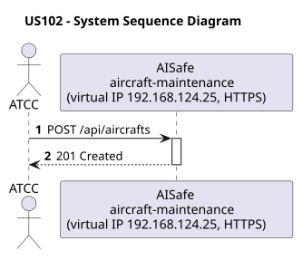
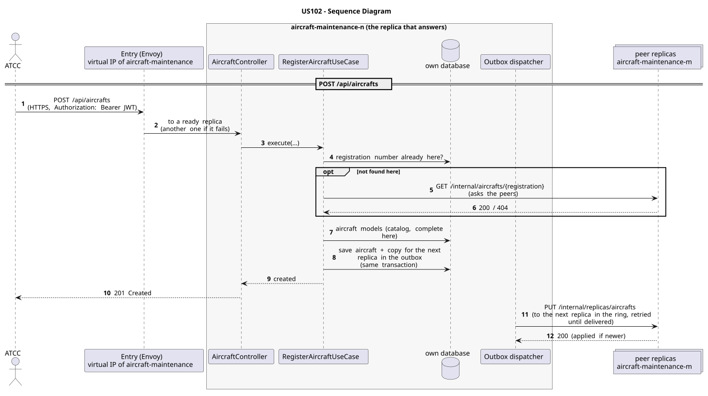

# US102 - Register Aircraft

| Service              | Work package (monolith) | Monolith documentation                                                                    |
| -------------------- | ----------------------- | ----------------------------------------------------------------------------------------- |
| aircraft-maintenance | WP1A                    | [US102](../../../../../docs_monolith/system-documentation/use-cases/WP1A/US102/README.md) |

## User Story

> As an ATCC user, I want to register an aircraft so that the fleet contains an operational unit linked to a model.

## Endpoints

| Method | Route            | Roles | Use case                  |
| ------ | ---------------- | ----- | ------------------------- |
| POST   | `/api/aircrafts` | ATCC  | `RegisterAircraftUseCase` |

Through the virtual IP of the service, HTTPS only, with a JWT issued by the login.

## Acceptance Criteria

- The request must provide `registrationNumber`, `modelName`, `manufacturingDate`, `seatCapacity`, `status`, and optional `features`.
- The registration number must follow the `XX-XXX` pattern and be unique.
- The aircraft model is resolved by `modelName`.
- The requested seat capacity cannot exceed the selected model's maximum seating capacity.
- On success the system returns HTTP 201 with `ViewAircraftDetailsResponse` and HATEOAS links.

In the distributed system:

- The new record is on two replicas once the copy is delivered (normally right after the answer).
- Every request and its answer are in the audit trail of the replica that answered.

## Pre-conditions

- The actor is authenticated through the login (JWT) with a role allowed for the route (see Endpoints).
- The aircraft model referenced by `modelName` exists.
- At least one replica of the service is ready.

## Post-conditions

- A new `Aircraft` entity is persisted with the requested status.
- The created aircraft becomes available to list, search, and detail views.
- The change is on both replicas that hold the record once the outbox delivers it.

## Main Success Scenario

1. The actor sends `POST /api/aircrafts` with the JWT to the virtual IP of aircraft-maintenance (HTTPS); the entry (Envoy) of the machine that holds that IP passes it to a ready replica of aircraft-maintenance, and tries another replica if that one fails.
2. `RegisterAircraftUseCase` validates the request and checks that no aircraft with the same registration number exists: in its own database and, if not found there, on its peers (`GET /internal/aircrafts/{registration}`). The aircraft models come from its own copy of the catalog.
3. It stores the aircraft on this replica (its home) and, in the same transaction, a copy for the next replica in the ring in the outbox; it answers 201.
4. Right after the commit the outbox sends the copy (`PUT /internal/replicas/aircrafts`), retrying until it is delivered.

## Alternative / Exception Flows

| Condition                                             | System Response                                                                           |
| ----------------------------------------------------- | ----------------------------------------------------------------------------------------- |
| Request invalid or status missing                     | HTTP 400                                                                                  |
| Referenced model does not exist                       | HTTP 400                                                                                  |
| Registration number already exists                    | HTTP 409                                                                                  |
| Seat capacity exceeds the model maximum               | HTTP 400                                                                                  |
| No valid token                                        | 401                                                                                       |
| The actor's role is not ATCC                          | 403                                                                                       |
| A peer could not be asked during the uniqueness check | the check is best effort: during a network partition a duplicate can get through          |
| The replica that got the request stops answering      | the entry repeats a read on another replica; a write only if it never reached the replica |

## Distribution

The aircraft is a **record**: it stays on the replica that created it and on the next one in the ring, and is never forwarded on creation. Its key (registration number) cannot be given twice by two replicas (checked on the peers before creating, best effort).

## Tests

Distributed end to end, in the [Postman collection](../../../../postman/README.md): folder 2. Forwarding between replicas, folder 6. Flights: the scheduling Saga, folder 7. Access control (roles).

## Sequence Diagrams

### System Sequence Diagram (SSD)

### Sequence Diagram (SD)

Sources: [`puml/ssd_us102.puml`](puml/ssd_us102.puml), [`puml/sd_us102.puml`](puml/sd_us102.puml).
