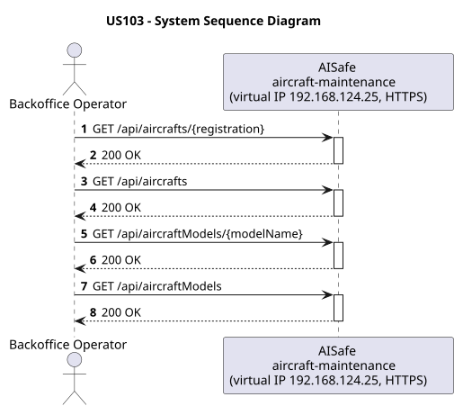
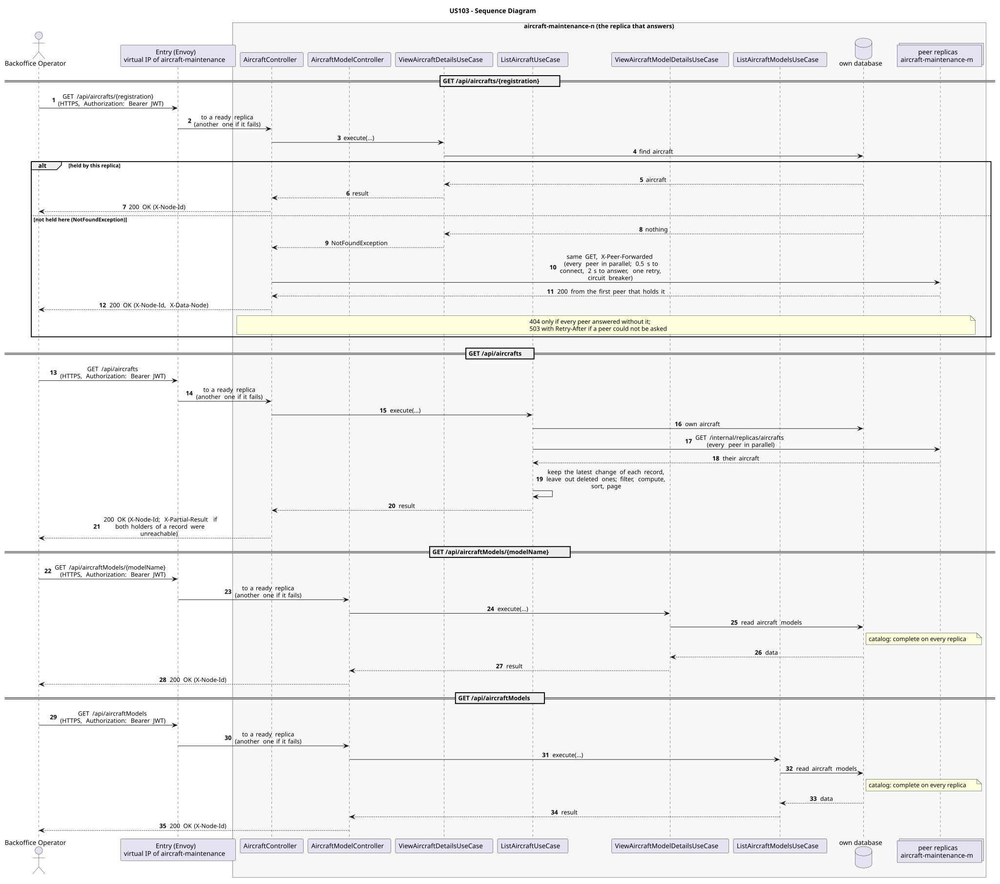

# US103 - View Aircraft Details

| Service              | Work package (monolith) | Monolith documentation                                                                    |
| -------------------- | ----------------------- | ----------------------------------------------------------------------------------------- |
| aircraft-maintenance | WP1A                    | [US103](../../../../../docs_monolith/system-documentation/use-cases/WP1A/US103/README.md) |

## User Story

> As an ATCC user or Backoffice Operator, I want to view the details of an aircraft by registration number.

## Endpoints

| Method | Route                             | Roles                     | Use case                          |
| ------ | --------------------------------- | ------------------------- | --------------------------------- |
| GET    | `/api/aircrafts/{registration}`   | Backoffice Operator, ATCC | `ViewAircraftDetailsUseCase`      |
| GET    | `/api/aircrafts`                  | ATCC, Backoffice Operator | `ListAircraftUseCase`             |
| GET    | `/api/aircraftModels/{modelName}` | Backoffice Operator, ATCC | `ViewAircraftModelDetailsUseCase` |
| GET    | `/api/aircraftModels`             | Backoffice Operator, ATCC | `ListAircraftModelsUseCase`       |

Through the virtual IP of the service, HTTPS only, with a JWT issued by the login.

## Acceptance Criteria

- The request path contains the aircraft registration number.
- The system returns the complete `ViewAircraftDetailsResponse` payload, including the version used for optimistic locking.
- If the aircraft does not exist, the system returns HTTP 404.
- On success the system returns HTTP 200 with HATEOAS links.

In the distributed system:

- The same answer whatever replica receives the request: one that does not hold the data asks its peers, and names the holder in `X-Data-Node`.
- The answer covers the records of every replica, not only those of the replica that answers.
- Any replica answers with the whole catalog, without asking its peers.
- Every request and its answer are in the audit trail of the replica that answered.

## Pre-conditions

- The actor is authenticated through the login (JWT) with a role allowed for the route (see Endpoints).
- At least one replica of the service is ready.

## Post-conditions

- No state change occurs; the use case is read-only.

## Main Success Scenario

**GET `/api/aircrafts/{registration}`**

1. The actor sends `GET /api/aircrafts/{registration}` with the JWT to the virtual IP of aircraft-maintenance (HTTPS); the entry (Envoy) of the machine that holds that IP passes it to a ready replica of aircraft-maintenance, and tries another replica if that one fails.
2. `ViewAircraftDetailsUseCase` looks for the aircraft in this replica's database.
3. If this replica holds it, it answers 200 with `X-Node-Id`. If not, it asks every peer in parallel (same request, marked `X-Peer-Forwarded`) and answers with the first holder's response, naming it in `X-Data-Node`.

**GET `/api/aircrafts`**

1. The actor sends `GET /api/aircrafts` with the JWT to the virtual IP of aircraft-maintenance (HTTPS); the entry (Envoy) of the machine that holds that IP passes it to a ready replica of aircraft-maintenance, and tries another replica if that one fails.
2. `ListAircraftUseCase` gathers the aircraft of every replica: its own, plus those of each peer (`GET /internal/replicas/{type}`, all peers in parallel), keeping the latest change of each record and leaving out deleted ones.
3. It filters, computes and sorts over the whole set, then answers 200.

**GET `/api/aircraftModels/{modelName}`**

1. The actor sends `GET /api/aircraftModels/{modelName}` with the JWT to the virtual IP of aircraft-maintenance (HTTPS); the entry (Envoy) of the machine that holds that IP passes it to a ready replica of aircraft-maintenance, and tries another replica if that one fails.
2. `ViewAircraftModelDetailsUseCase` reads the aircraft models from this replica's own database: the catalog is complete on every replica, so no peer is asked.
3. The replica answers 200 (with `X-Node-Id`).

**GET `/api/aircraftModels`**

1. The actor sends `GET /api/aircraftModels` with the JWT to the virtual IP of aircraft-maintenance (HTTPS); the entry (Envoy) of the machine that holds that IP passes it to a ready replica of aircraft-maintenance, and tries another replica if that one fails.
2. `ListAircraftModelsUseCase` reads the aircraft models from this replica's own database: the catalog is complete on every replica, so no peer is asked.
3. The replica answers 200 (with `X-Node-Id`).

## Alternative / Exception Flows

| Condition                                                                      | System Response                                                                           |
| ------------------------------------------------------------------------------ | ----------------------------------------------------------------------------------------- |
| Aircraft not found                                                             | HTTP 404                                                                                  |
| No valid token                                                                 | 401                                                                                       |
| The actor's role is not Backoffice Operator, ATCC                              | 403                                                                                       |
| No replica holds it, and every peer answered                                   | 404                                                                                       |
| No replica answered with it, and some peer could not be asked (it may hold it) | 503 with `Retry-After`, `X-Unreachable-Peers` (never a 404 for data that may exist)       |
| The replica that got the request stops answering                               | the entry repeats a read on another replica; a write only if it never reached the replica |
| The actor's role is not ATCC, Backoffice Operator                              | 403                                                                                       |
| Both replicas that hold some record could not be asked                         | 200 with `X-Partial-Result: true`                                                         |

## Distribution

- `GET /api/aircrafts/{registration}`: The aircraft is a **record**: it lives on two replicas, its home and the next one in the ring. Any replica answers: one that does not hold it forwards the read to its peers.
- `GET /api/aircrafts`: The answer covers **every replica**: the records are partitioned (each on two replicas), so the replica that answers gathers them from all of them (`AircraftAcrossReplicas`).
- `GET /api/aircraftModels/{modelName}`: The aircraft models are a **catalog**: every replica holds all of them, so any replica answers by itself.
- `GET /api/aircraftModels`: The aircraft models are a **catalog**: every replica holds all of them, so any replica answers by itself.

## Tests

Distributed end to end, in the [Postman collection](../../../../postman/README.md): folder 1. Local access, folder 2. Forwarding between replicas, folder 3. Aggregation over every replica, folder 4. Catalogs copied to every replica, folder 7. Access control (roles), folder 8. Failures: with a replica down.

## Sequence Diagrams

### System Sequence Diagram (SSD)

### Sequence Diagram (SD)

Sources: [`puml/ssd_us103.puml`](puml/ssd_us103.puml), [`puml/sd_us103.puml`](puml/sd_us103.puml).
