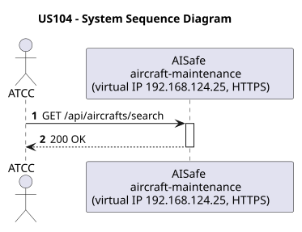
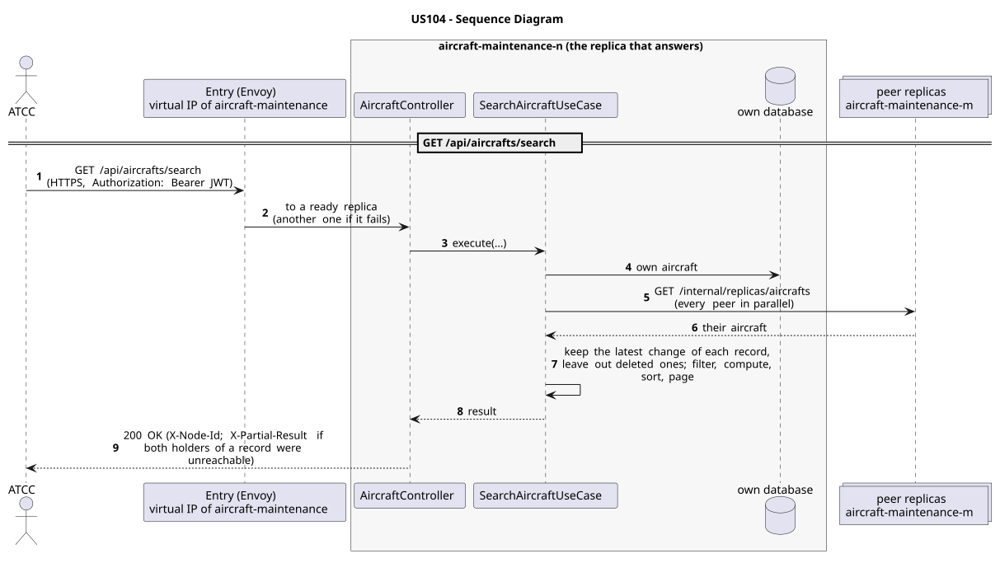

# US104 - Search Aircraft

| Service              | Work package (monolith) | Monolith documentation                                                                    |
| -------------------- | ----------------------- | ----------------------------------------------------------------------------------------- |
| aircraft-maintenance | WP1A                    | [US104](../../../../../docs_monolith/system-documentation/use-cases/WP1A/US104/README.md) |

## User Story

> As an ATCC user, I want to search aircraft by model, status, manufacturing year, and specific features so I can quickly filter the fleet. (Note: Incorporates requirements of bonus US224).

## Endpoints

| Method | Route                   | Roles | Use case                |
| ------ | ----------------------- | ----- | ----------------------- |
| GET    | `/api/aircrafts/search` | ATCC  | `SearchAircraftUseCase` |

Through the virtual IP of the service, HTTPS only, with a JWT issued by the login.

## Acceptance Criteria

- The search accepts optional `modelName`, `status`, `year`, and `feature` query parameters.
- Results are paginated.
- The response is a page of `SearchAircraftUseCaseResponse` DTOs.
- An empty result set still returns HTTP 200.

In the distributed system:

- The answer covers the records of every replica, not only those of the replica that answers.
- Every request and its answer are in the audit trail of the replica that answered.

## Pre-conditions

- The actor is authenticated through the login (JWT) with a role allowed for the route (see Endpoints).
- At least one replica of the service is ready.

## Post-conditions

- No state change occurs; the use case is read-only.

## Main Success Scenario

1. The actor sends `GET /api/aircrafts/search` with the JWT to the virtual IP of aircraft-maintenance (HTTPS); the entry (Envoy) of the machine that holds that IP passes it to a ready replica of aircraft-maintenance, and tries another replica if that one fails.
2. `SearchAircraftUseCase` gathers the aircraft of every replica: its own, plus those of each peer (`GET /internal/replicas/{type}`, all peers in parallel), keeping the latest change of each record and leaving out deleted ones.
3. It filters, computes and sorts over the whole set, then answers 200.

## Alternative / Exception Flows

| Condition                                              | System Response                                                                           |
| ------------------------------------------------------ | ----------------------------------------------------------------------------------------- |
| No aircraft match the filters                          | HTTP 200 with an empty page                                                               |
| No valid token                                         | 401                                                                                       |
| The actor's role is not ATCC                           | 403                                                                                       |
| Both replicas that hold some record could not be asked | 200 with `X-Partial-Result: true`                                                         |
| The replica that got the request stops answering       | the entry repeats a read on another replica; a write only if it never reached the replica |

## Distribution

The answer covers **every replica**: the records are partitioned (each on two replicas), so the replica that answers gathers them from all of them (`AircraftAcrossReplicas`).

## Tests

Not in the distributed Postman collection; covered by the unit and integration tests of aircraft-maintenance (`./mvnw test`), and served by the same forwarding, gathering and replication as the routes the collection does test.

## Sequence Diagrams

### System Sequence Diagram (SSD)

### Sequence Diagram (SD)

Sources: [`puml/ssd_us104.puml`](puml/ssd_us104.puml), [`puml/sd_us104.puml`](puml/sd_us104.puml).
