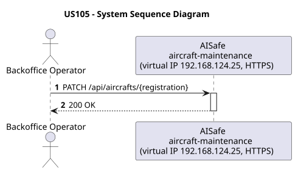
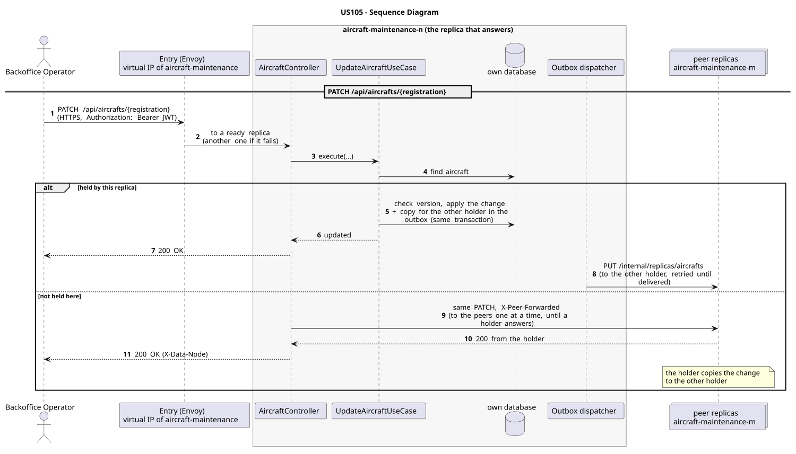

# US105 - Update Aircraft Status

| Service              | Work package (monolith) | Monolith documentation                                                                    |
| -------------------- | ----------------------- | ----------------------------------------------------------------------------------------- |
| aircraft-maintenance | WP1A                    | [US105](../../../../../docs_monolith/system-documentation/use-cases/WP1A/US105/README.md) |

## User Story

> As an ATCC user, I want to update an aircraft's status so the fleet view stays in sync with the current operational state.

## Endpoints

| Method | Route                           | Roles               | Use case                |
| ------ | ------------------------------- | ------------------- | ----------------------- |
| PATCH  | `/api/aircrafts/{registration}` | Backoffice Operator | `UpdateAircraftUseCase` |

Through the virtual IP of the service, HTTPS only, with a JWT issued by the login.

## Changes from the monolith

- The monolith's documentation names the ATCC, but its security rule for `PATCH /api/aircrafts/{registration}` was already the Backoffice Operator's (the ATCC rule was for a `/status` route that no controller had); the services keep that rule.

## Acceptance Criteria

- The request body only needs the new status value.
- The request must include the current resource version in the `If-Match` header.
- If the version does not match, the system returns HTTP 412.
- If the status is invalid, the system returns HTTP 400.
- On success the system returns HTTP 200 with `ViewAircraftDetailsResponse` and HATEOAS links.

In the distributed system:

- The change can be sent to any replica: one that does not hold the record passes it on to one that does.
- Every request and its answer are in the audit trail of the replica that answered.

## Pre-conditions

- The actor is authenticated through the login (JWT) with a role allowed for the route (see Endpoints).
- The target aircraft exists.
- At least one replica of the service is ready.

## Post-conditions

- The aircraft status is updated and the entity version is incremented.
- The change is on both replicas that hold the record once the outbox delivers it.

## Main Success Scenario

1. The actor sends `PATCH /api/aircrafts/{registration}` with the JWT to the virtual IP of aircraft-maintenance (HTTPS); the entry (Envoy) of the machine that holds that IP passes it to a ready replica of aircraft-maintenance, and tries another replica if that one fails.
2. If this replica holds the aircraft, `UpdateAircraftUseCase` applies the change (checking the version when the request carries one) and stores, in the same transaction, a copy for the other holder in the outbox; it answers 200.
3. If it does not hold it, the replica sends the same request to its peers one at a time until one that holds it answers, and returns that answer.
4. The outbox delivers the change to the other holder (`PUT /internal/replicas/aircrafts`).

## Alternative / Exception Flows

| Condition                                        | System Response                                                                           |
| ------------------------------------------------ | ----------------------------------------------------------------------------------------- |
| `If-Match` header is missing or invalid          | HTTP 400                                                                                  |
| Aircraft not found                               | HTTP 404                                                                                  |
| Version mismatch                                 | HTTP 412                                                                                  |
| Invalid status value                             | HTTP 400                                                                                  |
| No valid token                                   | 401                                                                                       |
| The actor's role is not Backoffice Operator      | 403                                                                                       |
| No replica holds it (every peer answered)        | 404                                                                                       |
| The replica that got the request stops answering | the entry repeats a read on another replica; a write only if it never reached the replica |

## Distribution

The aircraft is a **record** on two replicas: the change is applied on one of them and copied to the other.

## Tests

Not in the distributed Postman collection; covered by the unit and integration tests of aircraft-maintenance (`./mvnw test`), and served by the same forwarding, gathering and replication as the routes the collection does test.

## Sequence Diagrams

### System Sequence Diagram (SSD)

### Sequence Diagram (SD)

Sources: [`puml/ssd_us105.puml`](puml/ssd_us105.puml), [`puml/sd_us105.puml`](puml/sd_us105.puml).
