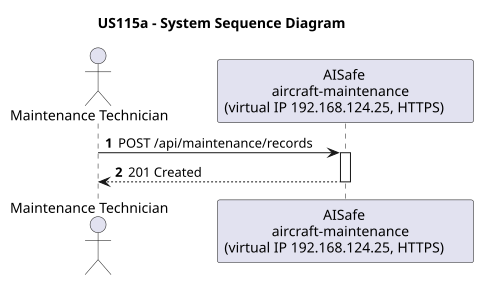
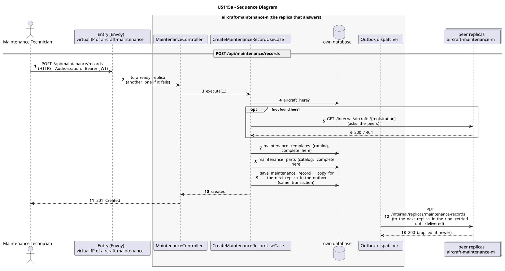

# US115a - Create a Maintenance Record

| Service              | Work package (monolith) | Monolith documentation                                                                      |
| -------------------- | ----------------------- | ------------------------------------------------------------------------------------------- |
| aircraft-maintenance | WP4A                    | [US115a](../../../../../docs_monolith/system-documentation/use-cases/WP4A/US115a/README.md) |

## User Story

> As a Maintenance Technician, I want to create a maintenance record for an aircraft so that the work performed is stored with its status and duration.

## Endpoints

| Method | Route                      | Roles                  | Use case                         |
| ------ | -------------------------- | ---------------------- | -------------------------------- |
| POST   | `/api/maintenance/records` | Maintenance Technician | `CreateMaintenanceRecordUseCase` |

Through the virtual IP of the service, HTTPS only, with a JWT issued by the login.

## Acceptance Criteria

- The request must provide `description`, `startDate`, `expectedDuration`, `part`, `template`, `status`, and `registrationNumber`.
- `part` is the part number of an existing maintenance part.
- `template` is the name of an existing maintenance template.
- `registrationNumber` must identify an existing aircraft.
- Duplicate records with the same start date, part, and template are rejected with HTTP 409.
- On success the system returns HTTP 201 with `MaintenanceRecordResponse` and HATEOAS links.

In the distributed system:

- The new record is on two replicas once the copy is delivered (normally right after the answer).
- Every request and its answer are in the audit trail of the replica that answered.

## Pre-conditions

- The actor is authenticated through the login (JWT) with a role allowed for the route (see Endpoints).
- The referenced aircraft, part, and template all exist.
- At least one replica of the service is ready.

## Post-conditions

- A new `MaintenanceRecord` entity is persisted.
- The record is linked to the aircraft, template, and part.
- The change is on both replicas that hold the record once the outbox delivers it.

## Main Success Scenario

1. The actor sends `POST /api/maintenance/records` with the JWT to the virtual IP of aircraft-maintenance (HTTPS); the entry (Envoy) of the machine that holds that IP passes it to a ready replica of aircraft-maintenance, and tries another replica if that one fails.
2. `CreateMaintenanceRecordUseCase` validates the request and checks that the aircraft exists: in its own database and, if not found there, on its peers (`GET /internal/aircrafts/{registration}`). The maintenance templates, maintenance parts come from its own copy of the catalog.
3. It stores the maintenance record on this replica (its home) and, in the same transaction, a copy for the next replica in the ring in the outbox; it answers 201.
4. Right after the commit the outbox sends the copy (`PUT /internal/replicas/maintenance-records`), retrying until it is delivered.

## Alternative / Exception Flows

| Condition                                             | System Response                                                                           |
| ----------------------------------------------------- | ----------------------------------------------------------------------------------------- |
| Part not found                                        | HTTP 404                                                                                  |
| Template not found                                    | HTTP 404                                                                                  |
| Aircraft not found                                    | HTTP 404                                                                                  |
| Equivalent record already exists                      | HTTP 409                                                                                  |
| No valid token                                        | 401                                                                                       |
| The actor's role is not Maintenance Technician        | 403                                                                                       |
| A peer could not be asked during the uniqueness check | the check is best effort: during a network partition a duplicate can get through          |
| The replica that got the request stops answering      | the entry repeats a read on another replica; a write only if it never reached the replica |

## Distribution

The maintenance record is a **record**: it stays on the replica that created it and on the next one in the ring, and is never forwarded on creation. Its key (random UUID) cannot be given twice by two replicas.

## Tests

Not in the distributed Postman collection; covered by the unit and integration tests of aircraft-maintenance (`./mvnw test`), and served by the same forwarding, gathering and replication as the routes the collection does test.

## Sequence Diagrams

### System Sequence Diagram (SSD)

### Sequence Diagram (SD)

Sources: [`puml/ssd_us115a.puml`](puml/ssd_us115a.puml), [`puml/sd_us115a.puml`](puml/sd_us115a.puml).
