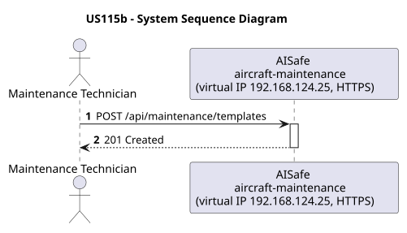
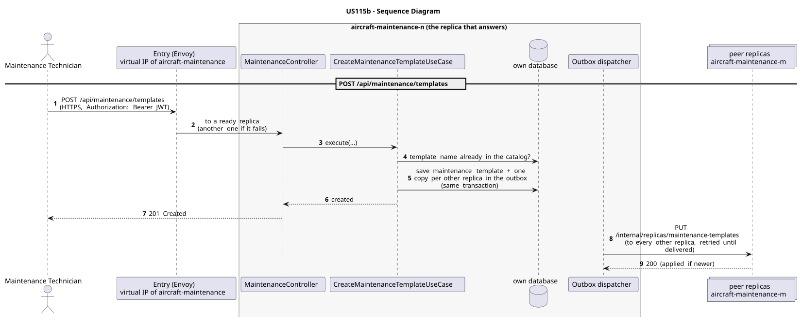

# US115b - Create Maintenance Templates

| Service              | Work package (monolith) | Monolith documentation                                                                      |
| -------------------- | ----------------------- | ------------------------------------------------------------------------------------------- |
| aircraft-maintenance | WP4A                    | [US115b](../../../../../docs_monolith/system-documentation/use-cases/WP4A/US115b/README.md) |

## User Story

> As a Maintenance Technician, I want to create maintenance templates so that recurring maintenance work can be reused across compatible aircraft models.

## Endpoints

| Method | Route                        | Roles                  | Use case                           |
| ------ | ---------------------------- | ---------------------- | ---------------------------------- |
| POST   | `/api/maintenance/templates` | Maintenance Technician | `CreateMaintenanceTemplateUseCase` |

Through the virtual IP of the service, HTTPS only, with a JWT issued by the login.

## Acceptance Criteria

- The request must provide `name`, `templateType`, `applicableModels`, `checklist`, `intervalFlightHours`, and `intervalDays`.
- `applicableModels` is a list of aircraft model names, not IDs.
- Each model name must exist in the aircraft model catalog.
- Template names must be unique.
- On success the system returns HTTP 201 with the persisted `MaintenanceTemplate` representation.

In the distributed system:

- The new entry reaches every replica once the copies are delivered (normally right after the answer).
- Every request and its answer are in the audit trail of the replica that answered.

## Pre-conditions

- The actor is authenticated through the login (JWT) with a role allowed for the route (see Endpoints).
- All referenced aircraft model names exist.
- At least one replica of the service is ready.

## Post-conditions

- A new `MaintenanceTemplate` entity is persisted with its applicable models and checklist.
- The change is on every replica once the outbox delivers it.

## Main Success Scenario

1. The actor sends `POST /api/maintenance/templates` with the JWT to the virtual IP of aircraft-maintenance (HTTPS); the entry (Envoy) of the machine that holds that IP passes it to a ready replica of aircraft-maintenance, and tries another replica if that one fails.
2. `CreateMaintenanceTemplateUseCase` validates the request and checks that no maintenance template with the same template name exists (the catalog is complete on every replica).
3. It stores the maintenance template and, in the same transaction, one copy for every other replica in the outbox; it answers 201.
4. Right after the commit the outbox sends the copies (`PUT /internal/replicas/maintenance-templates`), retrying until each one is delivered.

## Alternative / Exception Flows

| Condition                                        | System Response                                                                           |
| ------------------------------------------------ | ----------------------------------------------------------------------------------------- |
| One of the model names does not exist            | HTTP 404                                                                                  |
| Template name already exists                     | HTTP 409                                                                                  |
| No valid token                                   | 401                                                                                       |
| The actor's role is not Maintenance Technician   | 403                                                                                       |
| The replica that got the request stops answering | the entry repeats a read on another replica; a write only if it never reached the replica |

## Distribution

The maintenance template belongs to a **catalog**: every replica holds all of it, and every change is copied to all of them (last writer wins).

## Tests

Not in the distributed Postman collection; covered by the unit and integration tests of aircraft-maintenance (`./mvnw test`), and served by the same forwarding, gathering and replication as the routes the collection does test.

## Sequence Diagrams

### System Sequence Diagram (SSD)

### Sequence Diagram (SD)

Sources: [`puml/ssd_us115b.puml`](puml/ssd_us115b.puml), [`puml/sd_us115b.puml`](puml/sd_us115b.puml).
