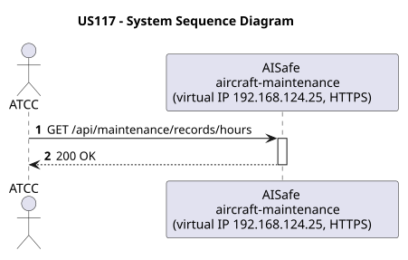
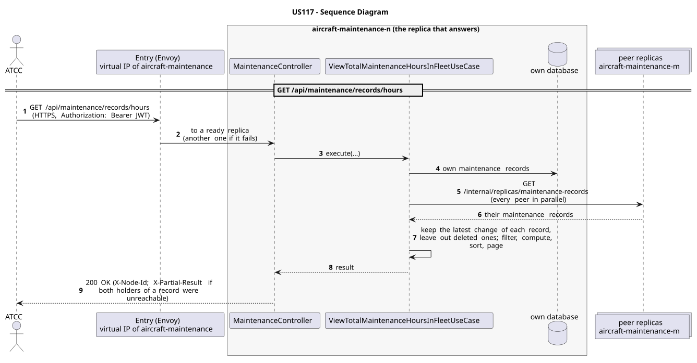

# US117 - View Total Maintenance Hours for the Fleet

| Service              | Work package (monolith) | Monolith documentation                                                                    |
| -------------------- | ----------------------- | ----------------------------------------------------------------------------------------- |
| aircraft-maintenance | WP4A                    | [US117](../../../../../docs_monolith/system-documentation/use-cases/WP4A/US117/README.md) |

## User Story

> As an ATCC, I want to view the total maintenance hours for the fleet so that I can understand the overall maintenance effort.

## Endpoints

| Method | Route                            | Roles | Use case                                  |
| ------ | -------------------------------- | ----- | ----------------------------------------- |
| GET    | `/api/maintenance/records/hours` | ATCC  | `ViewTotalMaintenanceHoursInFleetUseCase` |

Through the virtual IP of the service, HTTPS only, with a JWT issued by the login.

## Acceptance Criteria

- The system returns a single `ViewTotalMaintenanceHoursinFleetResponse` payload.
- The total is calculated from the sum of all maintenance record expected durations.
- The endpoint always returns HTTP 200.

In the distributed system:

- The answer covers the records of every replica, not only those of the replica that answers.
- Every request and its answer are in the audit trail of the replica that answered.

## Pre-conditions

- The actor is authenticated through the login (JWT) with a role allowed for the route (see Endpoints).
- At least one replica of the service is ready.

## Post-conditions

- No state change occurs; the use case is read-only.

## Main Success Scenario

1. The actor sends `GET /api/maintenance/records/hours` with the JWT to the virtual IP of aircraft-maintenance (HTTPS); the entry (Envoy) of the machine that holds that IP passes it to a ready replica of aircraft-maintenance, and tries another replica if that one fails.
2. `ViewTotalMaintenanceHoursInFleetUseCase` gathers the maintenance records of every replica: its own, plus those of each peer (`GET /internal/replicas/{type}`, all peers in parallel), keeping the latest change of each record and leaving out deleted ones.
3. It filters, computes and sorts over the whole set, then answers 200.

## Alternative / Exception Flows

| Condition                                              | System Response                                                                           |
| ------------------------------------------------------ | ----------------------------------------------------------------------------------------- |
| No maintenance records exist                           | HTTP 200 with total hours equal to 0                                                      |
| No valid token                                         | 401                                                                                       |
| The actor's role is not ATCC                           | 403                                                                                       |
| Both replicas that hold some record could not be asked | 200 with `X-Partial-Result: true`                                                         |
| The replica that got the request stops answering       | the entry repeats a read on another replica; a write only if it never reached the replica |

## Distribution

The answer covers **every replica**: the records are partitioned (each on two replicas), so the replica that answers gathers them from all of them (`MaintenanceRecordsAcrossReplicas`).

## Tests

Distributed end to end, in the [Postman collection](../../../../postman/README.md): folder 3. Aggregation over every replica.

## Sequence Diagrams

### System Sequence Diagram (SSD)

### Sequence Diagram (SD)

Sources: [`puml/ssd_us117.puml`](puml/ssd_us117.puml), [`puml/sd_us117.puml`](puml/sd_us117.puml).
