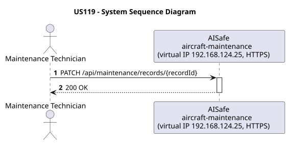
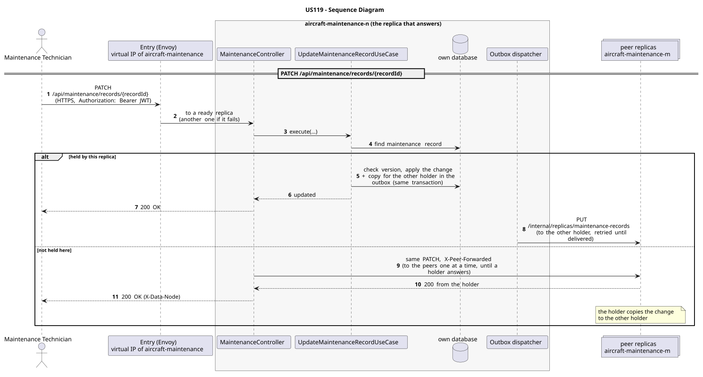

# US119 - Update Maintenance Record

| Service              | Work package (monolith) | Monolith documentation                                                                    |
| -------------------- | ----------------------- | ----------------------------------------------------------------------------------------- |
| aircraft-maintenance | WP4A                    | [US119](../../../../../docs_monolith/system-documentation/use-cases/WP4A/US119/README.md) |

## User Story

> As a Maintenance Technician, I want to update a maintenance record's status and notes so that I can close or progress the work item.

## Endpoints

| Method | Route                                 | Roles                  | Use case                         |
| ------ | ------------------------------------- | ---------------------- | -------------------------------- |
| PATCH  | `/api/maintenance/records/{recordId}` | Maintenance Technician | `UpdateMaintenanceRecordUseCase` |

Through the virtual IP of the service, HTTPS only, with a JWT issued by the login.

## Acceptance Criteria

- The path identifies the record by ID.
- The request body requires a `status` value and may include `notes`.
- The request must include the current resource version in the `If-Match` header.
- A version mismatch returns HTTP 412.
- On success the system returns HTTP 200 with `MaintenanceRecordResponse` and HATEOAS links.

In the distributed system:

- The change can be sent to any replica: one that does not hold the record passes it on to one that does.
- Every request and its answer are in the audit trail of the replica that answered.

## Pre-conditions

- The actor is authenticated through the login (JWT) with a role allowed for the route (see Endpoints).
- The target maintenance record exists.
- At least one replica of the service is ready.

## Post-conditions

- The maintenance record status is updated.
- The notes are replaced only when a non-blank value is provided.
- The change is on both replicas that hold the record once the outbox delivers it.

## Main Success Scenario

1. The actor sends `PATCH /api/maintenance/records/{recordId}` with the JWT to the virtual IP of aircraft-maintenance (HTTPS); the entry (Envoy) of the machine that holds that IP passes it to a ready replica of aircraft-maintenance, and tries another replica if that one fails.
2. If this replica holds the maintenance record, `UpdateMaintenanceRecordUseCase` applies the change (checking the version when the request carries one) and stores, in the same transaction, a copy for the other holder in the outbox; it answers 200.
3. If it does not hold it, the replica sends the same request to its peers one at a time until one that holds it answers, and returns that answer.
4. The outbox delivers the change to the other holder (`PUT /internal/replicas/maintenance-records`).

## Alternative / Exception Flows

| Condition                                        | System Response                                                                           |
| ------------------------------------------------ | ----------------------------------------------------------------------------------------- |
| `If-Match` header is missing or invalid          | HTTP 400                                                                                  |
| Maintenance record not found                     | HTTP 404                                                                                  |
| Version mismatch                                 | HTTP 412                                                                                  |
| Status is null                                   | HTTP 400                                                                                  |
| No valid token                                   | 401                                                                                       |
| The actor's role is not Maintenance Technician   | 403                                                                                       |
| No replica holds it (every peer answered)        | 404                                                                                       |
| The replica that got the request stops answering | the entry repeats a read on another replica; a write only if it never reached the replica |

## Distribution

The maintenance record is a **record** on two replicas: the change is applied on one of them and copied to the other.

## Tests

Not in the distributed Postman collection; covered by the unit and integration tests of aircraft-maintenance (`./mvnw test`), and served by the same forwarding, gathering and replication as the routes the collection does test.

## Sequence Diagrams

### System Sequence Diagram (SSD)

### Sequence Diagram (SD)

Sources: [`puml/ssd_us119.puml`](puml/ssd_us119.puml), [`puml/sd_us119.puml`](puml/sd_us119.puml).
