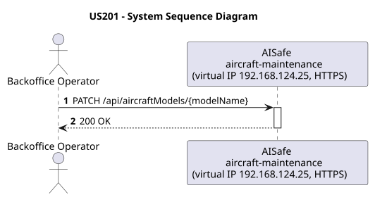
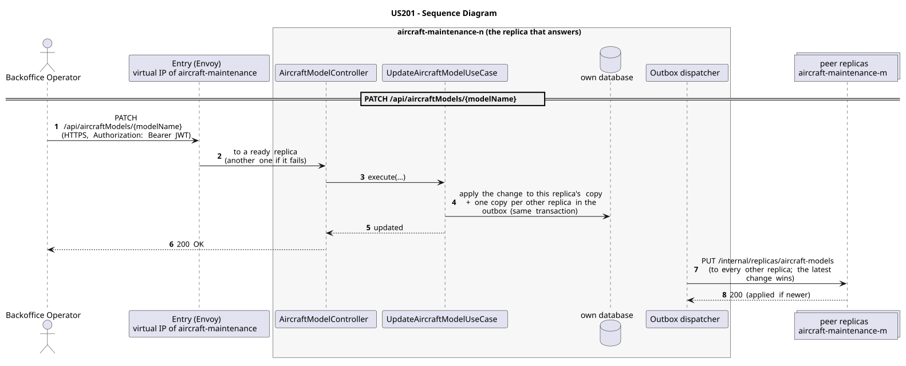

# US201 - Update Aircraft Model Details

| Service              | Work package (monolith) | Monolith documentation                                                                    |
| -------------------- | ----------------------- | ----------------------------------------------------------------------------------------- |
| aircraft-maintenance | WP1B                    | [US201](../../../../../docs_monolith/system-documentation/use-cases/WP1B/US201/README.md) |

## User Story

> As a Backoffice Operator, I want to update the specifications of an aircraft model to correct errors or reflect manufacturer updates.

## Endpoints

| Method | Route                             | Roles               | Use case                     |
| ------ | --------------------------------- | ------------------- | ---------------------------- |
| PATCH  | `/api/aircraftModels/{modelName}` | Backoffice Operator | `UpdateAircraftModelUseCase` |

Through the virtual IP of the service, HTTPS only, with a JWT issued by the login.

## Acceptance Criteria

- The request must specify the model by its `modelName` in the URL.
- Optional fields for update include `maxRange`, `fuelCapacity`, `cruisingSpeed`, and `maximumSeatingCapacity`.
- Numeric fields must be positive if provided.
- On success, the system returns HTTP 200 with the updated `AircraftModelResponse`.

In the distributed system:

- The change reaches every replica; of two concurrent changes, the latest wins.
- Every request and its answer are in the audit trail of the replica that answered.

## Pre-conditions

- The actor is authenticated through the login (JWT) with a role allowed for the route (see Endpoints).
- The aircraft model with the given name exists.
- At least one replica of the service is ready.

## Post-conditions

- The aircraft model's specifications are updated in the database.
- The change is on every replica once the outbox delivers it.

## Main Success Scenario

1. The actor sends `PATCH /api/aircraftModels/{modelName}` with the JWT to the virtual IP of aircraft-maintenance (HTTPS); the entry (Envoy) of the machine that holds that IP passes it to a ready replica of aircraft-maintenance, and tries another replica if that one fails.
2. `UpdateAircraftModelUseCase` applies the change to this replica's copy of the aircraft model (every replica has the catalog) and stores, in the same transaction, one copy for every other replica in the outbox; it answers 200.
3. The outbox delivers the change to every other replica (`PUT /internal/replicas/aircraft-models`); the latest change wins.

## Alternative / Exception Flows

| Condition                                        | System Response                                                                           |
| ------------------------------------------------ | ----------------------------------------------------------------------------------------- |
| Aircraft model not found                         | HTTP 404                                                                                  |
| Invalid numeric values                           | HTTP 400                                                                                  |
| No valid token                                   | 401                                                                                       |
| The actor's role is not Backoffice Operator      | 403                                                                                       |
| The replica that got the request stops answering | the entry repeats a read on another replica; a write only if it never reached the replica |

## Distribution

The aircraft model belongs to a **catalog**: every replica holds all of it, and every change is copied to all of them (last writer wins).

## Tests

Not in the distributed Postman collection; covered by the unit and integration tests of aircraft-maintenance (`./mvnw test`), and served by the same forwarding, gathering and replication as the routes the collection does test.

## Sequence Diagrams

### System Sequence Diagram (SSD)

### Sequence Diagram (SD)

Sources: [`puml/ssd_us201.puml`](puml/ssd_us201.puml), [`puml/sd_us201.puml`](puml/sd_us201.puml).
