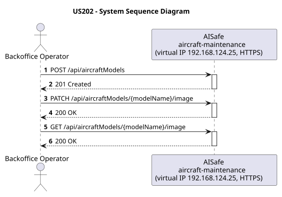
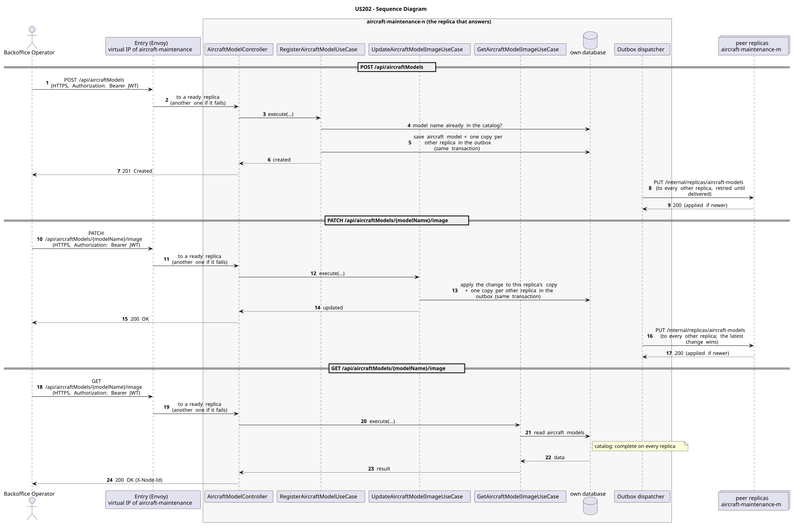

# US202 - Register Aircraft Model with Optional Image

| Service              | Work package (monolith) | Monolith documentation                                                                    |
| -------------------- | ----------------------- | ----------------------------------------------------------------------------------------- |
| aircraft-maintenance | WP1B                    | [US202](../../../../../docs_monolith/system-documentation/use-cases/WP1B/US202/README.md) |

## User Story

> As a Backoffice Operator, I want to register an aircraft model with an optional image and manage that image independently, so that the catalog can display aircraft model photos alongside technical specifications.

## Endpoints

| Method | Route                                         | Roles                     | Use case                          |
| ------ | --------------------------------------------- | ------------------------- | --------------------------------- |
| POST   | `/api/aircraftModels` (multipart, with image) | Backoffice Operator       | `RegisterAircraftModelUseCase`    |
| PATCH  | `/api/aircraftModels/{modelName}/image`       | Backoffice Operator       | `UpdateAircraftModelImageUseCase` |
| GET    | `/api/aircraftModels/{modelName}/image`       | Backoffice Operator, ATCC | `GetAircraftModelImageUseCase`    |

Through the virtual IP of the service, HTTPS only, with a JWT issued by the login.

## Acceptance Criteria

- A `POST /api/aircraftModels` with `Content-Type: multipart/form-data` accepts the same model fields as the JSON path plus an optional `image` file part.
- A `POST /api/aircraftModels` with `Content-Type: application/json` that includes an `image` field returns HTTP 400 with a message directing the client to use multipart/form-data.
- Only files with a MIME type starting with `image/` are accepted; any other type returns HTTP 400.
- `AircraftModelResponse` carries a `hasImage: boolean` flag instead of raw bytes (no Base64 in the main response).
- `PATCH /api/aircraftModels/{modelName}/image` replaces or sets the image for an existing model and returns the updated `AircraftModelResponse`.
- `GET /api/aircraftModels/{modelName}/image` returns the raw image bytes with the original `Content-Type` header (e.g. `image/jpeg`).
- `GET /api/aircraftModels/{modelName}/image` on a model with no image returns HTTP 404.

In the distributed system:

- The new entry reaches every replica once the copies are delivered (normally right after the answer).
- The change reaches every replica; of two concurrent changes, the latest wins.
- Any replica answers with the whole catalog, without asking its peers.
- Every request and its answer are in the audit trail of the replica that answered.

## Pre-conditions

- The actor is authenticated through the login (JWT) with a role allowed for the route (see Endpoints).
- For PATCH and GET: an aircraft model with the given name exists.
- At least one replica of the service is ready.

## Post-conditions

- On multipart POST: a new `AircraftModel` is persisted with the optional `AircraftModelImage` value object.
- On PATCH: the existing model's image is replaced in the database.
- On GET: no state change; the stored bytes are returned as-is.
- The change is on every replica once the outbox delivers it.

## Main Success Scenario

**POST `/api/aircraftModels`**

1. The actor sends `POST /api/aircraftModels` with the JWT to the virtual IP of aircraft-maintenance (HTTPS); the entry (Envoy) of the machine that holds that IP passes it to a ready replica of aircraft-maintenance, and tries another replica if that one fails.
2. `RegisterAircraftModelUseCase` validates the request and checks that no aircraft model with the same model name exists (the catalog is complete on every replica).
3. It stores the aircraft model and, in the same transaction, one copy for every other replica in the outbox; it answers 201.
4. Right after the commit the outbox sends the copies (`PUT /internal/replicas/aircraft-models`), retrying until each one is delivered.

**PATCH `/api/aircraftModels/{modelName}/image`**

1. The actor sends `PATCH /api/aircraftModels/{modelName}/image` with the JWT to the virtual IP of aircraft-maintenance (HTTPS); the entry (Envoy) of the machine that holds that IP passes it to a ready replica of aircraft-maintenance, and tries another replica if that one fails.
2. `UpdateAircraftModelImageUseCase` applies the change to this replica's copy of the aircraft model (every replica has the catalog) and stores, in the same transaction, one copy for every other replica in the outbox; it answers 200.
3. The outbox delivers the change to every other replica (`PUT /internal/replicas/aircraft-models`); the latest change wins.

**GET `/api/aircraftModels/{modelName}/image`**

1. The actor sends `GET /api/aircraftModels/{modelName}/image` with the JWT to the virtual IP of aircraft-maintenance (HTTPS); the entry (Envoy) of the machine that holds that IP passes it to a ready replica of aircraft-maintenance, and tries another replica if that one fails.
2. `GetAircraftModelImageUseCase` reads the aircraft models from this replica's own database: the catalog is complete on every replica, so no peer is asked.
3. The replica answers 200 (with `X-Node-Id`).

## Alternative / Exception Flows

| Condition                                         | System Response                                                                           |
| ------------------------------------------------- | ----------------------------------------------------------------------------------------- |
| Uploaded file MIME type is not `image/*`          | HTTP 400                                                                                  |
| JSON POST includes `image` field                  | HTTP 400 - hint to use multipart/form-data                                                |
| Model name already exists                         | HTTP 409 Conflict                                                                         |
| PATCH / GET: model name not found                 | HTTP 404                                                                                  |
| GET: model has no image                           | HTTP 404                                                                                  |
| No valid token                                    | 401                                                                                       |
| The actor's role is not Backoffice Operator       | 403                                                                                       |
| The replica that got the request stops answering  | the entry repeats a read on another replica; a write only if it never reached the replica |
| The actor's role is not Backoffice Operator, ATCC | 403                                                                                       |

## Distribution

- `POST /api/aircraftModels`: The aircraft model belongs to a **catalog**: every replica holds all of it, and every change is copied to all of them (last writer wins).
- `PATCH /api/aircraftModels/{modelName}/image`: The aircraft model belongs to a **catalog**: every replica holds all of it, and every change is copied to all of them (last writer wins).
- `GET /api/aircraftModels/{modelName}/image`: The aircraft models are a **catalog**: every replica holds all of them, so any replica answers by itself.

## Tests

Not in the distributed Postman collection; covered by the unit and integration tests of aircraft-maintenance (`./mvnw test`), and served by the same forwarding, gathering and replication as the routes the collection does test.

## Sequence Diagrams

### System Sequence Diagram (SSD)

### Sequence Diagram (SD)

Sources: [`puml/ssd_us202.puml`](puml/ssd_us202.puml), [`puml/sd_us202.puml`](puml/sd_us202.puml).
