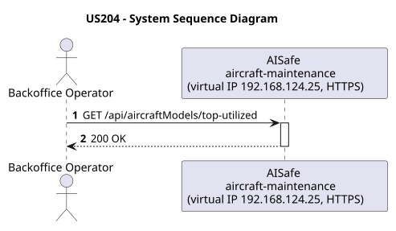
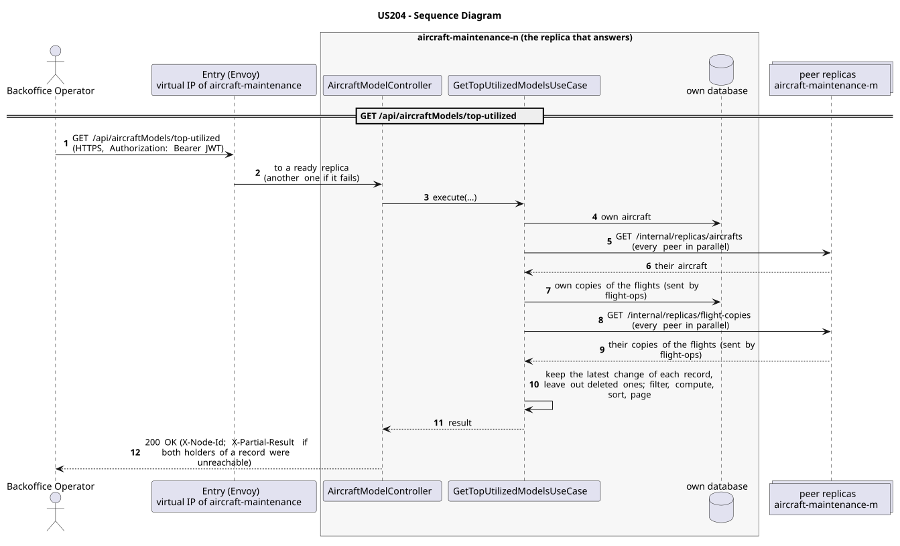

# US204 - Top 5 Most Utilized Aircraft Models

| Service              | Work package (monolith) | Monolith documentation                                                                    |
| -------------------- | ----------------------- | ----------------------------------------------------------------------------------------- |
| aircraft-maintenance | WP1B                    | [US204](../../../../../docs_monolith/system-documentation/use-cases/WP1B/US204/README.md) |

## User Story

> As a Backoffice Operator, I want to view the top 5 most utilized aircraft models so that I can analyze fleet utilization trends.

## Endpoints

| Method | Route                              | Roles               | Use case                      |
| ------ | ---------------------------------- | ------------------- | ----------------------------- |
| GET    | `/api/aircraftModels/top-utilized` | Backoffice Operator | `GetTopUtilizedModelsUseCase` |

Through the virtual IP of the service, HTTPS only, with a JWT issued by the login.

## Acceptance Criteria

- The request can filter by a `criteria` query parameter: either `HOURS` (flight hours) or `ASSIGNMENTS` (number of flight assignments).
- Defaults to `HOURS` if no criteria is provided.
- Returns a list of up to 5 aircraft models with their corresponding utilization metric.
- The aggregation is done over the aircraft and the flight copies gathered from every replica (in the monolith, by the database).
- The system returns HTTP 200.

In the distributed system:

- The answer covers the records of every replica, not only those of the replica that answers.
- Every request and its answer are in the audit trail of the replica that answered.

## Pre-conditions

- The actor is authenticated through the login (JWT) with a role allowed for the route (see Endpoints).
- At least one replica of the service is ready.

## Post-conditions

- No state change occurs; the use case is read-only.

## Main Success Scenario

1. The actor sends `GET /api/aircraftModels/top-utilized` with the JWT to the virtual IP of aircraft-maintenance (HTTPS); the entry (Envoy) of the machine that holds that IP passes it to a ready replica of aircraft-maintenance, and tries another replica if that one fails.
2. `GetTopUtilizedModelsUseCase` gathers the aircraft, the copies of the flights (sent by flight-ops) of every replica: its own, plus those of each peer (`GET /internal/replicas/{type}`, all peers in parallel), keeping the latest change of each record and leaving out deleted ones.
3. It filters, computes and sorts over the whole set, then answers 200.

## Alternative / Exception Flows

| Condition                                              | System Response                                                                           |
| ------------------------------------------------------ | ----------------------------------------------------------------------------------------- |
| No valid token                                         | 401                                                                                       |
| The actor's role is not Backoffice Operator            | 403                                                                                       |
| Both replicas that hold some record could not be asked | 200 with `X-Partial-Result: true`                                                         |
| The replica that got the request stops answering       | the entry repeats a read on another replica; a write only if it never reached the replica |

## Distribution

The answer covers **every replica**: the records are partitioned (each on two replicas), so the replica that answers gathers them from all of them (`AircraftAcrossReplicas`, `FlightCopiesAcrossReplicas`).

## Tests

Not in the distributed Postman collection; covered by the unit and integration tests of aircraft-maintenance (`./mvnw test`), and served by the same forwarding, gathering and replication as the routes the collection does test.

## Sequence Diagrams

### System Sequence Diagram (SSD)

### Sequence Diagram (SD)

Sources: [`puml/ssd_us204.puml`](puml/ssd_us204.puml), [`puml/sd_us204.puml`](puml/sd_us204.puml).
