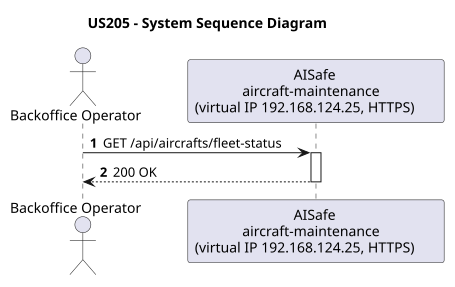
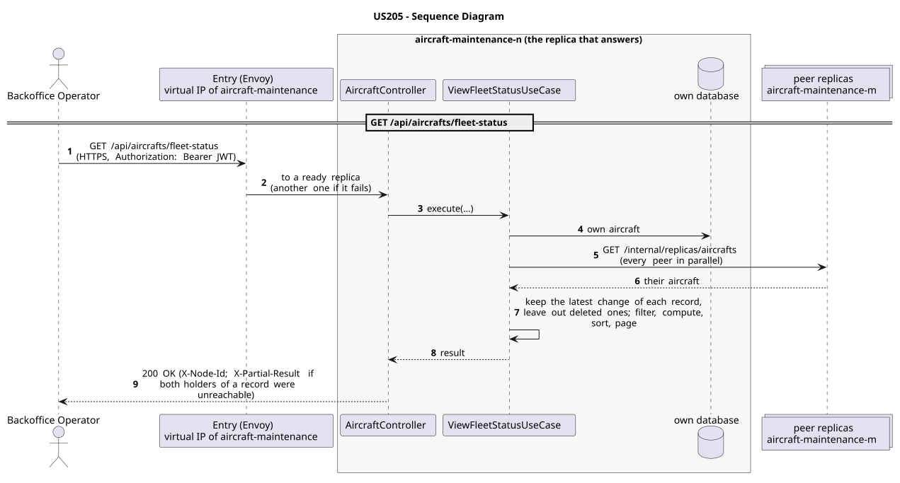

# US205 - View Fleet Status

| Service              | Work package (monolith) | Monolith documentation                                                                    |
| -------------------- | ----------------------- | ----------------------------------------------------------------------------------------- |
| aircraft-maintenance | WP1B                    | [US205](../../../../../docs_monolith/system-documentation/use-cases/WP1B/US205/README.md) |

## User Story

> As an ATCC, I want to view the status of all aircraft in the fleet so that I can assess operational availability at a glance.

## Endpoints

| Method | Route                         | Roles                     | Use case                 |
| ------ | ----------------------------- | ------------------------- | ------------------------ |
| GET    | `/api/aircrafts/fleet-status` | Backoffice Operator, ATCC | `ViewFleetStatusUseCase` |

Through the virtual IP of the service, HTTPS only, with a JWT issued by the login.

## Acceptance Criteria

- The endpoint requires no path or query parameters.
- The response groups all aircraft by their current status (AVAILABLE, INACTIVE, UNDER_MAINTENANCE, IN_FLIGHT).
- Each group includes the list of registration numbers in that status.
- The total count per group is included in the response.
- On success the system returns HTTP 200 with a `FleetStatusResponse` payload.

In the distributed system:

- The answer covers the records of every replica, not only those of the replica that answers.
- Every request and its answer are in the audit trail of the replica that answered.

## Pre-conditions

- The actor is authenticated through the login (JWT) with a role allowed for the route (see Endpoints).
- At least one replica of the service is ready.

## Post-conditions

- No state change occurs; the use case is read-only.

## Main Success Scenario

1. The actor sends `GET /api/aircrafts/fleet-status` with the JWT to the virtual IP of aircraft-maintenance (HTTPS); the entry (Envoy) of the machine that holds that IP passes it to a ready replica of aircraft-maintenance, and tries another replica if that one fails.
2. `ViewFleetStatusUseCase` gathers the aircraft of every replica: its own, plus those of each peer (`GET /internal/replicas/{type}`, all peers in parallel), keeping the latest change of each record and leaving out deleted ones.
3. It filters, computes and sorts over the whole set, then answers 200.

## Alternative / Exception Flows

| Condition                                              | System Response                                                                           |
| ------------------------------------------------------ | ----------------------------------------------------------------------------------------- |
| No aircraft registered                                 | HTTP 200 with all groups empty (count 0 each)                                             |
| No valid token                                         | 401                                                                                       |
| The actor's role is not Backoffice Operator, ATCC      | 403                                                                                       |
| Both replicas that hold some record could not be asked | 200 with `X-Partial-Result: true`                                                         |
| The replica that got the request stops answering       | the entry repeats a read on another replica; a write only if it never reached the replica |

## Distribution

The answer covers **every replica**: the records are partitioned (each on two replicas), so the replica that answers gathers them from all of them (`AircraftAcrossReplicas`).

## Tests

Not in the distributed Postman collection; covered by the unit and integration tests of aircraft-maintenance (`./mvnw test`), and served by the same forwarding, gathering and replication as the routes the collection does test.

## Sequence Diagrams

### System Sequence Diagram (SSD)

### Sequence Diagram (SD)

Sources: [`puml/ssd_us205.puml`](puml/ssd_us205.puml), [`puml/sd_us205.puml`](puml/sd_us205.puml).
