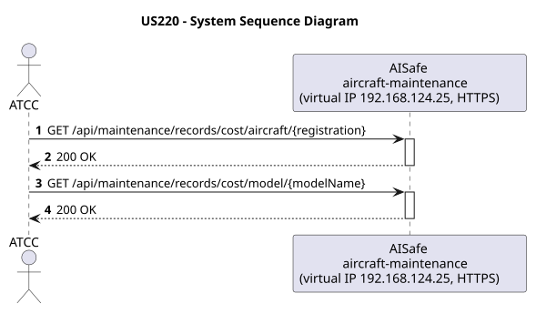
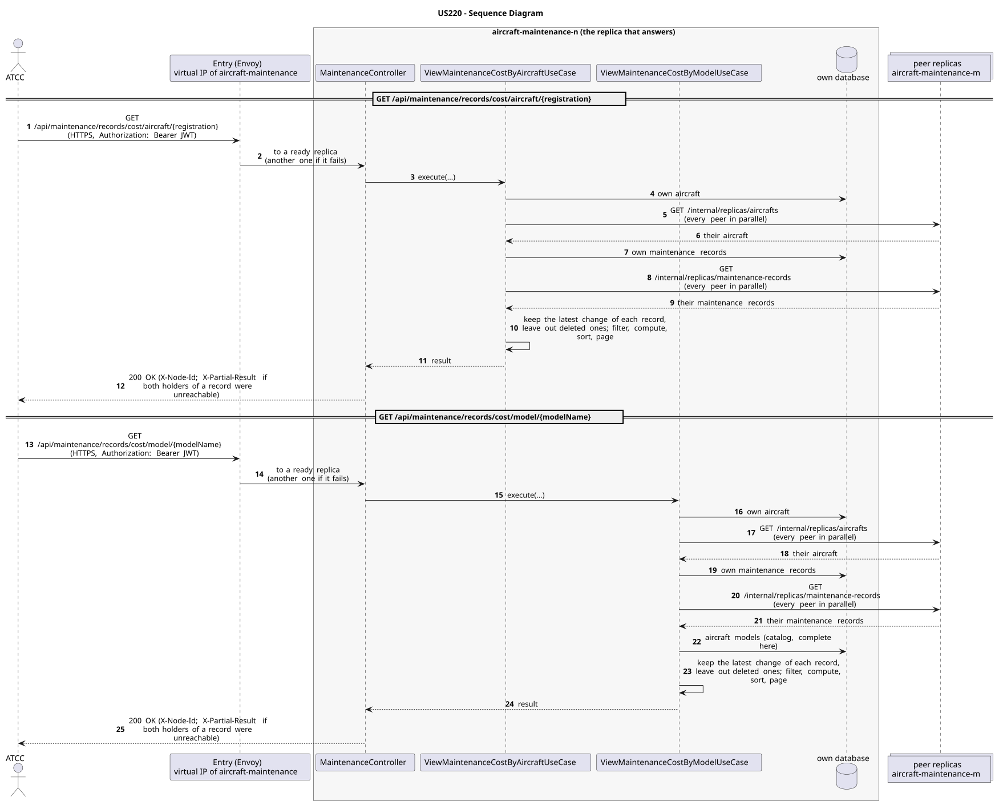

# US220 - Generate Maintenance Cost Reports

| Service              | Work package (monolith) | Monolith documentation                                                                    |
| -------------------- | ----------------------- | ----------------------------------------------------------------------------------------- |
| aircraft-maintenance | WP4B                    | [US220](../../../../../docs_monolith/system-documentation/use-cases/WP4B/US220/README.md) |

## User Story

> As an ATCC, I want to view maintenance cost reports aggregated by aircraft or by aircraft model so that I can understand the cost distribution of maintenance operations.

## Endpoints

| Method | Route                                                   | Roles                                             | Use case                               |
| ------ | ------------------------------------------------------- | ------------------------------------------------- | -------------------------------------- |
| GET    | `/api/maintenance/records/cost/aircraft/{registration}` | ATCC, Backoffice Operator, Maintenance Supervisor | `ViewMaintenanceCostByAircraftUseCase` |
| GET    | `/api/maintenance/records/cost/model/{modelName}`       | ATCC, Backoffice Operator, Maintenance Supervisor | `ViewMaintenanceCostByModelUseCase`    |

Through the virtual IP of the service, HTTPS only, with a JWT issued by the login.

## Acceptance Criteria

- Two sub-endpoints exist: one by aircraft registration, one by aircraft model name.
- The aircraft or model must exist; otherwise HTTP 404 is returned.
- The response includes total cost and average cost per record.

In the distributed system:

- The answer covers the records of every replica, not only those of the replica that answers.
- Every request and its answer are in the audit trail of the replica that answered.

## Pre-conditions

- The actor is authenticated through the login (JWT) with a role allowed for the route (see Endpoints).
- At least one replica of the service is ready.

## Post-conditions

- No state change occurs; the use case is read-only.

## Main Success Scenario

**GET `/api/maintenance/records/cost/aircraft/{registration}`**

1. The actor sends `GET /api/maintenance/records/cost/aircraft/{registration}` with the JWT to the virtual IP of aircraft-maintenance (HTTPS); the entry (Envoy) of the machine that holds that IP passes it to a ready replica of aircraft-maintenance, and tries another replica if that one fails.
2. `ViewMaintenanceCostByAircraftUseCase` gathers the aircraft, the maintenance records of every replica: its own, plus those of each peer (`GET /internal/replicas/{type}`, all peers in parallel), keeping the latest change of each record and leaving out deleted ones.
3. It filters, computes and sorts over the whole set, then answers 200.

**GET `/api/maintenance/records/cost/model/{modelName}`**

1. The actor sends `GET /api/maintenance/records/cost/model/{modelName}` with the JWT to the virtual IP of aircraft-maintenance (HTTPS); the entry (Envoy) of the machine that holds that IP passes it to a ready replica of aircraft-maintenance, and tries another replica if that one fails.
2. `ViewMaintenanceCostByModelUseCase` gathers the aircraft, the maintenance records of every replica: its own, plus those of each peer (`GET /internal/replicas/{type}`, all peers in parallel), keeping the latest change of each record and leaving out deleted ones. It reads the aircraft models from its own copy of the catalog.
3. It filters, computes and sorts over the whole set, then answers 200.

## Alternative / Exception Flows

| Condition                                                                 | System Response                                                                           |
| ------------------------------------------------------------------------- | ----------------------------------------------------------------------------------------- |
| Aircraft not found                                                        | HTTP 404                                                                                  |
| Aircraft model not found                                                  | HTTP 404                                                                                  |
| No valid token                                                            | 401                                                                                       |
| The actor's role is not ATCC, Backoffice Operator, Maintenance Supervisor | 403                                                                                       |
| Both replicas that hold some record could not be asked                    | 200 with `X-Partial-Result: true`                                                         |
| The replica that got the request stops answering                          | the entry repeats a read on another replica; a write only if it never reached the replica |

## Distribution

- `GET /api/maintenance/records/cost/aircraft/{registration}`: The answer covers **every replica**: the records are partitioned (each on two replicas), so the replica that answers gathers them from all of them (`AircraftAcrossReplicas`, `MaintenanceRecordsAcrossReplicas`).
- `GET /api/maintenance/records/cost/model/{modelName}`: The answer covers **every replica**: the records are partitioned (each on two replicas), so the replica that answers gathers them from all of them (`AircraftAcrossReplicas`, `MaintenanceRecordsAcrossReplicas`).

## Tests

Distributed end to end, in the [Postman collection](../../../../postman/README.md): folder 3. Aggregation over every replica.

## Sequence Diagrams

### System Sequence Diagram (SSD)

### Sequence Diagram (SD)

Sources: [`puml/ssd_us220.puml`](puml/ssd_us220.puml), [`puml/sd_us220.puml`](puml/sd_us220.puml).
