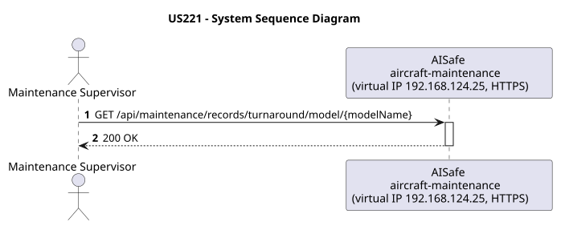
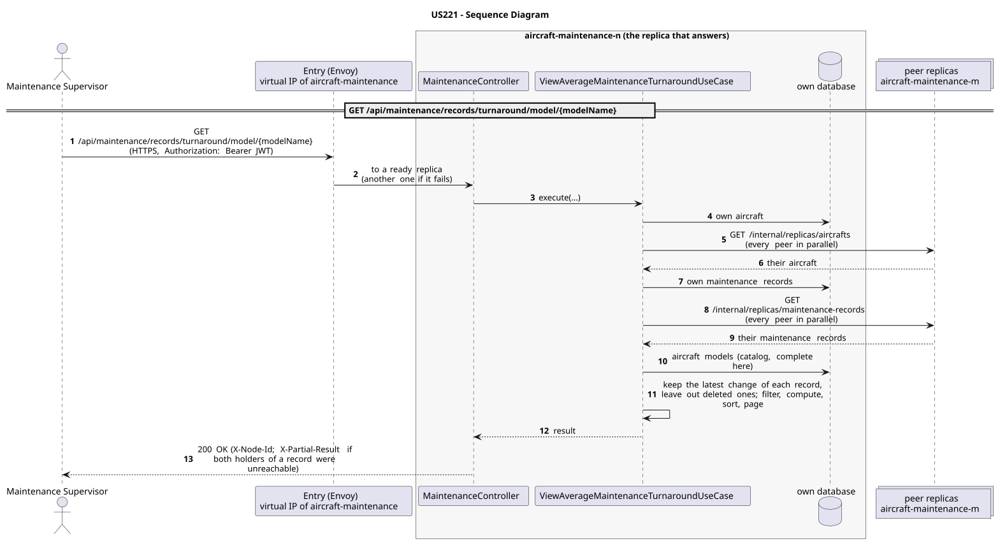

# US221 - View Average Maintenance Turnaround Time by Model

| Service              | Work package (monolith) | Monolith documentation                                                                    |
| -------------------- | ----------------------- | ----------------------------------------------------------------------------------------- |
| aircraft-maintenance | WP4B                    | [US221](../../../../../docs_monolith/system-documentation/use-cases/WP4B/US221/README.md) |

## User Story

> As a Maintenance Supervisor, I want to view the average turnaround time for completed maintenance records of a given aircraft model so that I can benchmark maintenance efficiency.

## Endpoints

| Method | Route                                                   | Roles                                                | Use case                                  |
| ------ | ------------------------------------------------------- | ---------------------------------------------------- | ----------------------------------------- |
| GET    | `/api/maintenance/records/turnaround/model/{modelName}` | Maintenance Supervisor, Maintenance Technician, ATCC | `ViewAverageMaintenanceTurnaroundUseCase` |

Through the virtual IP of the service, HTTPS only, with a JWT issued by the login.

## Acceptance Criteria

- The path identifies the aircraft model by its model name.
- The model must exist; otherwise HTTP 404 is returned.
- Only COMPLETED maintenance records contribute to the average.
- The response includes the average turnaround in hours and the record count.

In the distributed system:

- The answer covers the records of every replica, not only those of the replica that answers.
- Every request and its answer are in the audit trail of the replica that answered.

## Pre-conditions

- The actor is authenticated through the login (JWT) with a role allowed for the route (see Endpoints).
- At least one replica of the service is ready.

## Post-conditions

- No state change occurs; the use case is read-only.

## Main Success Scenario

1. The actor sends `GET /api/maintenance/records/turnaround/model/{modelName}` with the JWT to the virtual IP of aircraft-maintenance (HTTPS); the entry (Envoy) of the machine that holds that IP passes it to a ready replica of aircraft-maintenance, and tries another replica if that one fails.
2. `ViewAverageMaintenanceTurnaroundUseCase` gathers the aircraft, the maintenance records of every replica: its own, plus those of each peer (`GET /internal/replicas/{type}`, all peers in parallel), keeping the latest change of each record and leaving out deleted ones. It reads the aircraft models from its own copy of the catalog.
3. It filters, computes and sorts over the whole set, then answers 200.

## Alternative / Exception Flows

| Condition                                                                    | System Response                                                                           |
| ---------------------------------------------------------------------------- | ----------------------------------------------------------------------------------------- |
| Aircraft model not found                                                     | HTTP 404                                                                                  |
| No completed records for model                                               | HTTP 200 with average 0.0 and count 0                                                     |
| No valid token                                                               | 401                                                                                       |
| The actor's role is not Maintenance Supervisor, Maintenance Technician, ATCC | 403                                                                                       |
| Both replicas that hold some record could not be asked                       | 200 with `X-Partial-Result: true`                                                         |
| The replica that got the request stops answering                             | the entry repeats a read on another replica; a write only if it never reached the replica |

## Distribution

The answer covers **every replica**: the records are partitioned (each on two replicas), so the replica that answers gathers them from all of them (`AircraftAcrossReplicas`, `MaintenanceRecordsAcrossReplicas`).

## Tests

Not in the distributed Postman collection; covered by the unit and integration tests of aircraft-maintenance (`./mvnw test`), and served by the same forwarding, gathering and replication as the routes the collection does test.

## Sequence Diagrams

### System Sequence Diagram (SSD)

### Sequence Diagram (SD)

Sources: [`puml/ssd_us221.puml`](puml/ssd_us221.puml), [`puml/sd_us221.puml`](puml/sd_us221.puml).
