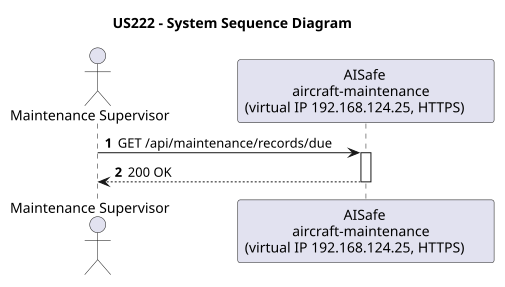
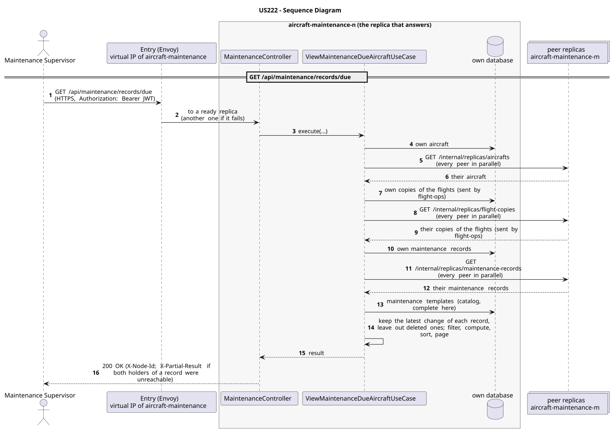

# US222 - Alert when Aircraft is Due for Scheduled Maintenance

| Service              | Work package (monolith) | Monolith documentation                                                                    |
| -------------------- | ----------------------- | ----------------------------------------------------------------------------------------- |
| aircraft-maintenance | WP4A                    | [US222](../../../../../docs_monolith/system-documentation/use-cases/WP4A/US222/README.md) |

## User Story

> As an ATCC, I want to see a list of aircraft that are currently due for scheduled maintenance so that I can plan maintenance checks proactively.

## Endpoints

| Method | Route                          | Roles                                                | Use case                            |
| ------ | ------------------------------ | ---------------------------------------------------- | ----------------------------------- |
| GET    | `/api/maintenance/records/due` | Maintenance Supervisor, Maintenance Technician, ATCC | `ViewMaintenanceDueAircraftUseCase` |

Through the virtual IP of the service, HTTPS only, with a JWT issued by the login.

## Acceptance Criteria

- The endpoint `GET /api/maintenance/records/due` returns all aircraft that exceed their flight hours limit or elapsed calendar days limit since their last completed maintenance (or since their manufacturing date if no maintenance has been completed yet).
- Limits can be defined in a `MaintenanceTemplate` applicable to the aircraft model.
- If no applicable templates are found, the system falls back to global thresholds defined in `application.properties` (`aisafe.maintenance.threshold.default-flight-hours` and `aisafe.maintenance.threshold.default-days`).
- The response lists the aircraft registration number, model, due reason (including metrics), current flight hours and elapsed days, and the name of the triggering template or "Default Fallback".
- Accessible to roles: `MAINTENANCE_SUPERVISOR`, `MAINTENANCE_TECHNICIAN`, `ATCC`, `ADMIN`.

In the distributed system:

- The answer covers the records of every replica, not only those of the replica that answers.
- Every request and its answer are in the audit trail of the replica that answered.

## Pre-conditions

- The actor is authenticated through the login (JWT) with a role allowed for the route (see Endpoints).
- At least one replica of the service is ready.

## Post-conditions

- The list of due aircraft is calculated and returned dynamically.

## Main Success Scenario

1. The actor sends `GET /api/maintenance/records/due` with the JWT to the virtual IP of aircraft-maintenance (HTTPS); the entry (Envoy) of the machine that holds that IP passes it to a ready replica of aircraft-maintenance, and tries another replica if that one fails.
2. `ViewMaintenanceDueAircraftUseCase` gathers the aircraft, the copies of the flights (sent by flight-ops), the maintenance records of every replica: its own, plus those of each peer (`GET /internal/replicas/{type}`, all peers in parallel), keeping the latest change of each record and leaving out deleted ones. It reads the maintenance templates from its own copy of the catalog.
3. It filters, computes and sorts over the whole set, then answers 200.

## Alternative / Exception Flows

| Condition                                                                    | System Response                                                                           |
| ---------------------------------------------------------------------------- | ----------------------------------------------------------------------------------------- |
| No valid token                                                               | 401                                                                                       |
| The actor's role is not Maintenance Supervisor, Maintenance Technician, ATCC | 403                                                                                       |
| Both replicas that hold some record could not be asked                       | 200 with `X-Partial-Result: true`                                                         |
| The replica that got the request stops answering                             | the entry repeats a read on another replica; a write only if it never reached the replica |

## Distribution

The answer covers **every replica**: the records are partitioned (each on two replicas), so the replica that answers gathers them from all of them (`AircraftAcrossReplicas`, `FlightCopiesAcrossReplicas`, `MaintenanceRecordsAcrossReplicas`).

## Tests

Not in the distributed Postman collection; covered by the unit and integration tests of aircraft-maintenance (`./mvnw test`), and served by the same forwarding, gathering and replication as the routes the collection does test.

## Sequence Diagrams

### System Sequence Diagram (SSD)

### Sequence Diagram (SD)

Sources: [`puml/ssd_us222.puml`](puml/ssd_us222.puml), [`puml/sd_us222.puml`](puml/sd_us222.puml).
