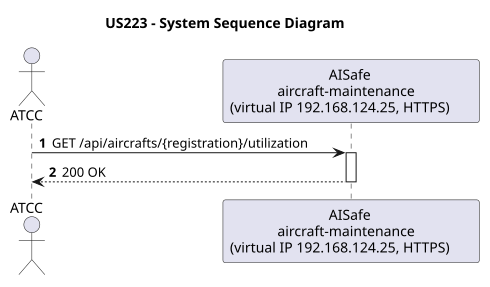
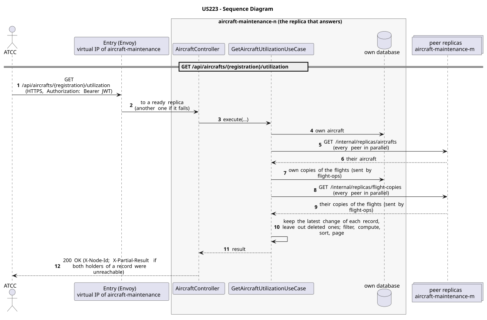

# US223 - Aircraft Utilization Rates Graphs

| Service              | Work package (monolith) | Monolith documentation                                                                     |
| -------------------- | ----------------------- | ------------------------------------------------------------------------------------------ |
| aircraft-maintenance | BONUS                   | [US223](../../../../../docs_monolith/system-documentation/use-cases/BONUS/US223/README.md) |

## User Story

> As an ATCC, I want to view aircraft utilization rates over time with graphical representations.

## Endpoints

| Method | Route                                       | Roles | Use case                        |
| ------ | ------------------------------------------- | ----- | ------------------------------- |
| GET    | `/api/aircrafts/{registration}/utilization` | ATCC  | `GetAircraftUtilizationUseCase` |

Through the virtual IP of the service, HTTPS only, with a JWT issued by the login.

## Acceptance Criteria

- The request must specify the aircraft by its `registrationNumber` in the URL.
- The request must specify a date range (`startDate` and `endDate`).
- The system returns daily data points containing flight hours and utilization rate percentage.
- The response should be a collection of points suitable for plotting graphical representations.
- If the aircraft does not exist, the system returns HTTP 404.
- On success, the system returns HTTP 200 with the data points.

In the distributed system:

- The answer covers the records of every replica, not only those of the replica that answers.
- Every request and its answer are in the audit trail of the replica that answered.

## Pre-conditions

- The actor is authenticated through the login (JWT) with a role allowed for the route (see Endpoints).
- The aircraft with the given registration exists.
- At least one replica of the service is ready.

## Post-conditions

- No state change occurs; the use case is read-only.

## Main Success Scenario

1. The actor sends `GET /api/aircrafts/{registration}/utilization` with the JWT to the virtual IP of aircraft-maintenance (HTTPS); the entry (Envoy) of the machine that holds that IP passes it to a ready replica of aircraft-maintenance, and tries another replica if that one fails.
2. `GetAircraftUtilizationUseCase` gathers the aircraft, the copies of the flights (sent by flight-ops) of every replica: its own, plus those of each peer (`GET /internal/replicas/{type}`, all peers in parallel), keeping the latest change of each record and leaving out deleted ones.
3. It filters, computes and sorts over the whole set, then answers 200.

## Alternative / Exception Flows

| Condition                                              | System Response                                                                           |
| ------------------------------------------------------ | ----------------------------------------------------------------------------------------- |
| Aircraft not found                                     | HTTP 404                                                                                  |
| No valid token                                         | 401                                                                                       |
| The actor's role is not ATCC                           | 403                                                                                       |
| Both replicas that hold some record could not be asked | 200 with `X-Partial-Result: true`                                                         |
| The replica that got the request stops answering       | the entry repeats a read on another replica; a write only if it never reached the replica |

## Distribution

The answer covers **every replica**: the records are partitioned (each on two replicas), so the replica that answers gathers them from all of them (`AircraftAcrossReplicas`, `FlightCopiesAcrossReplicas`).

## Tests

Not in the distributed Postman collection; covered by the unit and integration tests of aircraft-maintenance (`./mvnw test`), and served by the same forwarding, gathering and replication as the routes the collection does test.

## Sequence Diagrams

### System Sequence Diagram (SSD)

### Sequence Diagram (SD)

Sources: [`puml/ssd_us223.puml`](puml/ssd_us223.puml), [`puml/sd_us223.puml`](puml/sd_us223.puml).
