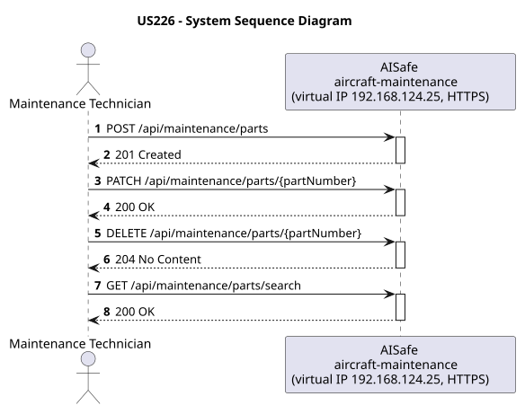
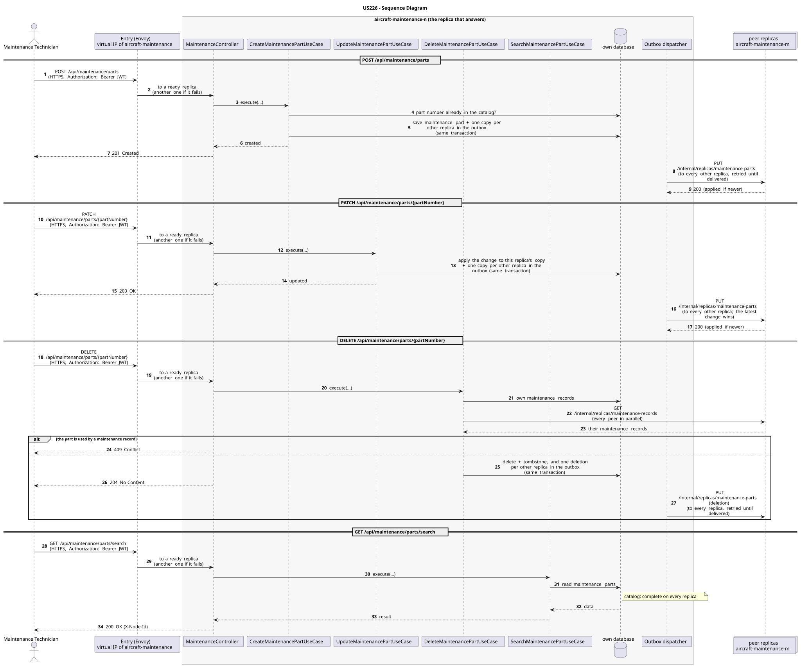

# US226 - Track Maintenance Parts Inventory and Alerts

| Service              | Work package (monolith) | Monolith documentation                                                                    |
| -------------------- | ----------------------- | ----------------------------------------------------------------------------------------- |
| aircraft-maintenance | WP4A                    | [US226](../../../../../docs_monolith/system-documentation/use-cases/WP4A/US226/README.md) |

## User Story

> As a Maintenance Supervisor, I want to track maintenance parts inventory and receive low-stock alerts.

## Endpoints

| Method | Route                                 | Roles                                                | Use case                       |
| ------ | ------------------------------------- | ---------------------------------------------------- | ------------------------------ |
| POST   | `/api/maintenance/parts`              | Maintenance Technician, Maintenance Supervisor       | `CreateMaintenancePartUseCase` |
| PATCH  | `/api/maintenance/parts/{partNumber}` | Maintenance Technician, Maintenance Supervisor       | `UpdateMaintenancePartUseCase` |
| DELETE | `/api/maintenance/parts/{partNumber}` | Maintenance Technician, Maintenance Supervisor       | `DeleteMaintenancePartUseCase` |
| GET    | `/api/maintenance/parts/search`       | Maintenance Technician, Maintenance Supervisor, ATCC | `SearchMaintenancePartUseCase` |

Through the virtual IP of the service, HTTPS only, with a JWT issued by the login.

## Acceptance Criteria

- The request must provide `partNumber`, `name`, `description`, `stockQuantity`, `minimumThreshold`, and `component`.
- `component` is a fixed enum value (`ENGINE`, `AIRFRAME`, `AVIONICS`, `INTERIOR`, `EXTERIOR`).
- Part numbers must be unique.
- On success the system returns HTTP 201 with the enriched `MaintenancePart` representation.
- Maintenance Supervisors can search for parts by `partNumber` (partial), `name` (partial), and `component`.
- The system must provide a mechanism to filter parts in "low stock" (where `stockQuantity < minimumThreshold`).
- Search results are paginated and include HATEOAS links to update the part.

In the distributed system:

- The new entry reaches every replica once the copies are delivered (normally right after the answer).
- The change reaches every replica; of two concurrent changes, the latest wins.
- A part is not deleted while a maintenance record of any replica uses it.
- Any replica answers with the whole catalog, without asking its peers.
- Every request and its answer are in the audit trail of the replica that answered.

## Pre-conditions

- The actor is authenticated through the login (JWT) with a role allowed for the route (see Endpoints).
- For registration: No part with the same part number exists yet.
- At least one replica of the service is ready.

## Post-conditions

- New `MaintenancePart` entities are persisted.
- Inventory levels are searchable and low-stock alerts are visible to the supervisor.
- The change is on every replica once the outbox delivers it.

## Main Success Scenario

**POST `/api/maintenance/parts`**

1. The actor sends `POST /api/maintenance/parts` with the JWT to the virtual IP of aircraft-maintenance (HTTPS); the entry (Envoy) of the machine that holds that IP passes it to a ready replica of aircraft-maintenance, and tries another replica if that one fails.
2. `CreateMaintenancePartUseCase` validates the request and checks that no maintenance part with the same part number exists (the catalog is complete on every replica).
3. It stores the maintenance part and, in the same transaction, one copy for every other replica in the outbox; it answers 201.
4. Right after the commit the outbox sends the copies (`PUT /internal/replicas/maintenance-parts`), retrying until each one is delivered.

**PATCH `/api/maintenance/parts/{partNumber}`**

1. The actor sends `PATCH /api/maintenance/parts/{partNumber}` with the JWT to the virtual IP of aircraft-maintenance (HTTPS); the entry (Envoy) of the machine that holds that IP passes it to a ready replica of aircraft-maintenance, and tries another replica if that one fails.
2. `UpdateMaintenancePartUseCase` applies the change to this replica's copy of the maintenance part (every replica has the catalog) and stores, in the same transaction, one copy for every other replica in the outbox; it answers 200.
3. The outbox delivers the change to every other replica (`PUT /internal/replicas/maintenance-parts`); the latest change wins.

**DELETE `/api/maintenance/parts/{partNumber}`**

1. The actor sends `DELETE /api/maintenance/parts/{partNumber}` with the JWT to the virtual IP of aircraft-maintenance (HTTPS); the entry (Envoy) of the machine that holds that IP passes it to a ready replica of aircraft-maintenance, and tries another replica if that one fails.
2. `DeleteMaintenancePartUseCase` checks the maintenance records of every replica (gathered as for a listing): a part still in use is not deleted (409).
3. It deletes the part, keeping a tombstone so that an older copy cannot bring it back, and stores one deletion for every other replica in the outbox; it answers 204.
4. The outbox delivers the deletion to every other replica (`PUT /internal/replicas/maintenance-parts`).

**GET `/api/maintenance/parts/search`**

1. The actor sends `GET /api/maintenance/parts/search` with the JWT to the virtual IP of aircraft-maintenance (HTTPS); the entry (Envoy) of the machine that holds that IP passes it to a ready replica of aircraft-maintenance, and tries another replica if that one fails.
2. `SearchMaintenancePartUseCase` reads the maintenance parts from this replica's own database: the catalog is complete on every replica, so no peer is asked.
3. The replica answers 200 (with `X-Node-Id`).

## Alternative / Exception Flows

| Condition                                                                    | System Response                                                                           |
| ---------------------------------------------------------------------------- | ----------------------------------------------------------------------------------------- |
| Request invalid or missing required field                                    | HTTP 400                                                                                  |
| Part number already exists (on create)                                       | HTTP 409                                                                                  |
| No valid token                                                               | 401                                                                                       |
| The actor's role is not Maintenance Technician, Maintenance Supervisor       | 403                                                                                       |
| The replica that got the request stops answering                             | the entry repeats a read on another replica; a write only if it never reached the replica |
| The actor's role is not Maintenance Technician, Maintenance Supervisor, ATCC | 403                                                                                       |

## Distribution

- `POST /api/maintenance/parts`: The maintenance part belongs to a **catalog**: every replica holds all of it, and every change is copied to all of them (last writer wins).
- `PATCH /api/maintenance/parts/{partNumber}`: The maintenance part belongs to a **catalog**: every replica holds all of it, and every change is copied to all of them (last writer wins).
- `DELETE /api/maintenance/parts/{partNumber}`: The maintenance part belongs to a **catalog**: every replica holds all of it, and every change is copied to all of them (last writer wins).
- `GET /api/maintenance/parts/search`: The maintenance parts are a **catalog**: every replica holds all of them, so any replica answers by itself.

## Tests

Not in the distributed Postman collection; covered by the unit and integration tests of aircraft-maintenance (`./mvnw test`), and served by the same forwarding, gathering and replication as the routes the collection does test.

## Sequence Diagrams

### System Sequence Diagram (SSD)

### Sequence Diagram (SD)

Sources: [`puml/ssd_us226.puml`](puml/ssd_us226.puml), [`puml/sd_us226.puml`](puml/sd_us226.puml).
