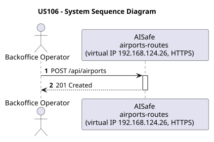
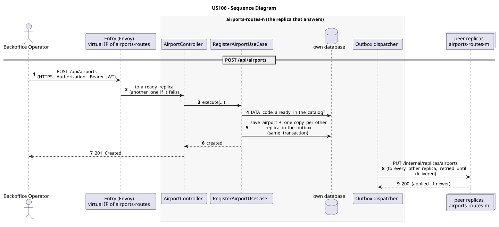

# US106 - Register an Airport

| Service         | Work package (monolith) | Monolith documentation                                                                    |
| --------------- | ----------------------- | ----------------------------------------------------------------------------------------- |
| airports-routes | WP2A                    | [US106](../../../../../docs_monolith/system-documentation/use-cases/WP2A/US106/README.md) |

## User Story

> As a **Backoffice Operator**, I want to register an airport with details including IATA code, name, city, country, timezone, coordinates, and runway information.

## Endpoints

| Method | Route           | Roles               | Use case                 |
| ------ | --------------- | ------------------- | ------------------------ |
| POST   | `/api/airports` | Backoffice Operator | `RegisterAirportUseCase` |

Through the virtual IP of the service, HTTPS only, with a JWT issued by the login.

## Acceptance Criteria

- The airport must have a unique, valid 3-character alphanumeric IATA code.
- Name, city, country, and timezone are mandatory.
- At least one runway must be provided; each runway requires a name, length (positive integer, in meters), and orientation.
- Latitude must be in [-90, 90] and longitude in [-180, 180].
- Optional fields: region, operational hours, image path, services, terminals, gates.
- On success the system returns HTTP 201 with the created airport representation including HATEOAS links.
- If an airport with the same IATA code already exists, the system returns HTTP 409.
- Invalid or missing required fields return HTTP 400 with a meaningful error message.

In the distributed system:

- The new entry reaches every replica once the copies are delivered (normally right after the answer).
- Every request and its answer are in the audit trail of the replica that answered.

## Pre-conditions

- The actor is authenticated through the login (JWT) with a role allowed for the route (see Endpoints).
- No airport with the given IATA code exists in the system.
- At least one replica of the service is ready.

## Post-conditions

- A new `Airport` entity is persisted with status `OPERATIONAL`.
- All provided runways are stored as embedded value objects.
- Optional facilities (services, terminals, gates) are stored if provided.
- The change is on every replica once the outbox delivers it.

## Main Success Scenario

1. The actor sends `POST /api/airports` with the JWT to the virtual IP of airports-routes (HTTPS); the entry (Envoy) of the machine that holds that IP passes it to a ready replica of airports-routes, and tries another replica if that one fails.
2. `RegisterAirportUseCase` validates the request and checks that no airport with the same IATA code exists (the catalog is complete on every replica).
3. It stores the airport and, in the same transaction, one copy for every other replica in the outbox; it answers 201.
4. Right after the commit the outbox sends the copies (`PUT /internal/replicas/airports`), retrying until each one is delivered.

## Alternative / Exception Flows

| Condition                                              | System Response                                                                           |
| ------------------------------------------------------ | ----------------------------------------------------------------------------------------- |
| IATA code format invalid or missing                    | HTTP 400                                                                                  |
| Required field missing (name, city, country, timezone) | HTTP 400                                                                                  |
| No runways provided                                    | HTTP 400                                                                                  |
| Coordinates out of valid range                         | HTTP 400                                                                                  |
| IATA code already registered                           | HTTP 409                                                                                  |
| No valid token                                         | 401                                                                                       |
| The actor's role is not Backoffice Operator            | 403                                                                                       |
| The replica that got the request stops answering       | the entry repeats a read on another replica; a write only if it never reached the replica |

## Distribution

The airport belongs to a **catalog**: every replica holds all of it, and every change is copied to all of them (last writer wins).

## Tests

Distributed end to end, in the [Postman collection](../../../../postman/README.md): folder 4. Catalogs copied to every replica.

## Sequence Diagrams

### System Sequence Diagram (SSD)

### Sequence Diagram (SD)

Sources: [`puml/ssd_us106.puml`](puml/ssd_us106.puml), [`puml/sd_us106.puml`](puml/sd_us106.puml).
