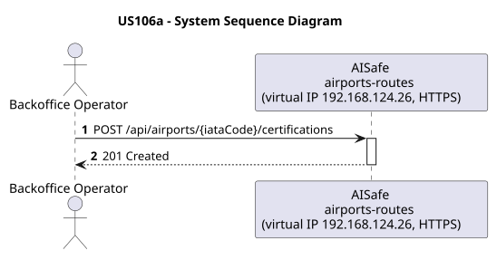
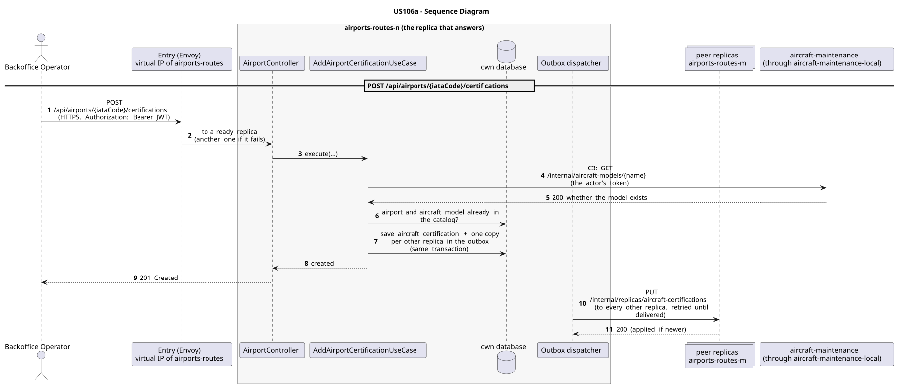

# US106a - Add Aircraft Certification to Airport

| Service         | Work package (monolith) | Monolith documentation                                                                      |
| --------------- | ----------------------- | ------------------------------------------------------------------------------------------- |
| airports-routes | WP2A                    | [US106a](../../../../../docs_monolith/system-documentation/use-cases/WP2A/US106a/README.md) |

## User Story

> As a **Backoffice Operator** or **ATCC**, I want to add an aircraft certification to an airport, indicating that a particular aircraft model can fly to/from that airport.

## Endpoints

| Method | Route                                     | Roles                     | Use case                         |
| ------ | ----------------------------------------- | ------------------------- | -------------------------------- |
| POST   | `/api/airports/{iataCode}/certifications` | Backoffice Operator, ATCC | `AddAirportCertificationUseCase` |

Through the virtual IP of the service, HTTPS only, with a JWT issued by the login.

## Changes from the monolith

- The aircraft models belong to aircraft-maintenance: airports-routes asks it whether the model exists (C3) before certifying the airport for it.

## Acceptance Criteria

- The airport identified by the given IATA code must exist.
- The aircraft model identified by the given name must exist.
- The same aircraft model cannot be certified for the same airport more than once.
- On success the system returns HTTP 201 with the certification representation and a HATEOAS link back to the airport.
- Airport not found returns HTTP 404; aircraft model not found returns HTTP 404.
- Duplicate certification returns HTTP 409 with a meaningful error message.

In the distributed system:

- The new entry reaches every replica once the copies are delivered (normally right after the answer).
- Every request and its answer are in the audit trail of the replica that answered.

## Pre-conditions

- The actor is authenticated through the login (JWT) with a role allowed for the route (see Endpoints).
- The target airport exists.
- The target aircraft model exists.
- At least one replica of the service is ready.
- aircraft-maintenance answers (contracts C3).

## Post-conditions

- A new `AircraftCertification` entity is persisted linking the airport to the aircraft model.
- The change is on every replica once the outbox delivers it.

## Main Success Scenario

1. The actor sends `POST /api/airports/{iataCode}/certifications` with the JWT to the virtual IP of airports-routes (HTTPS); the entry (Envoy) of the machine that holds that IP passes it to a ready replica of airports-routes, and tries another replica if that one fails.
2. The replica asks aircraft-maintenance for whether the model exists (contract C3: `GET /internal/aircraft-models/{name}`, through the entry of its own machine, `aircraft-maintenance-local`), forwarding the actor's token.
3. `AddAirportCertificationUseCase` validates the request and checks that no aircraft certification with the same airport and aircraft model exists (the catalog is complete on every replica).
4. It stores the aircraft certification and, in the same transaction, one copy for every other replica in the outbox; it answers 201.
5. Right after the commit the outbox sends the copies (`PUT /internal/replicas/aircraft-certifications`), retrying until each one is delivered.

## Alternative / Exception Flows

| Condition                                          | System Response                                                                           |
| -------------------------------------------------- | ----------------------------------------------------------------------------------------- |
| Airport not found                                  | HTTP 404                                                                                  |
| Aircraft model not found                           | HTTP 404                                                                                  |
| Certification already exists                       | HTTP 409                                                                                  |
| No valid token                                     | 401                                                                                       |
| The actor's role is not Backoffice Operator, ATCC  | 403                                                                                       |
| aircraft-maintenance does not answer (contract C3) | 503 with `Retry-After`                                                                    |
| The replica that got the request stops answering   | the entry repeats a read on another replica; a write only if it never reached the replica |

## Distribution

The aircraft certification belongs to a **catalog**: every replica holds all of it, and every change is copied to all of them (last writer wins).

## Tests

Distributed end to end, in the [Postman collection](../../../../postman/README.md): folder 5. Between services.

## Sequence Diagrams

### System Sequence Diagram (SSD)

### Sequence Diagram (SD)

Sources: [`puml/ssd_us106a.puml`](puml/ssd_us106a.puml), [`puml/sd_us106a.puml`](puml/sd_us106a.puml).
