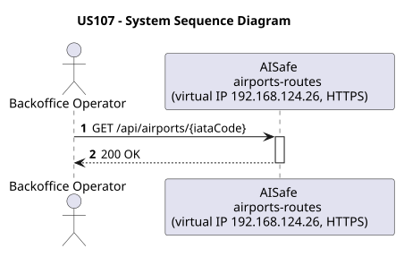
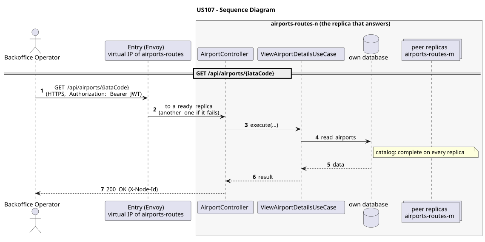

# US107 - View Airport Details

| Service         | Work package (monolith) | Monolith documentation                                                                    |
| --------------- | ----------------------- | ----------------------------------------------------------------------------------------- |
| airports-routes | WP2A                    | [US107](../../../../../docs_monolith/system-documentation/use-cases/WP2A/US107/README.md) |

## User Story

> As a **Backoffice Operator** or **ATCC**, I want to view an airport's details given its IATA code.

## Endpoints

| Method | Route                      | Roles                     | Use case                    |
| ------ | -------------------------- | ------------------------- | --------------------------- |
| GET    | `/api/airports/{iataCode}` | Backoffice Operator, ATCC | `ViewAirportDetailsUseCase` |

Through the virtual IP of the service, HTTPS only, with a JWT issued by the login.

## Acceptance Criteria

- The system returns full airport details: IATA code, name, city, country, region, timezone, coordinates, status, operational hours, image, runways, contacts, services, terminals, and gates.
- The response includes HATEOAS links: self, update-status, update-details, routes, certifications.
- If the airport is not found, the system returns HTTP 404.

In the distributed system:

- Any replica answers with the whole catalog, without asking its peers.
- Every request and its answer are in the audit trail of the replica that answered.

## Pre-conditions

- The actor is authenticated through the login (JWT) with a role allowed for the route (see Endpoints).
- At least one replica of the service is ready.

## Post-conditions

- No state change. Read-only operation.

## Main Success Scenario

1. The actor sends `GET /api/airports/{iataCode}` with the JWT to the virtual IP of airports-routes (HTTPS); the entry (Envoy) of the machine that holds that IP passes it to a ready replica of airports-routes, and tries another replica if that one fails.
2. `ViewAirportDetailsUseCase` reads the airports from this replica's own database: the catalog is complete on every replica, so no peer is asked.
3. The replica answers 200 (with `X-Node-Id`).

## Alternative / Exception Flows

| Condition                                         | System Response                                                                           |
| ------------------------------------------------- | ----------------------------------------------------------------------------------------- |
| Airport not found                                 | HTTP 404                                                                                  |
| No valid token                                    | 401                                                                                       |
| The actor's role is not Backoffice Operator, ATCC | 403                                                                                       |
| The replica that got the request stops answering  | the entry repeats a read on another replica; a write only if it never reached the replica |

## Distribution

The airports are a **catalog**: every replica holds all of them, so any replica answers by itself.

## Tests

Distributed end to end, in the [Postman collection](../../../../postman/README.md): folder 4. Catalogs copied to every replica.

## Sequence Diagrams

### System Sequence Diagram (SSD)

### Sequence Diagram (SD)

Sources: [`puml/ssd_us107.puml`](puml/ssd_us107.puml), [`puml/sd_us107.puml`](puml/sd_us107.puml).
