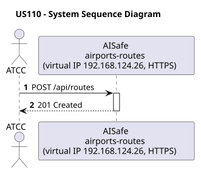
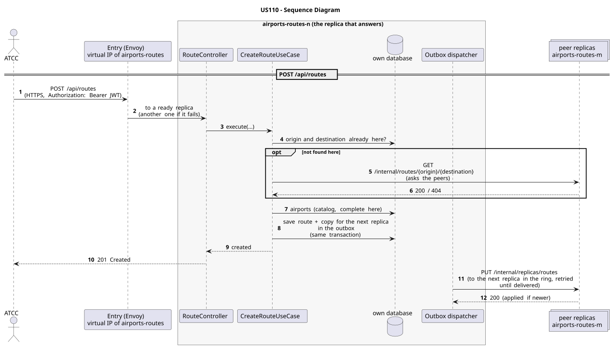

# US110 - Create a Flight Route

| Service         | Work package (monolith) | Monolith documentation                                                                    |
| --------------- | ----------------------- | ----------------------------------------------------------------------------------------- |
| airports-routes | WP3A                    | [US110](../../../../../docs_monolith/system-documentation/use-cases/WP3A/US110/README.md) |

## User Story

> As an **ATCC**, I want to create a flight route by specifying origin airport, destination airport, estimated flight time, and minimum aircraft requirements (range, capacity), so that routes can be planned and managed in the system.

## Endpoints

| Method | Route         | Roles | Use case             |
| ------ | ------------- | ----- | -------------------- |
| POST   | `/api/routes` | ATCC  | `CreateRouteUseCase` |

Through the virtual IP of the service, HTTPS only, with a JWT issued by the login.

## Acceptance Criteria

- Both origin and destination airports must exist in the system and be operational.
- Origin and destination airports cannot be the same.
- Estimated flight time is mandatory and must be positive.
- Minimum aircraft range and capacity are mandatory and must be positive values.
- The route must be uniquely identified.
- On success the system returns HTTP 201 with the created route representation.
- If either airport does not exist, the system returns HTTP 404.
- If either airport is not operational, the system returns HTTP 400.
- Invalid or missing required fields return HTTP 400.

In the distributed system:

- The new record is on two replicas once the copy is delivered (normally right after the answer).
- Every request and its answer are in the audit trail of the replica that answered.

## Pre-conditions

- The actor is authenticated through the login (JWT) with a role allowed for the route (see Endpoints).
- The origin and destination airports are already registered in the system.
- At least one replica of the service is ready.

## Post-conditions

- A new `Route` entity is persisted in the system.
- The route stores the estimated flight time and aircraft requirements.
- The route is available for future searches and operational planning.
- The change is on both replicas that hold the record once the outbox delivers it.

## Main Success Scenario

1. The actor sends `POST /api/routes` with the JWT to the virtual IP of airports-routes (HTTPS); the entry (Envoy) of the machine that holds that IP passes it to a ready replica of airports-routes, and tries another replica if that one fails.
2. `CreateRouteUseCase` validates the request and checks that no route with the same origin and destination exists: in its own database and, if not found there, on its peers (`GET /internal/routes/{origin}/{destination}`). The airports come from its own copy of the catalog.
3. It stores the route on this replica (its home) and, in the same transaction, a copy for the next replica in the ring in the outbox; it answers 201.
4. Right after the commit the outbox sends the copy (`PUT /internal/replicas/routes`), retrying until it is delivered.

## Alternative / Exception Flows

| Condition                                             | System Response                                                                           |
| ----------------------------------------------------- | ----------------------------------------------------------------------------------------- |
| Missing or invalid required field                     | HTTP 400                                                                                  |
| Estimated flight time <= 0                            | HTTP 400                                                                                  |
| Minimum range or capacity <= 0                        | HTTP 400                                                                                  |
| Origin airport does not exist                         | HTTP 404                                                                                  |
| Destination airport does not exist                    | HTTP 404                                                                                  |
| Origin or destination airport is not operational      | HTTP 400                                                                                  |
| Origin and destination are the same                   | HTTP 400                                                                                  |
| No valid token                                        | 401                                                                                       |
| The actor's role is not ATCC                          | 403                                                                                       |
| A peer could not be asked during the uniqueness check | the check is best effort: during a network partition a duplicate can get through          |
| The replica that got the request stops answering      | the entry repeats a read on another replica; a write only if it never reached the replica |

## Distribution

The route is a **record**: it stays on the replica that created it and on the next one in the ring, and is never forwarded on creation. Its key (origin and destination) cannot be given twice by two replicas (checked on the peers before creating, best effort).

## Tests

Distributed end to end, in the [Postman collection](../../../../postman/README.md): folder 2. Forwarding between replicas.

## Sequence Diagrams

### System Sequence Diagram (SSD)

### Sequence Diagram (SD)

Sources: [`puml/ssd_us110.puml`](puml/ssd_us110.puml), [`puml/sd_us110.puml`](puml/sd_us110.puml).
