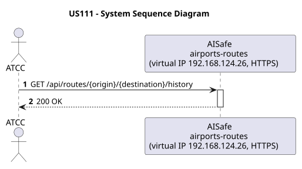
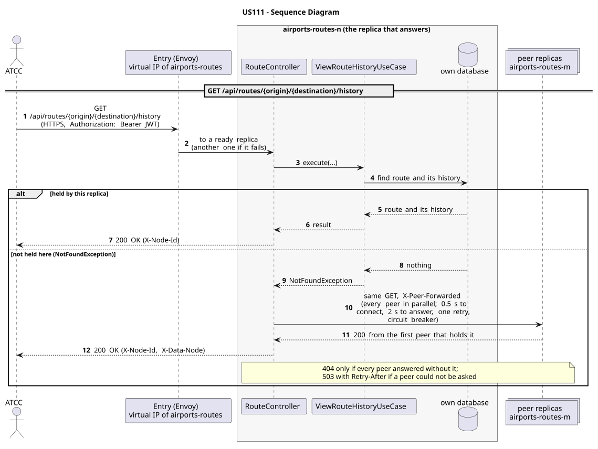

# US111 - Keep Track of Route History

| Service         | Work package (monolith) | Monolith documentation                                                                    |
| --------------- | ----------------------- | ----------------------------------------------------------------------------------------- |
| airports-routes | WP3A                    | [US111](../../../../../docs_monolith/system-documentation/use-cases/WP3A/US111/README.md) |

## User Story

> As an **ATCC**, I want to keep track of route history so that I can audit route changes and operational decisions over time.

## Endpoints

| Method | Route                                        | Roles | Use case                  |
| ------ | -------------------------------------------- | ----- | ------------------------- |
| GET    | `/api/routes/{origin}/{destination}/history` | ATCC  | `ViewRouteHistoryUseCase` |

Through the virtual IP of the service, HTTPS only, with a JWT issued by the login.

## Changes from the monolith

- The history travels with its route: every copy of a route carries its whole history.

## Acceptance Criteria

- Every route update or deactivation must generate a history entry.
- History entries must include timestamp, operation type, and modified fields.
- Route history must be retrievable by origin and destination IATA codes.
- History entries are immutable.
- On success the system returns HTTP 200 with the route history.
- If the route does not exist, the system returns HTTP 404.

In the distributed system:

- The same answer whatever replica receives the request: one that does not hold the data asks its peers, and names the holder in `X-Data-Node`.
- Every request and its answer are in the audit trail of the replica that answered.

## Pre-conditions

- The actor is authenticated through the login (JWT) with a role allowed for the route (see Endpoints).
- The route exists in the system.
- At least one replica of the service is ready.

## Post-conditions

- Route history entries are persisted after every update or deactivation performed in US112.
- Historical data remains available for auditing purposes.

## Main Success Scenario

1. The actor sends `GET /api/routes/{origin}/{destination}/history` with the JWT to the virtual IP of airports-routes (HTTPS); the entry (Envoy) of the machine that holds that IP passes it to a ready replica of airports-routes, and tries another replica if that one fails.
2. `ViewRouteHistoryUseCase` looks for the route and its history in this replica's database.
3. If this replica holds it, it answers 200 with `X-Node-Id`. If not, it asks every peer in parallel (same request, marked `X-Peer-Forwarded`) and answers with the first holder's response, naming it in `X-Data-Node`.

## Alternative / Exception Flows

| Condition                                                                      | System Response                                                                           |
| ------------------------------------------------------------------------------ | ----------------------------------------------------------------------------------------- |
| Route does not exist                                                           | HTTP 404                                                                                  |
| No history entries found                                                       | HTTP 200 with empty list                                                                  |
| No valid token                                                                 | 401                                                                                       |
| The actor's role is not ATCC                                                   | 403                                                                                       |
| No replica holds it, and every peer answered                                   | 404                                                                                       |
| No replica answered with it, and some peer could not be asked (it may hold it) | 503 with `Retry-After`, `X-Unreachable-Peers` (never a 404 for data that may exist)       |
| The replica that got the request stops answering                               | the entry repeats a read on another replica; a write only if it never reached the replica |

## Distribution

The route and its history is a **record**: it lives on two replicas, its home and the next one in the ring. Any replica answers: one that does not hold it forwards the read to its peers.

## Tests

Not in the distributed Postman collection; covered by the unit and integration tests of airports-routes (`./mvnw test`), and served by the same forwarding, gathering and replication as the routes the collection does test.

## Sequence Diagrams

### System Sequence Diagram (SSD)

### Sequence Diagram (SD)

Sources: [`puml/ssd_us111.puml`](puml/ssd_us111.puml), [`puml/sd_us111.puml`](puml/sd_us111.puml).
