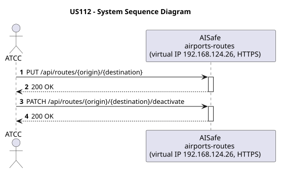
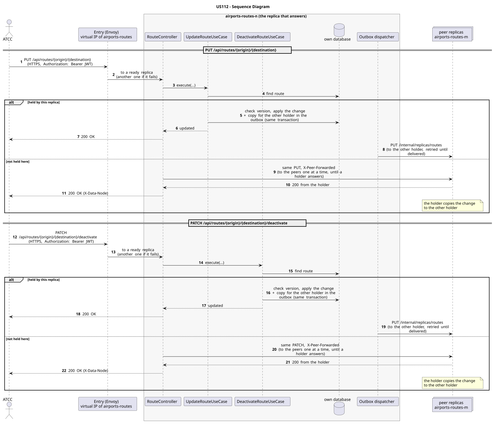

# US112 - Update or Deactivate a Route

| Service         | Work package (monolith) | Monolith documentation                                                                    |
| --------------- | ----------------------- | ----------------------------------------------------------------------------------------- |
| airports-routes | WP3A                    | [US112](../../../../../docs_monolith/system-documentation/use-cases/WP3A/US112/README.md) |

## User Story

> As an **ATCC or Backoffice Operator**, I want to update or deactivate a route so that route information remains accurate and operationally valid.

## Endpoints

| Method | Route                                           | Roles                     | Use case                 |
| ------ | ----------------------------------------------- | ------------------------- | ------------------------ |
| PUT    | `/api/routes/{origin}/{destination}`            | ATCC, Backoffice Operator | `UpdateRouteUseCase`     |
| PATCH  | `/api/routes/{origin}/{destination}/deactivate` | ATCC, Backoffice Operator | `DeactivateRouteUseCase` |

Through the virtual IP of the service, HTTPS only, with a JWT issued by the login.

## Acceptance Criteria

- Route details may be updated if the route exists.
- A route can be deactivated instead of permanently deleted.
- Deactivated routes cannot be used for operational planning.
- Every update or deactivation generates a route history entry.
- Updating route details is performed with `PUT /api/routes/{origin}/{destination}`.
- Deactivating a route is performed with `PATCH /api/routes/{origin}/{destination}/deactivate`.
- On success the system returns HTTP 200 with the updated route representation.
- If the route does not exist, the system returns HTTP 404.

In the distributed system:

- The change can be sent to any replica: one that does not hold the record passes it on to one that does.
- Every request and its answer are in the audit trail of the replica that answered.

## Pre-conditions

- The actor is authenticated through the login (JWT) with a role allowed for the route (see Endpoints).
- The route exists in the system.
- At least one replica of the service is ready.

## Post-conditions

- The route information is updated or marked as inactive.
- A history entry is created describing the operation performed.
- The change is on both replicas that hold the record once the outbox delivers it.

## Main Success Scenario

**PUT `/api/routes/{origin}/{destination}`**

1. The actor sends `PUT /api/routes/{origin}/{destination}` with the JWT to the virtual IP of airports-routes (HTTPS); the entry (Envoy) of the machine that holds that IP passes it to a ready replica of airports-routes, and tries another replica if that one fails.
2. If this replica holds the route, `UpdateRouteUseCase` applies the change (checking the version when the request carries one) and stores, in the same transaction, a copy for the other holder in the outbox; it answers 200.
3. If it does not hold it, the replica sends the same request to its peers one at a time until one that holds it answers, and returns that answer.
4. The outbox delivers the change to the other holder (`PUT /internal/replicas/routes`).

**PATCH `/api/routes/{origin}/{destination}/deactivate`**

1. The actor sends `PATCH /api/routes/{origin}/{destination}/deactivate` with the JWT to the virtual IP of airports-routes (HTTPS); the entry (Envoy) of the machine that holds that IP passes it to a ready replica of airports-routes, and tries another replica if that one fails.
2. If this replica holds the route, `DeactivateRouteUseCase` applies the change (checking the version when the request carries one) and stores, in the same transaction, a copy for the other holder in the outbox; it answers 200.
3. If it does not hold it, the replica sends the same request to its peers one at a time until one that holds it answers, and returns that answer.
4. The outbox delivers the change to the other holder (`PUT /internal/replicas/routes`).

## Alternative / Exception Flows

| Condition                                         | System Response                                                                           |
| ------------------------------------------------- | ----------------------------------------------------------------------------------------- |
| Invalid request data                              | HTTP 400                                                                                  |
| Route not found                                   | HTTP 404                                                                                  |
| No valid token                                    | 401                                                                                       |
| The actor's role is not ATCC, Backoffice Operator | 403                                                                                       |
| No replica holds it (every peer answered)         | 404                                                                                       |
| The replica that got the request stops answering  | the entry repeats a read on another replica; a write only if it never reached the replica |

## Distribution

- `PUT /api/routes/{origin}/{destination}`: The route is a **record** on two replicas: the change is applied on one of them and copied to the other.
- `PATCH /api/routes/{origin}/{destination}/deactivate`: The route is a **record** on two replicas: the change is applied on one of them and copied to the other.

## Tests

Not in the distributed Postman collection; covered by the unit and integration tests of airports-routes (`./mvnw test`), and served by the same forwarding, gathering and replication as the routes the collection does test.

## Sequence Diagrams

### System Sequence Diagram (SSD)

### Sequence Diagram (SD)

Sources: [`puml/ssd_us112.puml`](puml/ssd_us112.puml), [`puml/sd_us112.puml`](puml/sd_us112.puml).
