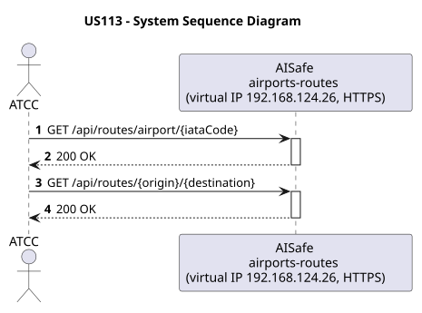
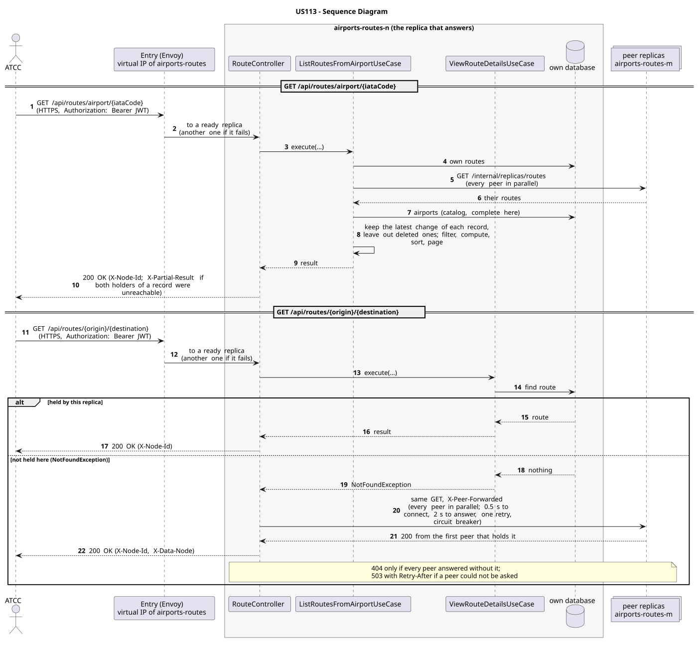

# US113 - View Routes

| Service         | Work package (monolith) | Monolith documentation                                                                    |
| --------------- | ----------------------- | ----------------------------------------------------------------------------------------- |
| airports-routes | WP3A                    | [US113](../../../../../docs_monolith/system-documentation/use-cases/WP3A/US113/README.md) |

## User Story

> As an **ATCC**, I want to view all routes from a specific airport, and to view the details of a route given its ID.

## Endpoints

| Method | Route                                | Roles | Use case                       |
| ------ | ------------------------------------ | ----- | ------------------------------ |
| GET    | `/api/routes/airport/{iataCode}`     | ATCC  | `ListRoutesFromAirportUseCase` |
| GET    | `/api/routes/{origin}/{destination}` | ATCC  | `ViewRouteDetailsUseCase`      |

Through the virtual IP of the service, HTTPS only, with a JWT issued by the login.

## Acceptance Criteria

- The system must allow listing routes departing from a specific origin airport.
- The system must allow retrieving route details by route ID.
- If the airport or route does not exist, the system returns HTTP 404.
- On success the system returns HTTP 200 with the requested data.

In the distributed system:

- The answer covers the records of every replica, not only those of the replica that answers.
- The same answer whatever replica receives the request: one that does not hold the data asks its peers, and names the holder in `X-Data-Node`.
- Every request and its answer are in the audit trail of the replica that answered.

## Pre-conditions

- The actor is authenticated through the login (JWT) with a role allowed for the route (see Endpoints).
- At least one replica of the service is ready.

## Post-conditions

- Route information is retrieved and presented to the actor.

## Main Success Scenario

**GET `/api/routes/airport/{iataCode}`**

1. The actor sends `GET /api/routes/airport/{iataCode}` with the JWT to the virtual IP of airports-routes (HTTPS); the entry (Envoy) of the machine that holds that IP passes it to a ready replica of airports-routes, and tries another replica if that one fails.
2. `ListRoutesFromAirportUseCase` gathers the routes of every replica: its own, plus those of each peer (`GET /internal/replicas/{type}`, all peers in parallel), keeping the latest change of each record and leaving out deleted ones. It reads the airports from its own copy of the catalog.
3. It filters, computes and sorts over the whole set, then answers 200.

**GET `/api/routes/{origin}/{destination}`**

1. The actor sends `GET /api/routes/{origin}/{destination}` with the JWT to the virtual IP of airports-routes (HTTPS); the entry (Envoy) of the machine that holds that IP passes it to a ready replica of airports-routes, and tries another replica if that one fails.
2. `ViewRouteDetailsUseCase` looks for the route in this replica's database.
3. If this replica holds it, it answers 200 with `X-Node-Id`. If not, it asks every peer in parallel (same request, marked `X-Peer-Forwarded`) and answers with the first holder's response, naming it in `X-Data-Node`.

## Alternative / Exception Flows

| Condition                                                                      | System Response                                                                           |
| ------------------------------------------------------------------------------ | ----------------------------------------------------------------------------------------- |
| Airport not found                                                              | HTTP 404                                                                                  |
| Route not found                                                                | HTTP 404                                                                                  |
| No routes found                                                                | HTTP 200 with empty list                                                                  |
| No valid token                                                                 | 401                                                                                       |
| The actor's role is not ATCC                                                   | 403                                                                                       |
| Both replicas that hold some record could not be asked                         | 200 with `X-Partial-Result: true`                                                         |
| The replica that got the request stops answering                               | the entry repeats a read on another replica; a write only if it never reached the replica |
| No replica holds it, and every peer answered                                   | 404                                                                                       |
| No replica answered with it, and some peer could not be asked (it may hold it) | 503 with `Retry-After`, `X-Unreachable-Peers` (never a 404 for data that may exist)       |

## Distribution

- `GET /api/routes/airport/{iataCode}`: The answer covers **every replica**: the records are partitioned (each on two replicas), so the replica that answers gathers them from all of them (`RoutesAcrossReplicas`).
- `GET /api/routes/{origin}/{destination}`: The route is a **record**: it lives on two replicas, its home and the next one in the ring. Any replica answers: one that does not hold it forwards the read to its peers.

## Tests

Distributed end to end, in the [Postman collection](../../../../postman/README.md): folder 1. Local access, folder 2. Forwarding between replicas, folder 8. Failures: with a replica down.

## Sequence Diagrams

### System Sequence Diagram (SSD)

### Sequence Diagram (SD)

Sources: [`puml/ssd_us113.puml`](puml/ssd_us113.puml), [`puml/sd_us113.puml`](puml/sd_us113.puml).
