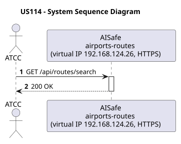
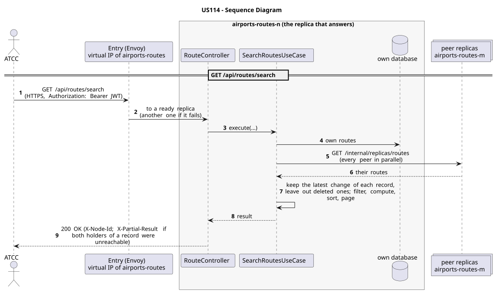

# US114 - Search Routes

| Service         | Work package (monolith) | Monolith documentation                                                                    |
| --------------- | ----------------------- | ----------------------------------------------------------------------------------------- |
| airports-routes | WP3A                    | [US114](../../../../../docs_monolith/system-documentation/use-cases/WP3A/US114/README.md) |

## User Story

> As an **ATCC**, I want to search for routes by origin, destination, or both.

## Endpoints

| Method | Route                | Roles | Use case              |
| ------ | -------------------- | ----- | --------------------- |
| GET    | `/api/routes/search` | ATCC  | `SearchRoutesUseCase` |

Through the virtual IP of the service, HTTPS only, with a JWT issued by the login.

## Acceptance Criteria

- The system must support filtering routes by:
- origin airport
- destination airport
- both origin and destination
- Search results must include route summaries.
- If no routes match the criteria, the system returns an empty list.
- On success the system returns HTTP 200.

In the distributed system:

- The answer covers the records of every replica, not only those of the replica that answers.
- Every request and its answer are in the audit trail of the replica that answered.

## Pre-conditions

- The actor is authenticated through the login (JWT) with a role allowed for the route (see Endpoints).
- At least one replica of the service is ready.

## Post-conditions

- Matching routes are retrieved and presented to the actor.

## Main Success Scenario

1. The actor sends `GET /api/routes/search` with the JWT to the virtual IP of airports-routes (HTTPS); the entry (Envoy) of the machine that holds that IP passes it to a ready replica of airports-routes, and tries another replica if that one fails.
2. `SearchRoutesUseCase` gathers the routes of every replica: its own, plus those of each peer (`GET /internal/replicas/{type}`, all peers in parallel), keeping the latest change of each record and leaving out deleted ones.
3. It filters, computes and sorts over the whole set, then answers 200.

## Alternative / Exception Flows

| Condition                                              | System Response                                                                           |
| ------------------------------------------------------ | ----------------------------------------------------------------------------------------- |
| Invalid filter format                                  | HTTP 400                                                                                  |
| No matching routes found                               | HTTP 200 with empty list                                                                  |
| No valid token                                         | 401                                                                                       |
| The actor's role is not ATCC                           | 403                                                                                       |
| Both replicas that hold some record could not be asked | 200 with `X-Partial-Result: true`                                                         |
| The replica that got the request stops answering       | the entry repeats a read on another replica; a write only if it never reached the replica |

## Distribution

The answer covers **every replica**: the records are partitioned (each on two replicas), so the replica that answers gathers them from all of them (`RoutesAcrossReplicas`).

## Tests

Distributed end to end, in the [Postman collection](../../../../postman/README.md): folder 3. Aggregation over every replica, folder 8. Failures: with a replica down.

## Sequence Diagrams

### System Sequence Diagram (SSD)

### Sequence Diagram (SD)

Sources: [`puml/ssd_us114.puml`](puml/ssd_us114.puml), [`puml/sd_us114.puml`](puml/sd_us114.puml).
