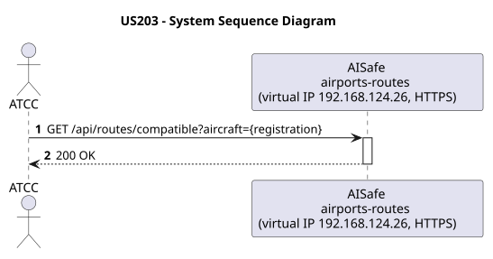
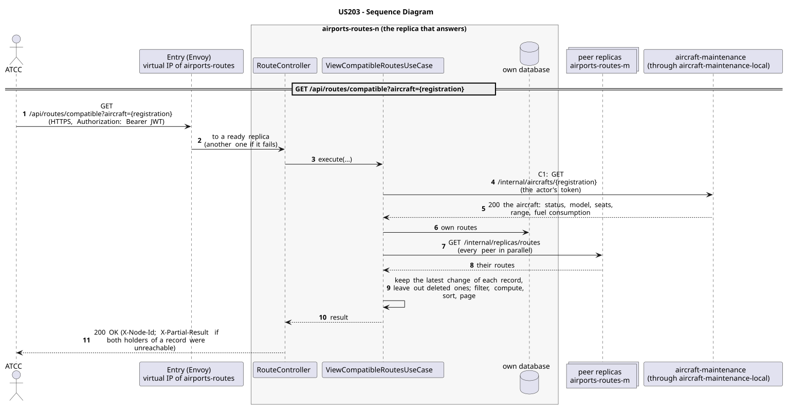

# US203 - View Compatible Routes for an Aircraft

| Service         | Work package (monolith) | Monolith documentation                                                                    |
| --------------- | ----------------------- | ----------------------------------------------------------------------------------------- |
| airports-routes | WP1B                    | [US203](../../../../../docs_monolith/system-documentation/use-cases/WP1B/US203/README.md) |

## User Story

> As an ATCC user, I want to view a list of compatible routes for a specific aircraft to help with route assignment planning.

## Endpoints

| Method | Route                                            | Roles | Use case                      |
| ------ | ------------------------------------------------ | ----- | ----------------------------- |
| GET    | `/api/routes/compatible?aircraft={registration}` | ATCC  | `ViewCompatibleRoutesUseCase` |

Through the virtual IP of the service, HTTPS only, with a JWT issued by the login.

## Changes from the monolith

- In the monolith this was `GET /api/aircrafts/{registration}/compatible-routes`. It needs the routes, which airports-routes owns, so it moved there; airports-routes asks aircraft-maintenance for the aircraft (C1) instead of aircraft-maintenance depending on airports-routes.

## Acceptance Criteria

- The request must specify the aircraft by its `registrationNumber` in the URL.
- A route is considered compatible if the aircraft's `range` is greater than or equal to the route's `minimumRange` AND the aircraft's `seatCapacity` is greater than or equal to the route's `minimumCapacity`.
- The system returns HTTP 200 with a list of compatible `Route` DTOs.
- If the aircraft does not exist, the system returns HTTP 404.

In the distributed system:

- The answer covers the records of every replica, not only those of the replica that answers.
- Every request and its answer are in the audit trail of the replica that answered.

## Pre-conditions

- The actor is authenticated through the login (JWT) with a role allowed for the route (see Endpoints).
- The aircraft with the given registration exists.
- At least one replica of the service is ready.
- aircraft-maintenance answers (contracts C1).

## Post-conditions

- No state change occurs; the use case is read-only.

## Main Success Scenario

1. The actor sends `GET /api/routes/compatible?aircraft={registration}` with the JWT to the virtual IP of airports-routes (HTTPS); the entry (Envoy) of the machine that holds that IP passes it to a ready replica of airports-routes, and tries another replica if that one fails.
2. The replica asks aircraft-maintenance for the aircraft: status, model, seats, range, fuel consumption (contract C1: `GET /internal/aircrafts/{registration}`, through the entry of its own machine, `aircraft-maintenance-local`), forwarding the actor's token.
3. `ViewCompatibleRoutesUseCase` gathers the routes of every replica: its own, plus those of each peer (`GET /internal/replicas/{type}`, all peers in parallel), keeping the latest change of each record and leaving out deleted ones.
4. It filters, computes and sorts over the whole set, then answers 200.

## Alternative / Exception Flows

| Condition                                              | System Response                                                                           |
| ------------------------------------------------------ | ----------------------------------------------------------------------------------------- |
| Aircraft not found                                     | HTTP 404                                                                                  |
| No valid token                                         | 401                                                                                       |
| The actor's role is not ATCC                           | 403                                                                                       |
| Both replicas that hold some record could not be asked | 200 with `X-Partial-Result: true`                                                         |
| aircraft-maintenance does not answer (contract C1)     | 503 with `Retry-After`                                                                    |
| The replica that got the request stops answering       | the entry repeats a read on another replica; a write only if it never reached the replica |

## Distribution

The answer covers **every replica**: the records are partitioned (each on two replicas), so the replica that answers gathers them from all of them (`RoutesAcrossReplicas`).

## Tests

Distributed end to end, in the [Postman collection](../../../../postman/README.md): folder 5. Between services, folder 7. Access control (roles).

## Sequence Diagrams

### System Sequence Diagram (SSD)

### Sequence Diagram (SD)

Sources: [`puml/ssd_us203.puml`](puml/ssd_us203.puml), [`puml/sd_us203.puml`](puml/sd_us203.puml).
