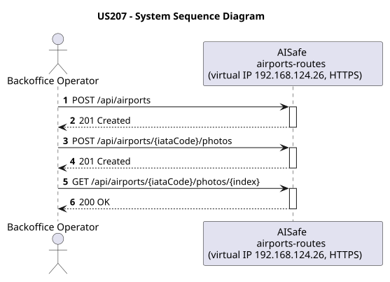
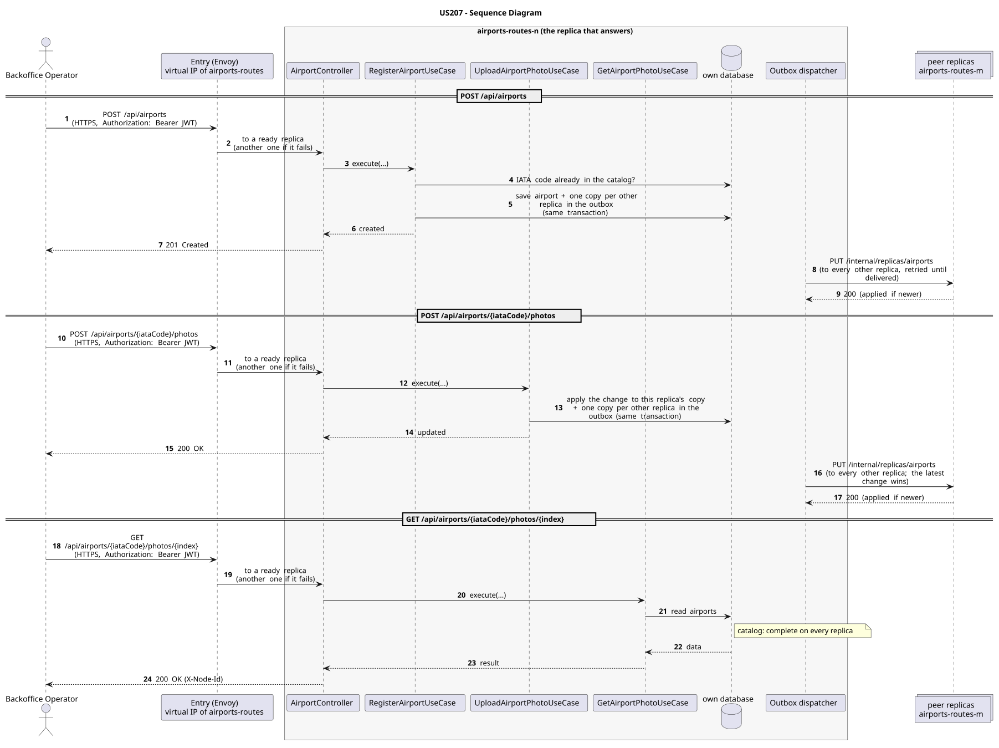

# US207 - Register Airport with Optional Photo Upload

| Service         | Work package (monolith) | Monolith documentation                                                                    |
| --------------- | ----------------------- | ----------------------------------------------------------------------------------------- |
| airports-routes | WP2B                    | [US207](../../../../../docs_monolith/system-documentation/use-cases/WP2B/US207/README.md) |

## User Story

> As a **Backoffice Operator**, I want to register an airport with optional photo and detailed facilities information (terminals, gates, services), and manage that photo independently.

## Endpoints

| Method | Route                                     | Roles                     | Use case                    |
| ------ | ----------------------------------------- | ------------------------- | --------------------------- |
| POST   | `/api/airports` (multipart, with photos)  | Backoffice Operator       | `RegisterAirportUseCase`    |
| POST   | `/api/airports/{iataCode}/photos`         | Backoffice Operator       | `UploadAirportPhotoUseCase` |
| GET    | `/api/airports/{iataCode}/photos/{index}` | Backoffice Operator, ATCC | `GetAirportPhotoUseCase`    |

Through the virtual IP of the service, HTTPS only, with a JWT issued by the login.

## Acceptance Criteria

- A `POST /api/airports` with `Content-Type: multipart/form-data` accepts the same airport fields as the JSON path plus an optional `photo` file part.
- A `POST /api/airports` with `Content-Type: application/json` that includes an `image` field returns HTTP 400 with a message directing the client to use multipart/form-data.
- Only files with a MIME type starting with `image/` are accepted; any other type returns HTTP 400.
- `AirportResponse` carries a `hasPhoto: boolean` flag instead of raw bytes.
- `PATCH /api/airports/{iataCode}/photo` replaces or sets the photo for an existing airport and returns the updated `AirportResponse`.
- `GET /api/airports/{iataCode}/photo` returns the raw photo bytes with the original `Content-Type` header (e.g. `image/jpeg`).
- `GET /api/airports/{iataCode}/photo` on an airport with no photo returns HTTP 404.
- All facility fields (services, terminals, gates, photo) remain optional; the airport can be registered without them and updated later via US208 or the dedicated photo endpoint.

In the distributed system:

- The new entry reaches every replica once the copies are delivered (normally right after the answer).
- The change reaches every replica; of two concurrent changes, the latest wins.
- Any replica answers with the whole catalog, without asking its peers.
- Every request and its answer are in the audit trail of the replica that answered.

## Pre-conditions

- The actor is authenticated through the login (JWT) with a role allowed for the route (see Endpoints).
- No airport with the given IATA code exists in the system.
- For PATCH and GET: an airport with the given IATA code exists.
- At least one replica of the service is ready.

## Post-conditions

- On multipart POST: a new `Airport` entity is persisted with the optional `AirportPhoto` value object and status `OPERATIONAL`.
- On PATCH: the existing airport's photo is replaced in the database.
- On GET: no state change; the stored bytes are returned with the correct `Content-Type`.
- The change is on every replica once the outbox delivers it.

## Main Success Scenario

**POST `/api/airports`**

1. The actor sends `POST /api/airports` with the JWT to the virtual IP of airports-routes (HTTPS); the entry (Envoy) of the machine that holds that IP passes it to a ready replica of airports-routes, and tries another replica if that one fails.
2. `RegisterAirportUseCase` validates the request and checks that no airport with the same IATA code exists (the catalog is complete on every replica).
3. It stores the airport and, in the same transaction, one copy for every other replica in the outbox; it answers 201.
4. Right after the commit the outbox sends the copies (`PUT /internal/replicas/airports`), retrying until each one is delivered.

**POST `/api/airports/{iataCode}/photos`**

1. The actor sends `POST /api/airports/{iataCode}/photos` with the JWT to the virtual IP of airports-routes (HTTPS); the entry (Envoy) of the machine that holds that IP passes it to a ready replica of airports-routes, and tries another replica if that one fails.
2. `UploadAirportPhotoUseCase` applies the change to this replica's copy of the airport (every replica has the catalog) and stores, in the same transaction, one copy for every other replica in the outbox; it answers 200.
3. The outbox delivers the change to every other replica (`PUT /internal/replicas/airports`); the latest change wins.

**GET `/api/airports/{iataCode}/photos/{index}`**

1. The actor sends `GET /api/airports/{iataCode}/photos/{index}` with the JWT to the virtual IP of airports-routes (HTTPS); the entry (Envoy) of the machine that holds that IP passes it to a ready replica of airports-routes, and tries another replica if that one fails.
2. `GetAirportPhotoUseCase` reads the airports from this replica's own database: the catalog is complete on every replica, so no peer is asked.
3. The replica answers 200 (with `X-Node-Id`).

## Alternative / Exception Flows

| Condition                                         | System Response                                                                           |
| ------------------------------------------------- | ----------------------------------------------------------------------------------------- |
| Uploaded file MIME type is not `image/*`          | HTTP 400                                                                                  |
| JSON POST includes `image` field                  | HTTP 400 - hint to use multipart/form-data                                                |
| Required field missing or invalid                 | HTTP 400                                                                                  |
| IATA code already registered                      | HTTP 409 Conflict                                                                         |
| PATCH / GET: airport not found                    | HTTP 404                                                                                  |
| GET: airport has no photo                         | HTTP 404                                                                                  |
| No valid token                                    | 401                                                                                       |
| The actor's role is not Backoffice Operator       | 403                                                                                       |
| The replica that got the request stops answering  | the entry repeats a read on another replica; a write only if it never reached the replica |
| The actor's role is not Backoffice Operator, ATCC | 403                                                                                       |

## Distribution

- `POST /api/airports`: The airport belongs to a **catalog**: every replica holds all of it, and every change is copied to all of them (last writer wins).
- `POST /api/airports/{iataCode}/photos`: The airport belongs to a **catalog**: every replica holds all of it, and every change is copied to all of them (last writer wins).
- `GET /api/airports/{iataCode}/photos/{index}`: The airports are a **catalog**: every replica holds all of them, so any replica answers by itself.

## Tests

Not in the distributed Postman collection; covered by the unit and integration tests of airports-routes (`./mvnw test`), and served by the same forwarding, gathering and replication as the routes the collection does test.

## Sequence Diagrams

### System Sequence Diagram (SSD)

### Sequence Diagram (SD)

Sources: [`puml/ssd_us207.puml`](puml/ssd_us207.puml), [`puml/sd_us207.puml`](puml/sd_us207.puml).
