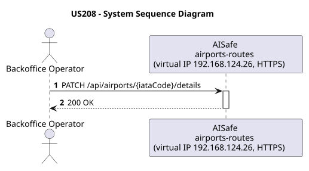
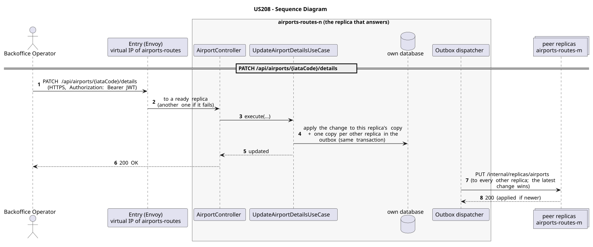

# US208 - Update Airport Details

| Service         | Work package (monolith) | Monolith documentation                                                                    |
| --------------- | ----------------------- | ----------------------------------------------------------------------------------------- |
| airports-routes | WP2B                    | [US208](../../../../../docs_monolith/system-documentation/use-cases/WP2B/US208/README.md) |

## User Story

> As a **Backoffice Operator**, I want to update airport details including operational hours and contact information.

## Endpoints

| Method | Route                              | Roles               | Use case                      |
| ------ | ---------------------------------- | ------------------- | ----------------------------- |
| PATCH  | `/api/airports/{iataCode}/details` | Backoffice Operator | `UpdateAirportDetailsUseCase` |

Through the virtual IP of the service, HTTPS only, with a JWT issued by the login.

## Acceptance Criteria

- Updatable fields: operational hours, contacts (type, value, description), services, terminals, gates.
- All fields are optional; only provided fields are updated (partial update semantics).
- Contact types must be valid values (`PHONE`, `EMAIL`, `FAX`, etc.).
- The airport must exist.
- On success the system returns HTTP 200 with the updated airport representation.
- Airport not found returns HTTP 404.
- Concurrent update conflict returns HTTP 412.

In the distributed system:

- The change reaches every replica; of two concurrent changes, the latest wins.
- Every request and its answer are in the audit trail of the replica that answered.

## Pre-conditions

- The actor is authenticated through the login (JWT) with a role allowed for the route (see Endpoints).
- The target airport exists.
- At least one replica of the service is ready.

## Post-conditions

- The airport's updatable fields are replaced with the provided values.
- Fields not present in the request remain unchanged.
- The change is on every replica once the outbox delivers it.

## Main Success Scenario

1. The actor sends `PATCH /api/airports/{iataCode}/details` with the JWT to the virtual IP of airports-routes (HTTPS); the entry (Envoy) of the machine that holds that IP passes it to a ready replica of airports-routes, and tries another replica if that one fails.
2. `UpdateAirportDetailsUseCase` applies the change to this replica's copy of the airport (every replica has the catalog) and stores, in the same transaction, one copy for every other replica in the outbox; it answers 200.
3. The outbox delivers the change to every other replica (`PUT /internal/replicas/airports`); the latest change wins.

## Alternative / Exception Flows

| Condition                                        | System Response                                                                           |
| ------------------------------------------------ | ----------------------------------------------------------------------------------------- |
| Airport not found                                | HTTP 404                                                                                  |
| Optimistic locking version conflict              | HTTP 412                                                                                  |
| No valid token                                   | 401                                                                                       |
| The actor's role is not Backoffice Operator      | 403                                                                                       |
| The replica that got the request stops answering | the entry repeats a read on another replica; a write only if it never reached the replica |

## Distribution

The airport belongs to a **catalog**: every replica holds all of it, and every change is copied to all of them (last writer wins).

## Tests

Not in the distributed Postman collection; covered by the unit and integration tests of airports-routes (`./mvnw test`), and served by the same forwarding, gathering and replication as the routes the collection does test.

## Sequence Diagrams

### System Sequence Diagram (SSD)

### Sequence Diagram (SD)

Sources: [`puml/ssd_us208.puml`](puml/ssd_us208.puml), [`puml/sd_us208.puml`](puml/sd_us208.puml).
