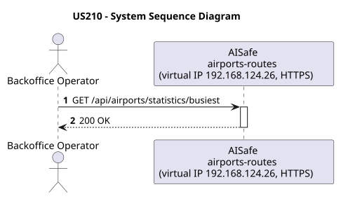
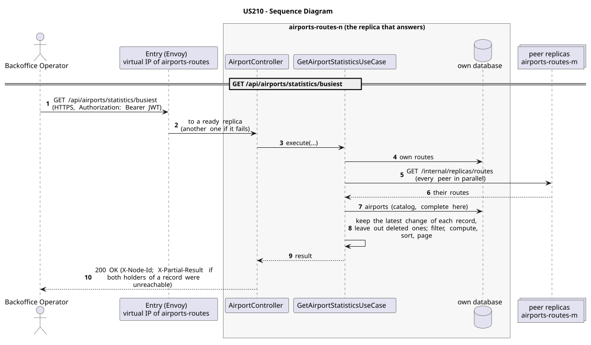

# US210 - Statistics on Busiest Airports

| Service         | Work package (monolith) | Monolith documentation                                                                    |
| --------------- | ----------------------- | ----------------------------------------------------------------------------------------- |
| airports-routes | WP2B                    | [US210](../../../../../docs_monolith/system-documentation/use-cases/WP2B/US210/README.md) |

## User Story

> As a **Backoffice Operator**, I want to generate statistics on the busiest airports by number of routes.

## Endpoints

| Method | Route                              | Roles               | Use case                      |
| ------ | ---------------------------------- | ------------------- | ----------------------------- |
| GET    | `/api/airports/statistics/busiest` | Backoffice Operator | `GetAirportStatisticsUseCase` |

Through the virtual IP of the service, HTTPS only, with a JWT issued by the login.

## Acceptance Criteria

- The system returns all airports ranked by total number of associated routes (origin + destination), in descending order.
- Each entry includes: IATA code, name, city, country, and route count.
- Airports with zero routes are included in the result.
- The system returns HTTP 200.

In the distributed system:

- The answer covers the records of every replica, not only those of the replica that answers.
- Every request and its answer are in the audit trail of the replica that answered.

## Pre-conditions

- The actor is authenticated through the login (JWT) with a role allowed for the route (see Endpoints).
- At least one replica of the service is ready.

## Post-conditions

- No state change. Read-only operation.

## Main Success Scenario

1. The actor sends `GET /api/airports/statistics/busiest` with the JWT to the virtual IP of airports-routes (HTTPS); the entry (Envoy) of the machine that holds that IP passes it to a ready replica of airports-routes, and tries another replica if that one fails.
2. `GetAirportStatisticsUseCase` gathers the routes of every replica: its own, plus those of each peer (`GET /internal/replicas/{type}`, all peers in parallel), keeping the latest change of each record and leaving out deleted ones. It reads the airports from its own copy of the catalog.
3. It filters, computes and sorts over the whole set, then answers 200.

## Alternative / Exception Flows

| Condition                                              | System Response                                                                           |
| ------------------------------------------------------ | ----------------------------------------------------------------------------------------- |
| No airports registered                                 | HTTP 200 with empty list                                                                  |
| No valid token                                         | 401                                                                                       |
| The actor's role is not Backoffice Operator            | 403                                                                                       |
| Both replicas that hold some record could not be asked | 200 with `X-Partial-Result: true`                                                         |
| The replica that got the request stops answering       | the entry repeats a read on another replica; a write only if it never reached the replica |

## Distribution

The answer covers **every replica**: the records are partitioned (each on two replicas), so the replica that answers gathers them from all of them (`RoutesAcrossReplicas`).

## Tests

Not in the distributed Postman collection; covered by the unit and integration tests of airports-routes (`./mvnw test`), and served by the same forwarding, gathering and replication as the routes the collection does test.

## Sequence Diagrams

### System Sequence Diagram (SSD)

### Sequence Diagram (SD)

Sources: [`puml/ssd_us210.puml`](puml/ssd_us210.puml), [`puml/sd_us210.puml`](puml/sd_us210.puml).
