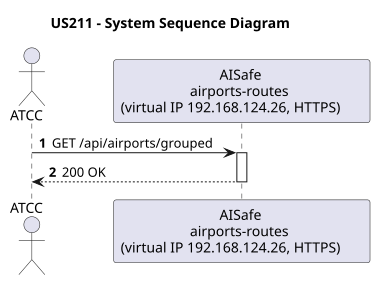
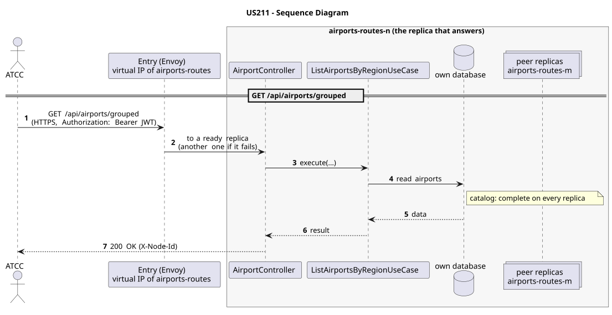

# US211 - View Airports Grouped by Region or Country

| Service         | Work package (monolith) | Monolith documentation                                                                    |
| --------------- | ----------------------- | ----------------------------------------------------------------------------------------- |
| airports-routes | WP2B                    | [US211](../../../../../docs_monolith/system-documentation/use-cases/WP2B/US211/README.md) |

## User Story

> As an **ATCC**, I want to view airports grouped by region or country.

## Endpoints

| Method | Route                   | Roles                     | Use case                      |
| ------ | ----------------------- | ------------------------- | ----------------------------- |
| GET    | `/api/airports/grouped` | ATCC, Backoffice Operator | `ListAirportsByRegionUseCase` |

Through the virtual IP of the service, HTTPS only, with a JWT issued by the login.

## Acceptance Criteria

- The default grouping is by region; passing `?by=country` groups by country instead.
- Groups are returned sorted alphabetically by group key.
- Airports without a region are placed in a group labelled `"Unknown"`.
- Each group contains the full airport representations.
- The system returns HTTP 200.

In the distributed system:

- Any replica answers with the whole catalog, without asking its peers.
- Every request and its answer are in the audit trail of the replica that answered.

## Pre-conditions

- The actor is authenticated through the login (JWT) with a role allowed for the route (see Endpoints).
- At least one replica of the service is ready.

## Post-conditions

- No state change. Read-only operation.

## Main Success Scenario

1. The actor sends `GET /api/airports/grouped` with the JWT to the virtual IP of airports-routes (HTTPS); the entry (Envoy) of the machine that holds that IP passes it to a ready replica of airports-routes, and tries another replica if that one fails.
2. `ListAirportsByRegionUseCase` reads the airports from this replica's own database: the catalog is complete on every replica, so no peer is asked.
3. The replica answers 200 (with `X-Node-Id`).

## Alternative / Exception Flows

| Condition                                         | System Response                                                                           |
| ------------------------------------------------- | ----------------------------------------------------------------------------------------- |
| No airports registered                            | HTTP 200 with empty list                                                                  |
| Airport has no region (region is null)            | Airport placed in `"Unknown"` group                                                       |
| No valid token                                    | 401                                                                                       |
| The actor's role is not ATCC, Backoffice Operator | 403                                                                                       |
| The replica that got the request stops answering  | the entry repeats a read on another replica; a write only if it never reached the replica |

## Distribution

The airports are a **catalog**: every replica holds all of them, so any replica answers by itself.

## Tests

Not in the distributed Postman collection; covered by the unit and integration tests of airports-routes (`./mvnw test`), and served by the same forwarding, gathering and replication as the routes the collection does test.

## Sequence Diagrams

### System Sequence Diagram (SSD)

### Sequence Diagram (SD)

Sources: [`puml/ssd_us211.puml`](puml/ssd_us211.puml), [`puml/sd_us211.puml`](puml/sd_us211.puml).
