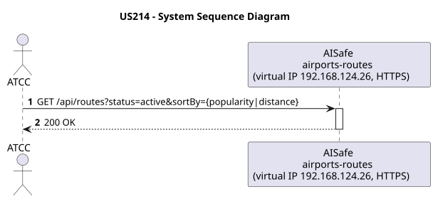
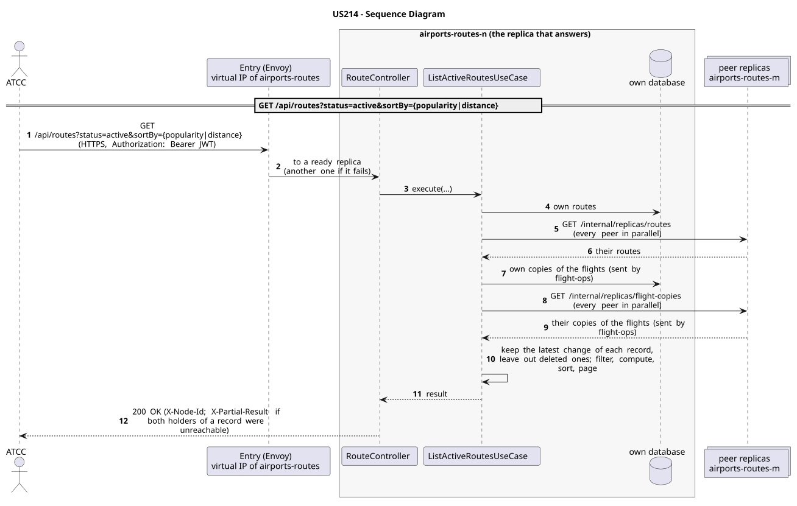

# US214 - List Active Routes Sorted by Popularity or Distance

| Service         | Work package (monolith) | Monolith documentation                                                                    |
| --------------- | ----------------------- | ----------------------------------------------------------------------------------------- |
| airports-routes | WP3B                    | [US214](../../../../../docs_monolith/system-documentation/use-cases/WP3B/US214/README.md) |

## User Story

> As an **ATCC**, I want to list all active routes sorted by popularity (number of times used) or distance.

## Endpoints

| Method | Route                                         | Roles      | Use case |
| ------ | --------------------------------------------- | ---------- | -------- |
| GET    | `/api/routes?status=active&sortBy={popularity | distance}` | ATCC     | `ListActiveRoutesUseCase` |

Through the virtual IP of the service, HTTPS only, with a JWT issued by the login.

## Changes from the monolith

- Popularity is the number of flights on a route: airports-routes counts the copies of the flights that flight-ops sends it (C5), gathered from every replica.

## Acceptance Criteria

- The system must fetch only routes marked as active.
- The request must allow a `sortBy` parameter (`distance` or `popularity`).
- If sorted by distance, the calculation must use the coordinates of the associated airports.
- On success, the system returns HTTP 200 with the sorted list.

In the distributed system:

- The answer covers the records of every replica, not only those of the replica that answers.
- Every request and its answer are in the audit trail of the replica that answered.

## Pre-conditions

- The actor is authenticated through the login (JWT) with a role allowed for the route (see Endpoints).
- At least one replica of the service is ready.

## Post-conditions

- None (Read-only operation).

## Main Success Scenario

1. The actor sends `GET /api/routes?status=active&sortBy={popularity|distance}` with the JWT to the virtual IP of airports-routes (HTTPS); the entry (Envoy) of the machine that holds that IP passes it to a ready replica of airports-routes, and tries another replica if that one fails.
2. `ListActiveRoutesUseCase` gathers the routes, the copies of the flights (sent by flight-ops) of every replica: its own, plus those of each peer (`GET /internal/replicas/{type}`, all peers in parallel), keeping the latest change of each record and leaving out deleted ones.
3. It filters, computes and sorts over the whole set, then answers 200.

## Alternative / Exception Flows

| Condition                                              | System Response                                                                           |
| ------------------------------------------------------ | ----------------------------------------------------------------------------------------- |
| Invalid `sortBy` parameter                             | HTTP 400 Bad Request                                                                      |
| Associated Airport missing/deleted                     | HTTP 500 Internal Server Error (Data integrity issue)                                     |
| No valid token                                         | 401                                                                                       |
| The actor's role is not ATCC                           | 403                                                                                       |
| Both replicas that hold some record could not be asked | 200 with `X-Partial-Result: true`                                                         |
| The replica that got the request stops answering       | the entry repeats a read on another replica; a write only if it never reached the replica |

## Distribution

The answer covers **every replica**: the records are partitioned (each on two replicas), so the replica that answers gathers them from all of them (`RoutesAcrossReplicas`, `FlightCopiesAcrossReplicas`).

## Tests

Distributed end to end, in the [Postman collection](../../../../postman/README.md): folder 3. Aggregation over every replica, folder 6. Flights: the scheduling Saga.

## Sequence Diagrams

### System Sequence Diagram (SSD)

### Sequence Diagram (SD)

Sources: [`puml/ssd_us214.puml`](puml/ssd_us214.puml), [`puml/sd_us214.puml`](puml/sd_us214.puml).
