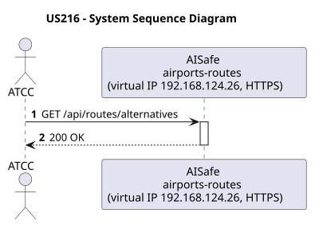
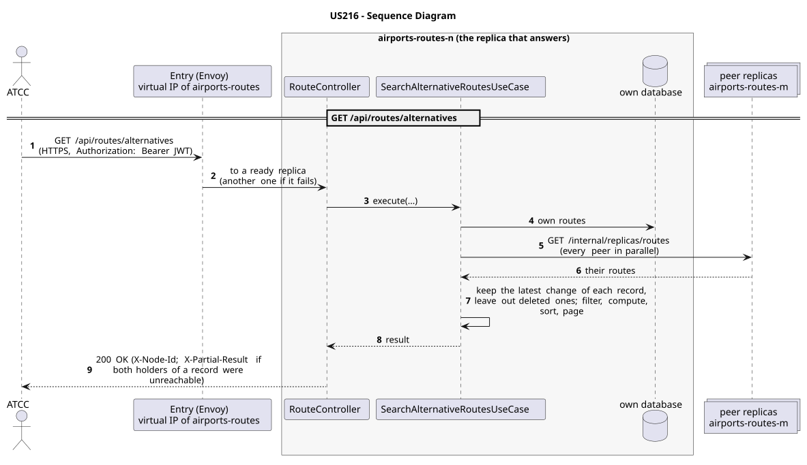

# US216 - Search Alternative Routes

| Service         | Work package (monolith) | Monolith documentation                                                                    |
| --------------- | ----------------------- | ----------------------------------------------------------------------------------------- |
| airports-routes | WP3B                    | [US216](../../../../../docs_monolith/system-documentation/use-cases/WP3B/US216/README.md) |

## User Story

> As an **ATCC**, I want to search for alternative routes between two airports.

## Endpoints

| Method | Route                      | Roles | Use case                         |
| ------ | -------------------------- | ----- | -------------------------------- |
| GET    | `/api/routes/alternatives` | ATCC  | `SearchAlternativeRoutesUseCase` |

Through the virtual IP of the service, HTTPS only, with a JWT issued by the login.

## Changes from the monolith

- The route graph is built from the routes of every replica (`NetworkGraphService`), so an alternative through a route held by another replica is found.

## Acceptance Criteria

- The request must specify an origin and destination airport (IATA codes).
- The system must return viable alternative paths (sequence of connected airports) that do not consist solely of the direct route.
- On success, the system returns HTTP 200 with the list of alternative paths.

In the distributed system:

- The answer covers the records of every replica, not only those of the replica that answers.
- Every request and its answer are in the audit trail of the replica that answered.

## Pre-conditions

- The actor is authenticated through the login (JWT) with a role allowed for the route (see Endpoints).
- Both origin and destination airports must exist.
- At least one replica of the service is ready.

## Post-conditions

- None (Read-only operation).

## Main Success Scenario

1. The actor sends `GET /api/routes/alternatives` with the JWT to the virtual IP of airports-routes (HTTPS); the entry (Envoy) of the machine that holds that IP passes it to a ready replica of airports-routes, and tries another replica if that one fails.
2. `SearchAlternativeRoutesUseCase` gathers the routes of every replica: its own, plus those of each peer (`GET /internal/replicas/{type}`, all peers in parallel), keeping the latest change of each record and leaving out deleted ones.
3. It filters, computes and sorts over the whole set, then answers 200.

## Alternative / Exception Flows

| Condition                                              | System Response                                                                           |
| ------------------------------------------------------ | ----------------------------------------------------------------------------------------- |
| Origin equals destination                              | HTTP 400 Bad Request                                                                      |
| One or both airports not found                         | HTTP 404 Not Found                                                                        |
| No alternative paths exist                             | HTTP 200 OK (Empty List)                                                                  |
| No valid token                                         | 401                                                                                       |
| The actor's role is not ATCC                           | 403                                                                                       |
| Both replicas that hold some record could not be asked | 200 with `X-Partial-Result: true`                                                         |
| The replica that got the request stops answering       | the entry repeats a read on another replica; a write only if it never reached the replica |

## Distribution

The answer covers **every replica**: the records are partitioned (each on two replicas), so the replica that answers gathers them from all of them (`RoutesAcrossReplicas`).

## Tests

Not in the distributed Postman collection; covered by the unit and integration tests of airports-routes (`./mvnw test`), and served by the same forwarding, gathering and replication as the routes the collection does test.

## Sequence Diagrams

### System Sequence Diagram (SSD)

### Sequence Diagram (SD)

Sources: [`puml/ssd_us216.puml`](puml/ssd_us216.puml), [`puml/sd_us216.puml`](puml/sd_us216.puml).
