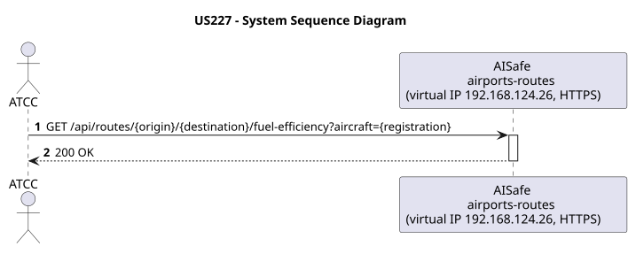
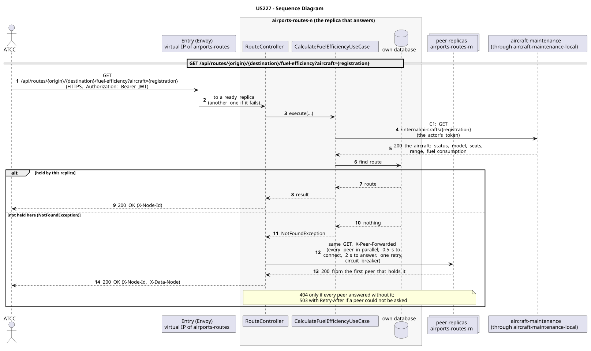

# US227 - Calculate Fuel Efficiency Metrics

| Service         | Work package (monolith) | Monolith documentation                                                                     |
| --------------- | ----------------------- | ------------------------------------------------------------------------------------------ |
| airports-routes | BONUS                   | [US227](../../../../../docs_monolith/system-documentation/use-cases/BONUS/US227/README.md) |

## User Story

> As an ATCC, I want to calculate fuel efficiency metrics per aircraft and per route.

## Endpoints

| Method | Route                                                                        | Roles | Use case                         |
| ------ | ---------------------------------------------------------------------------- | ----- | -------------------------------- |
| GET    | `/api/routes/{origin}/{destination}/fuel-efficiency?aircraft={registration}` | ATCC  | `CalculateFuelEfficiencyUseCase` |

Through the virtual IP of the service, HTTPS only, with a JWT issued by the login.

## Changes from the monolith

- In the monolith this was `GET /api/aircrafts/{registration}/fuel-efficiency`. It needs the route, which airports-routes owns, so it moved there and asks aircraft-maintenance for the aircraft (C1).

## Acceptance Criteria

- The request must specify the aircraft by its `registrationNumber` in the URL.
- The request can optionally specify an `origin` and `destination` IATA code pair to identify a route.
- The system calculates the base fuel consumption per distance unit using the aircraft's operational range and the model's fuel capacity.
- If a route is provided, the system also calculates the total fuel needed for that specific route based on its minimum range.
- The system returns HTTP 200 with the `FuelEfficiencyResponse` DTO.
- If the aircraft does not exist, the system returns HTTP 404.
- If the route does not exist, the system returns HTTP 400.

In the distributed system:

- The same answer whatever replica receives the request: one that does not hold the data asks its peers, and names the holder in `X-Data-Node`.
- Every request and its answer are in the audit trail of the replica that answered.

## Pre-conditions

- The actor is authenticated through the login (JWT) with a role allowed for the route (see Endpoints).
- The aircraft with the given registration exists.
- At least one replica of the service is ready.
- aircraft-maintenance answers (contracts C1).

## Post-conditions

- No state change occurs; the use case is read-only.

## Main Success Scenario

1. The actor sends `GET /api/routes/{origin}/{destination}/fuel-efficiency?aircraft={registration}` with the JWT to the virtual IP of airports-routes (HTTPS); the entry (Envoy) of the machine that holds that IP passes it to a ready replica of airports-routes, and tries another replica if that one fails.
2. The replica asks aircraft-maintenance for the aircraft: status, model, seats, range, fuel consumption (contract C1: `GET /internal/aircrafts/{registration}`, through the entry of its own machine, `aircraft-maintenance-local`), forwarding the actor's token.
3. `CalculateFuelEfficiencyUseCase` looks for the route in this replica's database.
4. If this replica holds it, it answers 200 with `X-Node-Id`. If not, it asks every peer in parallel (same request, marked `X-Peer-Forwarded`) and answers with the first holder's response, naming it in `X-Data-Node`.

## Alternative / Exception Flows

| Condition                                                                      | System Response                                                                           |
| ------------------------------------------------------------------------------ | ----------------------------------------------------------------------------------------- |
| Aircraft not found                                                             | HTTP 404                                                                                  |
| Route not found                                                                | HTTP 400                                                                                  |
| No valid token                                                                 | 401                                                                                       |
| The actor's role is not ATCC                                                   | 403                                                                                       |
| No replica holds it, and every peer answered                                   | 404                                                                                       |
| No replica answered with it, and some peer could not be asked (it may hold it) | 503 with `Retry-After`, `X-Unreachable-Peers` (never a 404 for data that may exist)       |
| aircraft-maintenance does not answer (contract C1)                             | 503 with `Retry-After`                                                                    |
| The replica that got the request stops answering                               | the entry repeats a read on another replica; a write only if it never reached the replica |

## Distribution

The route is a **record**: it lives on two replicas, its home and the next one in the ring. Any replica answers: one that does not hold it forwards the read to its peers.

## Tests

Distributed end to end, in the [Postman collection](../../../../postman/README.md): folder 5. Between services.

## Sequence Diagrams

### System Sequence Diagram (SSD)

### Sequence Diagram (SD)

Sources: [`puml/ssd_us227.puml`](puml/ssd_us227.puml), [`puml/sd_us227.puml`](puml/sd_us227.puml).
