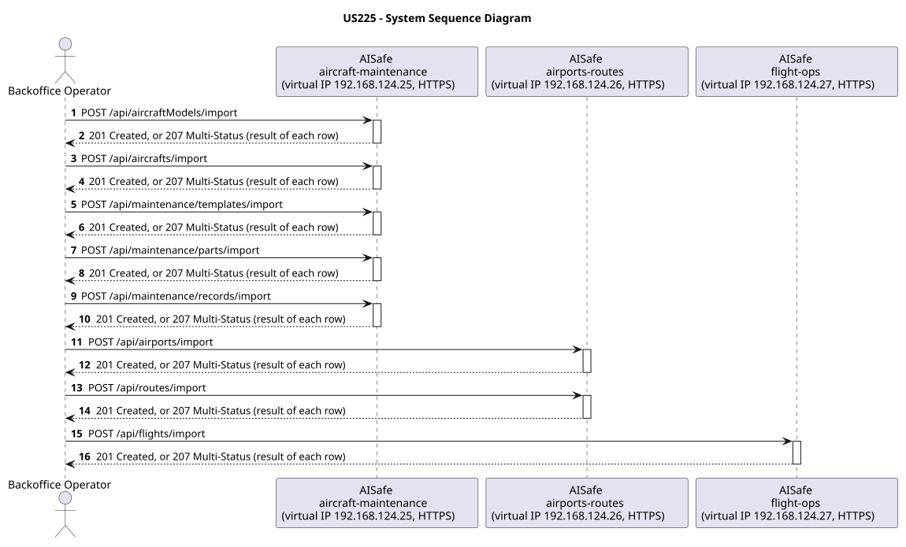
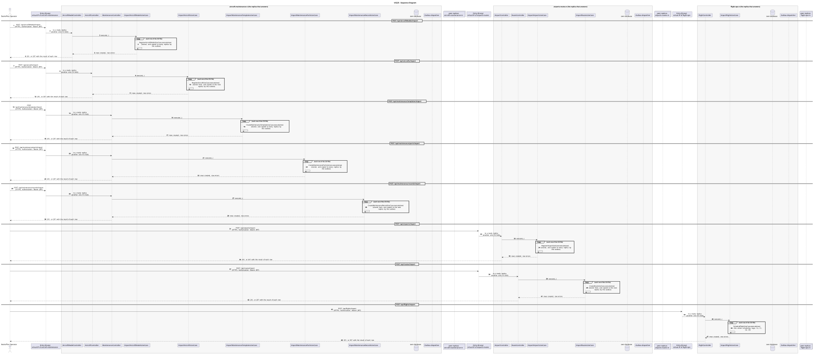

# US225 - Import Bulk Data (CSV)

| Service                                           | Work package (monolith) | Monolith documentation                                                                     |
| ------------------------------------------------- | ----------------------- | ------------------------------------------------------------------------------------------ |
| aircraft-maintenance, airports-routes, flight-ops | BONUS                   | [US225](../../../../../docs_monolith/system-documentation/use-cases/BONUS/US225/README.md) |

## User Story

> As a Backoffice Operator, I want to import data in bulk from CSV files across all domains so that I can efficiently populate the system.

## Endpoints

| Method | Route                               | Roles                                          | Use case                                                   |
| ------ | ----------------------------------- | ---------------------------------------------- | ---------------------------------------------------------- |
| POST   | `/api/aircraftModels/import`        | Backoffice Operator                            | `ImportAircraftModelsUseCase` (aircraft-maintenance)       |
| POST   | `/api/aircrafts/import`             | Backoffice Operator                            | `ImportAircraftsUseCase` (aircraft-maintenance)            |
| POST   | `/api/maintenance/templates/import` | Maintenance Technician                         | `ImportMaintenanceTemplatesUseCase` (aircraft-maintenance) |
| POST   | `/api/maintenance/parts/import`     | Maintenance Technician, Maintenance Supervisor | `ImportMaintenancePartsUseCase` (aircraft-maintenance)     |
| POST   | `/api/maintenance/records/import`   | Maintenance Technician                         | `ImportMaintenanceRecordsUseCase` (aircraft-maintenance)   |
| POST   | `/api/airports/import`              | Backoffice Operator                            | `ImportAirportsUseCase` (airports-routes)                  |
| POST   | `/api/routes/import`                | Backoffice Operator                            | `ImportRoutesUseCase` (airports-routes)                    |
| POST   | `/api/flights/import`               | Backoffice Operator                            | `ImportFlightsUseCase` (flight-ops)                        |

Through the virtual IP of the service, HTTPS only, with a JWT issued by the login.

## Changes from the monolith

- Each service imports its own data: the monolith's single import is split by owner. Every row goes through the same use case as a single create, so it is stored and copied exactly like one (a flight row runs the whole scheduling Saga).
- `POST /api/maintenance/parts/import` had no rule of its own in the monolith, so any authenticated user could call it; it now allows the same roles as creating a part (US226).

## Acceptance Criteria

- CSV files are uploaded using `multipart/form-data` via domain-specific import endpoints.
- The system parses the CSV file and processes each row independently.
- If all rows succeed, the system returns HTTP 201.
- If some rows fail, the system returns HTTP 207 Multi-Status with per-row success/error details.
- If the file is invalid or empty, the system returns HTTP 400.

In the distributed system:

- Each row is stored and copied as a single create would be.
- Every request and its answer are in the audit trail of the replica that answered.

## Pre-conditions

- The actor is authenticated through the login (JWT) with a role allowed for the route (see Endpoints).
- At least one replica of the service is ready.

## Post-conditions

- Valid rows are persisted as new entities in their respective domains.
- Invalid rows are reported with error details without affecting valid rows.

## Main Success Scenario

**POST `/api/aircraftModels/import`**

1. The actor sends `POST /api/aircraftModels/import` with the JWT to the virtual IP of aircraft-maintenance (HTTPS); the entry (Envoy) of the machine that holds that IP passes it to a ready replica of aircraft-maintenance, and tries another replica if that one fails.
2. `ImportAircraftModelsUseCase` reads the CSV file and runs `RegisterAircraftModelUseCase` for each row, as a single create would: each row is copied to every replica.
3. It answers with the rows created and the errors of the rejected rows.

**POST `/api/aircrafts/import`**

1. The actor sends `POST /api/aircrafts/import` with the JWT to the virtual IP of aircraft-maintenance (HTTPS); the entry (Envoy) of the machine that holds that IP passes it to a ready replica of aircraft-maintenance, and tries another replica if that one fails.
2. `ImportAircraftsUseCase` reads the CSV file and runs `RegisterAircraftUseCase` for each row, as a single create would: each row is stored on this replica and copied to the next one.
3. It answers with the rows created and the errors of the rejected rows.

**POST `/api/maintenance/templates/import`**

1. The actor sends `POST /api/maintenance/templates/import` with the JWT to the virtual IP of aircraft-maintenance (HTTPS); the entry (Envoy) of the machine that holds that IP passes it to a ready replica of aircraft-maintenance, and tries another replica if that one fails.
2. `ImportMaintenanceTemplatesUseCase` reads the CSV file and runs `CreateMaintenanceTemplateUseCase` for each row, as a single create would: each row is copied to every replica.
3. It answers with the rows created and the errors of the rejected rows.

**POST `/api/maintenance/parts/import`**

1. The actor sends `POST /api/maintenance/parts/import` with the JWT to the virtual IP of aircraft-maintenance (HTTPS); the entry (Envoy) of the machine that holds that IP passes it to a ready replica of aircraft-maintenance, and tries another replica if that one fails.
2. `ImportMaintenancePartsUseCase` reads the CSV file and runs `CreateMaintenancePartUseCase` for each row, as a single create would: each row is copied to every replica.
3. It answers with the rows created and the errors of the rejected rows.

**POST `/api/maintenance/records/import`**

1. The actor sends `POST /api/maintenance/records/import` with the JWT to the virtual IP of aircraft-maintenance (HTTPS); the entry (Envoy) of the machine that holds that IP passes it to a ready replica of aircraft-maintenance, and tries another replica if that one fails.
2. `ImportMaintenanceRecordsUseCase` reads the CSV file and runs `CreateMaintenanceRecordUseCase` for each row, as a single create would: each row is stored on this replica and copied to the next one.
3. It answers with the rows created and the errors of the rejected rows.

**POST `/api/airports/import`**

1. The actor sends `POST /api/airports/import` with the JWT to the virtual IP of airports-routes (HTTPS); the entry (Envoy) of the machine that holds that IP passes it to a ready replica of airports-routes, and tries another replica if that one fails.
2. `ImportAirportsUseCase` reads the CSV file and runs `RegisterAirportUseCase` for each row, as a single create would: each row is copied to every replica.
3. It answers with the rows created and the errors of the rejected rows.

**POST `/api/routes/import`**

1. The actor sends `POST /api/routes/import` with the JWT to the virtual IP of airports-routes (HTTPS); the entry (Envoy) of the machine that holds that IP passes it to a ready replica of airports-routes, and tries another replica if that one fails.
2. `ImportRoutesUseCase` reads the CSV file and runs `CreateRouteUseCase` for each row, as a single create would: each row is stored on this replica and copied to the next one.
3. It answers with the rows created and the errors of the rejected rows.

**POST `/api/flights/import`**

1. The actor sends `POST /api/flights/import` with the JWT to the virtual IP of flight-ops (HTTPS); the entry (Envoy) of the machine that holds that IP passes it to a ready replica of flight-ops, and tries another replica if that one fails.
2. `ImportFlightsUseCase` reads the CSV file and runs `ScheduleFlightUseCase` for each row, as a single create would: each row is scheduled with the whole Saga (C2, C1, C4, C5).
3. It answers with the rows created and the errors of the rejected rows.

## Alternative / Exception Flows

| Condition                                                              | System Response                                                                           |
| ---------------------------------------------------------------------- | ----------------------------------------------------------------------------------------- |
| File is invalid or empty                                               | HTTP 400                                                                                  |
| Some rows fail                                                         | HTTP 207 with per-row success/error details in the response                               |
| No valid token                                                         | 401                                                                                       |
| The actor's role is not Backoffice Operator                            | 403                                                                                       |
| The replica that got the request stops answering                       | the entry repeats a read on another replica; a write only if it never reached the replica |
| The actor's role is not Maintenance Technician                         | 403                                                                                       |
| The actor's role is not Maintenance Technician, Maintenance Supervisor | 403                                                                                       |

## Distribution

- `POST /api/aircraftModels/import`: Each row follows the rules of the create it runs (see the use case of each row).
- `POST /api/aircrafts/import`: Each row follows the rules of the create it runs (see the use case of each row).
- `POST /api/maintenance/templates/import`: Each row follows the rules of the create it runs (see the use case of each row).
- `POST /api/maintenance/parts/import`: Each row follows the rules of the create it runs (see the use case of each row).
- `POST /api/maintenance/records/import`: Each row follows the rules of the create it runs (see the use case of each row).
- `POST /api/airports/import`: Each row follows the rules of the create it runs (see the use case of each row).
- `POST /api/routes/import`: Each row follows the rules of the create it runs (see the use case of each row).
- `POST /api/flights/import`: Each row follows the rules of the create it runs (see the use case of each row).

## Tests

Not in the distributed Postman collection; covered by the unit and integration tests of aircraft-maintenance, airports-routes, flight-ops (`./mvnw test`), and served by the same forwarding, gathering and replication as the routes the collection does test.

## Sequence Diagrams

### System Sequence Diagram (SSD)

### Sequence Diagram (SD)

Sources: [`puml/ssd_us225.puml`](puml/ssd_us225.puml), [`puml/sd_us225.puml`](puml/sd_us225.puml).
