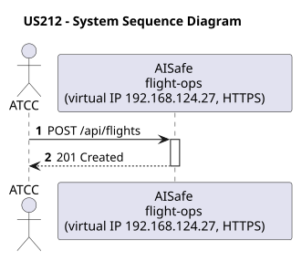
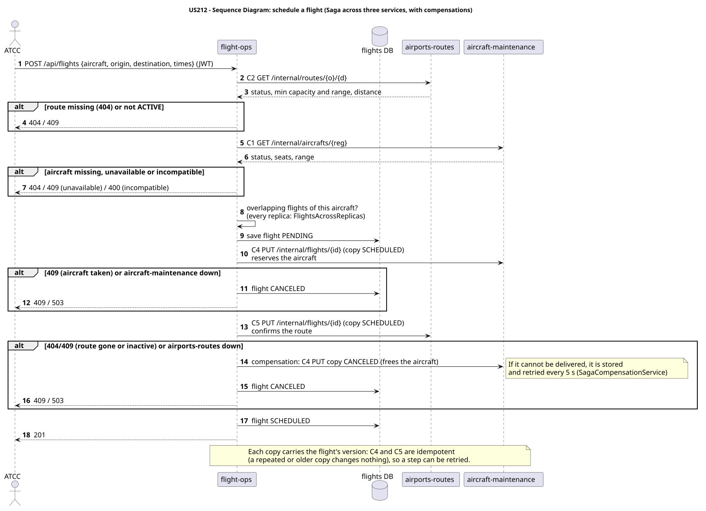

# US212 - Assign Aircraft to Route (Scheduled Flight)

| Service    | Work package (monolith) | Monolith documentation                                                                    |
| ---------- | ----------------------- | ----------------------------------------------------------------------------------------- |
| flight-ops | WP3B                    | [US212](../../../../../docs_monolith/system-documentation/use-cases/WP3B/US212/README.md) |

## User Story

> As an **ATCC**, I want to assign an aircraft to a route for a specific date and time to create a scheduled flight. These should comply with range requirements, airplane and airport availability.

## Endpoints

| Method | Route          | Roles | Use case                |
| ------ | -------------- | ----- | ----------------------- |
| POST   | `/api/flights` | ATCC  | `ScheduleFlightUseCase` |

Through the virtual IP of the service, HTTPS only, with a JWT issued by the login.

## Acceptance Criteria

- The request must include the aircraft ID, route ID, departure datetime, and arrival datetime.
- The system must validate that the route's distance does not exceed the aircraft's maximum range.
- The system must validate that the aircraft's seating capacity meets the route's minimum capacity requirement.
- The system must validate that the aircraft's range meets the route's minimum range requirement.
- The system must validate that the aircraft is not under maintenance or inactive.
- The system must validate that the aircraft is available (no overlapping flights in the given timeframe).
- On success, the system returns HTTP 201 with the created flight representation.

In the distributed system:

- Either the flight ends SCHEDULED with its copies in aircraft-maintenance and airports-routes, or nothing is left of it (compensations).
- Every request and its answer are in the audit trail of the replica that answered.

## Pre-conditions

- The actor is authenticated through the login (JWT) with a role allowed for the route (see Endpoints).
- Both the specified Aircraft and Route must exist in the system.
- At least one replica of the service is ready.
- aircraft-maintenance, airports-routes answers (contracts C1, C2, C4, C5).

## Post-conditions

- A new `Flight` entity is persisted in the database, linking the aircraft and the route for the specified timeframe.

## Main Success Scenario

1. The actor sends `POST /api/flights` with the JWT to the virtual IP of flight-ops (HTTPS); the entry (Envoy) of the machine that holds that IP passes it to a ready replica of flight-ops, and tries another replica if that one fails.
2. `ScheduleFlightUseCase` asks airports-routes for the route (C2) and aircraft-maintenance for the aircraft (C1), and checks capacity, range and that the aircraft is free at that time, over the flights of every replica.
3. It stores the flight as PENDING (with an id that ends in this replica's digit) and copies it to the next replica.
4. It sends a copy of the flight to aircraft-maintenance (C4, the aircraft is reserved) and to airports-routes (C5, the route counts one more flight).
5. If a step is refused, the steps already done are undone (compensations); a compensation that cannot be delivered is stored and retried every 5 s until it is.
6. The flight becomes SCHEDULED and the replica answers 201.

## Alternative / Exception Flows

| Condition                                                        | System Response                                                                           |
| ---------------------------------------------------------------- | ----------------------------------------------------------------------------------------- |
| Route or Aircraft not found                                      | HTTP 404 Not Found                                                                        |
| Route distance > Aircraft range                                  | HTTP 400 Bad Request (Business Rule Violation)                                            |
| Aircraft range < Route minimum                                   | HTTP 400 Bad Request (Business Rule Violation)                                            |
| Seating capacity < Route minimum                                 | HTTP 400 Bad Request (Business Rule Violation)                                            |
| Aircraft is under maintenance/inactive                           | HTTP 409 Conflict (Aircraft Unavailable)                                                  |
| Aircraft schedule overlaps                                       | HTTP 409 Conflict (Aircraft Unavailable)                                                  |
| No valid token                                                   | 401                                                                                       |
| The actor's role is not ATCC                                     | 403                                                                                       |
| Route or aircraft unknown (C2, C1)                               | 404, nothing stored                                                                       |
| The aircraft or route cannot take the flight (C4, C5 answer 409) | 409; the flight is cancelled and the copies already sent are cancelled                    |
| aircraft-maintenance or airports-routes does not answer          | 503; the steps already done are undone                                                    |
| The replica that got the request stops answering                 | the entry repeats a read on another replica; a write only if it never reached the replica |

## Distribution

The flight is a **record** of flight-ops (two replicas); its copies live in aircraft-maintenance (C4) and airports-routes (C5). No distributed transaction: a Saga with compensations.

## Tests

Distributed end to end, in the [Postman collection](../../../../postman/README.md): folder 6. Flights: the scheduling Saga, folder 7. Access control (roles).

## Sequence Diagrams

### System Sequence Diagram (SSD)

### Sequence Diagram (SD)

Sources: [`puml/ssd_us212.puml`](puml/ssd_us212.puml), [`puml/sd_us212.puml`](puml/sd_us212.puml).
