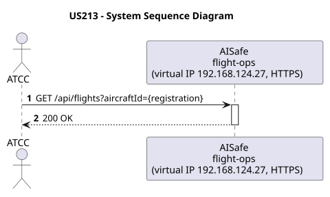
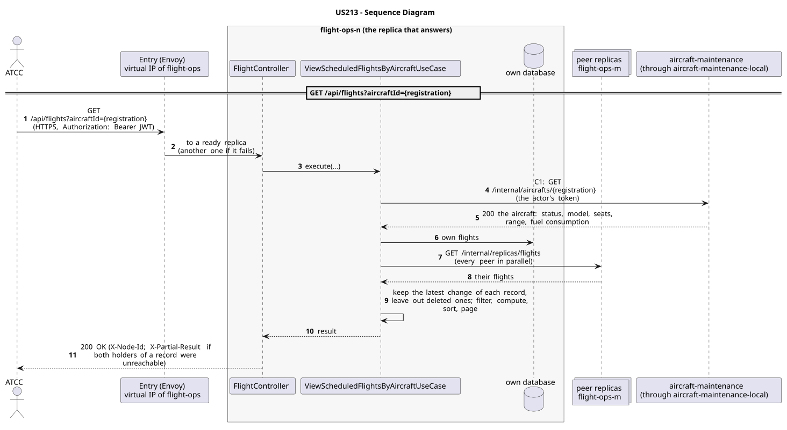

# US213 - View Scheduled Flights by Aircraft

| Service    | Work package (monolith) | Monolith documentation                                                                    |
| ---------- | ----------------------- | ----------------------------------------------------------------------------------------- |
| flight-ops | WP3B                    | [US213](../../../../../docs_monolith/system-documentation/use-cases/WP3B/US213/README.md) |

## User Story

> As an **ATCC**, I want to view all scheduled flights for a specific aircraft.

## Endpoints

| Method | Route                                    | Roles | Use case                                |
| ------ | ---------------------------------------- | ----- | --------------------------------------- |
| GET    | `/api/flights?aircraftId={registration}` | ATCC  | `ViewScheduledFlightsByAircraftUseCase` |

Through the virtual IP of the service, HTTPS only, with a JWT issued by the login.

## Acceptance Criteria

- The system must accept an aircraft identifier.
- The system must return a list of all scheduled flights associated with that aircraft.
- On success, the system returns HTTP 200 with the list.

In the distributed system:

- The answer covers the records of every replica, not only those of the replica that answers.
- Every request and its answer are in the audit trail of the replica that answered.

## Pre-conditions

- The actor is authenticated through the login (JWT) with a role allowed for the route (see Endpoints).
- The aircraft ID provided must be valid.
- At least one replica of the service is ready.
- aircraft-maintenance answers (contracts C1).

## Post-conditions

- None (Read-only operation).

## Main Success Scenario

1. The actor sends `GET /api/flights?aircraftId={registration}` with the JWT to the virtual IP of flight-ops (HTTPS); the entry (Envoy) of the machine that holds that IP passes it to a ready replica of flight-ops, and tries another replica if that one fails.
2. The replica asks aircraft-maintenance for the aircraft: status, model, seats, range, fuel consumption (contract C1: `GET /internal/aircrafts/{registration}`, through the entry of its own machine, `aircraft-maintenance-local`), forwarding the actor's token.
3. `ViewScheduledFlightsByAircraftUseCase` gathers the flights of every replica: its own, plus those of each peer (`GET /internal/replicas/{type}`, all peers in parallel), keeping the latest change of each record and leaving out deleted ones.
4. It filters, computes and sorts over the whole set, then answers 200.

## Alternative / Exception Flows

| Condition                                              | System Response                                                                           |
| ------------------------------------------------------ | ----------------------------------------------------------------------------------------- |
| Missing aircraftId parameter                           | HTTP 400 Bad Request                                                                      |
| No flights found for aircraft                          | HTTP 200 OK (Empty List)                                                                  |
| No valid token                                         | 401                                                                                       |
| The actor's role is not ATCC                           | 403                                                                                       |
| Both replicas that hold some record could not be asked | 200 with `X-Partial-Result: true`                                                         |
| aircraft-maintenance does not answer (contract C1)     | 503 with `Retry-After`                                                                    |
| The replica that got the request stops answering       | the entry repeats a read on another replica; a write only if it never reached the replica |

## Distribution

The answer covers **every replica**: the records are partitioned (each on two replicas), so the replica that answers gathers them from all of them (`FlightsAcrossReplicas`).

## Tests

Distributed end to end, in the [Postman collection](../../../../postman/README.md): folder 6. Flights: the scheduling Saga, folder 7. Access control (roles), folder 8. Failures: with a replica down.

## Sequence Diagrams

### System Sequence Diagram (SSD)

### Sequence Diagram (SD)

Sources: [`puml/ssd_us213.puml`](puml/ssd_us213.puml), [`puml/sd_us213.puml`](puml/sd_us213.puml).
