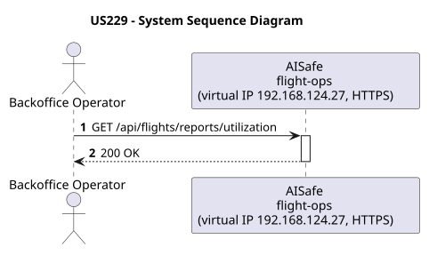
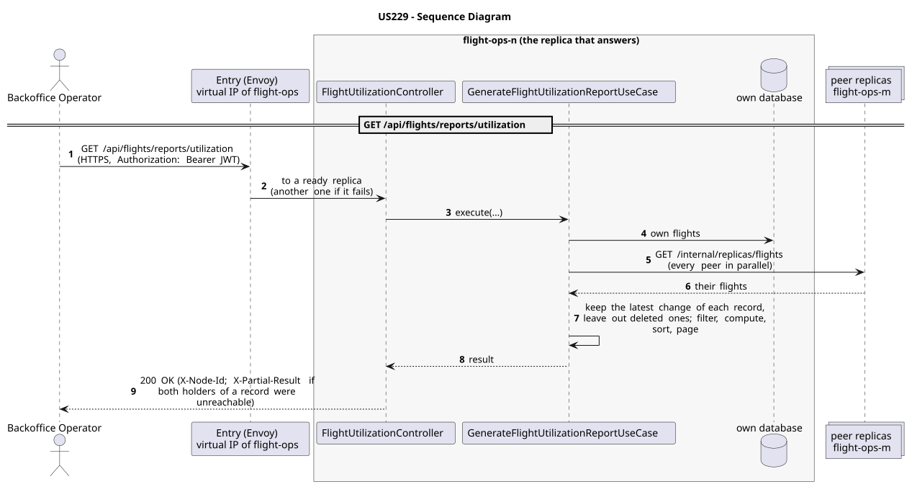

# US229 - Generate flight utilization reports

| Service    | Work package (monolith) | Monolith documentation                                                                     |
| ---------- | ----------------------- | ------------------------------------------------------------------------------------------ |
| flight-ops | BONUS                   | [US229](../../../../../docs_monolith/system-documentation/use-cases/BONUS/US229/README.md) |

## User Story

> As a Backoffice Operator, I want to generate flight utilization reports showing which routes are most frequently flown so that I can optimize the network based on demand.

## Endpoints

| Method | Route                              | Roles               | Use case                                 |
| ------ | ---------------------------------- | ------------------- | ---------------------------------------- |
| GET    | `/api/flights/reports/utilization` | Backoffice Operator | `GenerateFlightUtilizationReportUseCase` |

Through the virtual IP of the service, HTTPS only, with a JWT issued by the login.

## Acceptance Criteria

- GET endpoint `/api/flights/reports/utilization` with optional `startDate` and `endDate`.
- Report includes: `routeId`, `origin`, `destination`, and count of completed flights.
- Results sorted by frequency (descending).
- Return HTTP 200 with JSON payload.
- The flights are counted over those gathered from every replica (in the monolith, by the database with COUNT/GROUP BY: one database no longer has them all).
- Unit/Integration tests covering the aggregation logic and date filtering.

In the distributed system:

- The answer covers the records of every replica, not only those of the replica that answers.
- Every request and its answer are in the audit trail of the replica that answered.

## Pre-conditions

- The actor is authenticated through the login (JWT) with a role allowed for the route (see Endpoints).
- At least one replica of the service is ready.

## Post-conditions

- Nothing is changed (a read).

## Main Success Scenario

1. The actor sends `GET /api/flights/reports/utilization` with the JWT to the virtual IP of flight-ops (HTTPS); the entry (Envoy) of the machine that holds that IP passes it to a ready replica of flight-ops, and tries another replica if that one fails.
2. `GenerateFlightUtilizationReportUseCase` gathers the flights of every replica: its own, plus those of each peer (`GET /internal/replicas/{type}`, all peers in parallel), keeping the latest change of each record and leaving out deleted ones.
3. It filters, computes and sorts over the whole set, then answers 200.

## Alternative / Exception Flows

| Condition                                              | System Response                                                                           |
| ------------------------------------------------------ | ----------------------------------------------------------------------------------------- |
| No valid token                                         | 401                                                                                       |
| The actor's role is not Backoffice Operator            | 403                                                                                       |
| Both replicas that hold some record could not be asked | 200 with `X-Partial-Result: true`                                                         |
| The replica that got the request stops answering       | the entry repeats a read on another replica; a write only if it never reached the replica |

## Distribution

The answer covers **every replica**: the records are partitioned (each on two replicas), so the replica that answers gathers them from all of them (`FlightsAcrossReplicas`).

## Tests

Not in the distributed Postman collection; covered by the unit and integration tests of flight-ops (`./mvnw test`), and served by the same forwarding, gathering and replication as the routes the collection does test.

## Sequence Diagrams

### System Sequence Diagram (SSD)

### Sequence Diagram (SD)

Sources: [`puml/ssd_us229.puml`](puml/ssd_us229.puml), [`puml/sd_us229.puml`](puml/sd_us229.puml).
